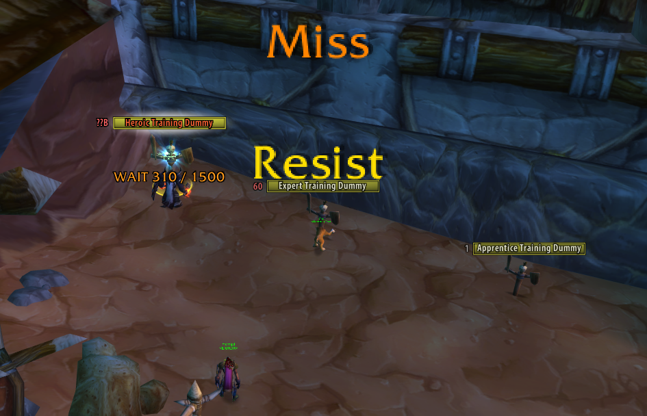
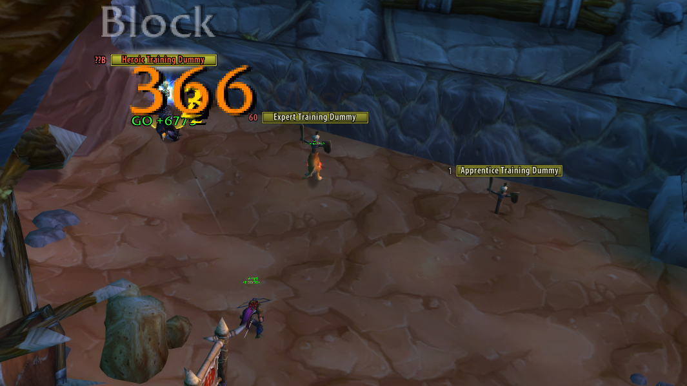
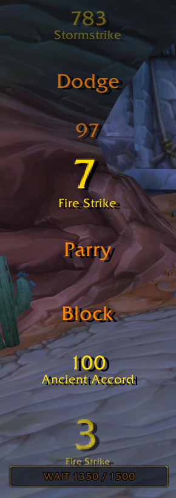
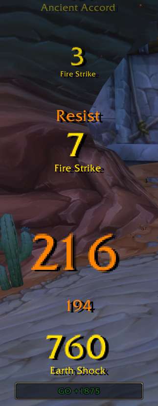
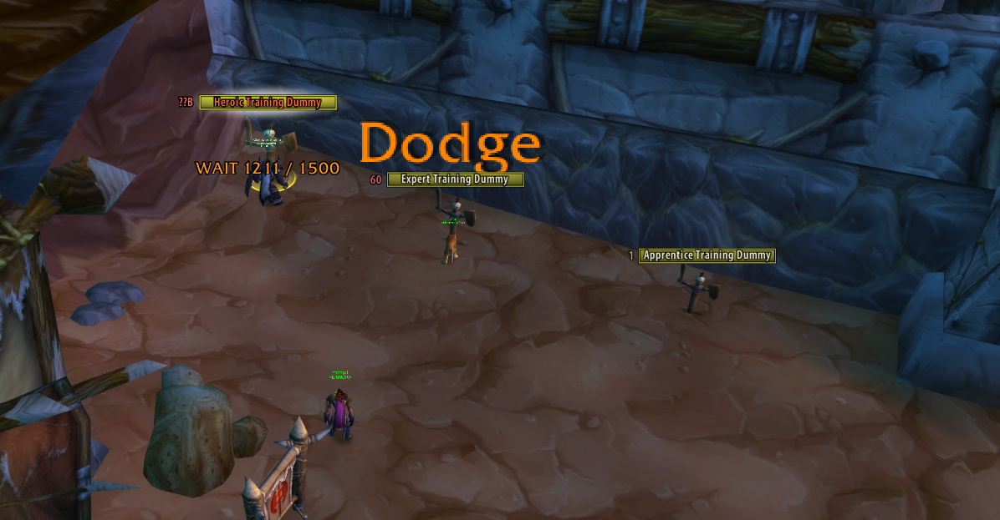
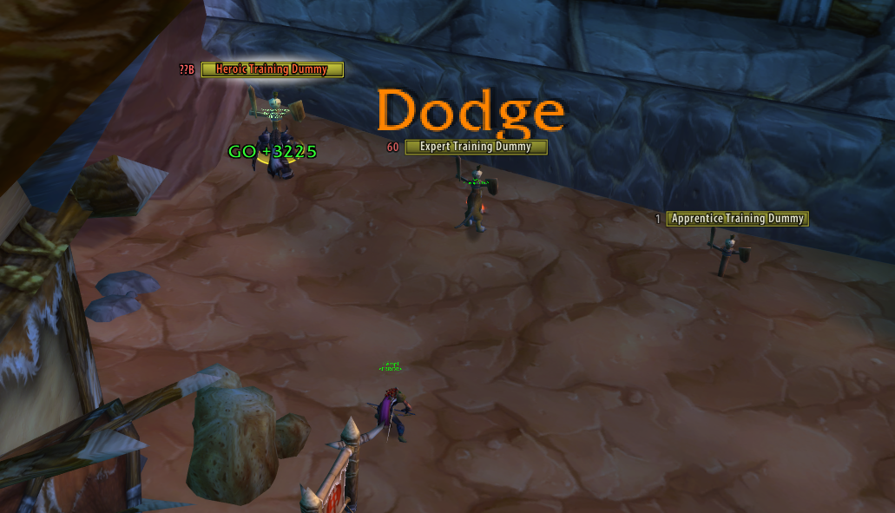
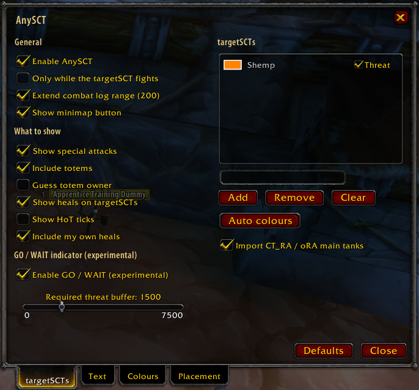
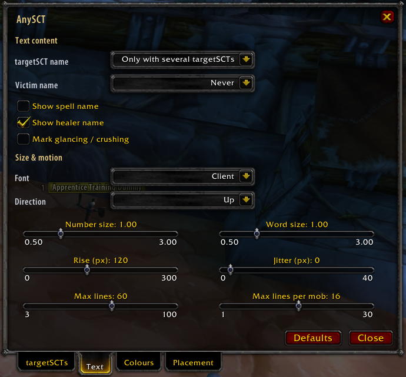
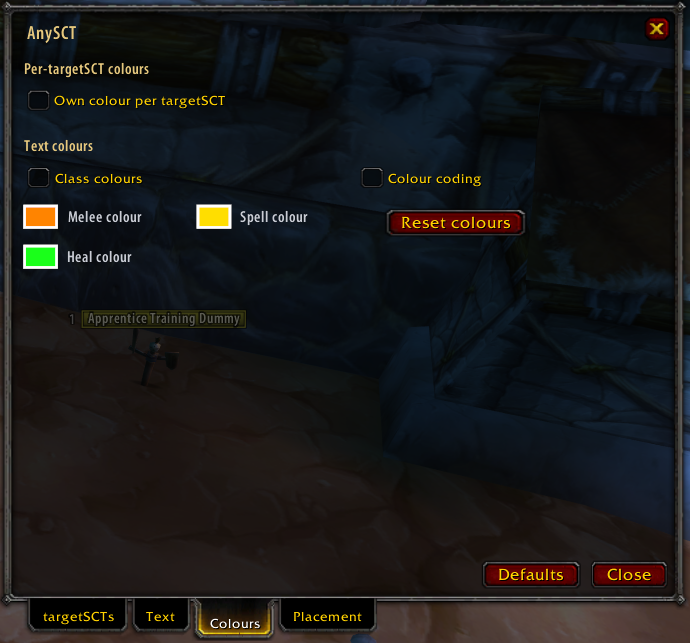
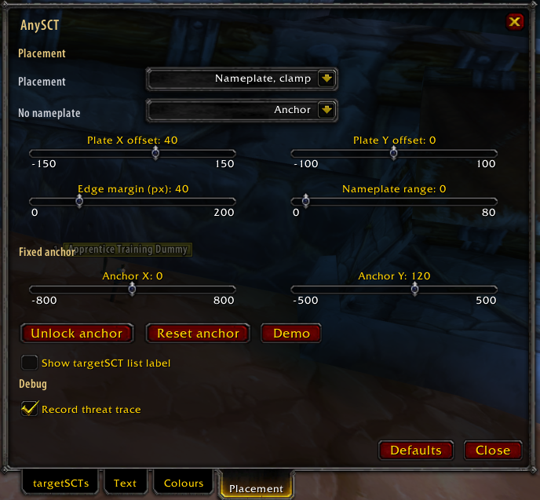

# AnySCT

Blizzard-pet-style floating combat text for **any units you pick**, for TurtleWoW / WoW 1.12.1 (Vanilla).

Put a tank, a pet, a totem, a boss or an enemy player on a short list (a *targetSCT*). Every hit, crit,
miss, dodge, parry and heal of those units then floats over the **victim** in the same style as the
client's own pet damage text. Use it to watch what your tank does before you open up, to follow a boss
or an enemy player, or to see a pet's damage on the mob it hit.

AnySCT shows only the events of the units on its list. It never touches Blizzard's CombatText,
`SHOW_COMBAT_TEXT` or another scrolling-combat-text addon, and it never shows your own events (if you
are on the list, your own SCT addon stays the only one that shows your damage).

*The training dummies in Orgrimmar, seen from another character: a pet's orange melee "Miss" and gold spell
"Resist" over the Expert Training Dummy it attacks, and the experimental WAIT label under the Heroic Training
Dummy the listed tank is hitting.*

## What's new — 0.3.1 · 2026-10-15

- **The line tower no longer overlaps.** Every line reserves its real height, including the crit size pop
  and the spell / name line under it, and crits now rise with the rest of the stack, so newer lines can
  not run into them.
- **Crits of tiny procs pop smaller** (a crit "3" among Fire Strike ticks is half size), measured against
  the source's average hit.

## What's new — 0.3.0 · 2026-10-15

- **Identical hits are merged.** Fire Strike style tick storms become one line with the running sum
  (same source, victim, ability and hit/crit within 0.4 s; the number updates in place, words are not
  summed). Switch off or tune under Text: *Merge identical hits*, *Merge window*, *Show hit count*.
- **Placement "Nameplate + anchor"** shows every line, and the GO / WAIT label, over the plate and at the
  fixed anchor at once, with separate line limits.
- **The Demo previews your own setup**: a 2.5 s burst of your first targetSCT's class skills (Stormstrike,
  Earth Shock and friends for a shaman) with all your display settings, plus the GO / WAIT label inside
  the anchor box, to judge the line tower without a second character.
- **Fixed: the anchor no longer jumps when you drop it.** The dropped position is now exact, and the
  Anchor X / Y sliders cover the whole screen.

## What's new — 0.2.0 · 2026-10-15

- **targetSCT.** What used to be called "tank" is now *targetSCT* everywhere (menu, options, commands
  keep working). Each targetSCT can show its **name** next to its numbers (Never / only with several /
  always) and gets its **own colour**, picked automatically so they are easy to tell apart.
- **Every hit is shown.** The default limits are 16 lines per mob and 60 on screen, so a burst of about
  ten hits per second is no longer recycled.
- **nampower spell events are used on every nampower build**: builds that deliver spell damage and miss
  events without the `NP_Enable...` CVars were treated as "no events" and fell back to chat rows.
- **Regrouped options with tooltips on every label**, four tabs: targetSCTs, Text, Colours, Placement.
  The window now sits above world nameplates.
- **Experimental GO / WAIT label** over your own elite target: how much threat lead the targetSCT has
  over you, from the server's threat data (needs a group; see [GO / WAIT](#go--wait-threat-label-experimental)).

**Version history** — details in [CHANGELOG.md](CHANGELOG.md):

- **0.3.1** (2026-10-15) — fix: the line tower no longer overlaps (real line heights, crits rise with the
  stack), crits of tiny procs pop smaller.
- **0.3.0** (2026-10-15) — merged identical hits, "Nameplate + anchor" placement, a demo that plays your own
  targetSCT's class burst and previews GO / WAIT, anchor drop fix.
- **0.2.0** (2026-10-15) — targetSCT rename, name option, per-targetSCT colours, regrouped options with
  label tooltips, higher line limits, experimental threat-based GO / WAIT.
- **0.1.0** (2026-10-14) — first release: list, victim-routed text in the client's own style, nameplate
  placement, heals, options and minimap button.

## What you see

Everything floats over the **victim** of the event, never over the source:

- **Melee in orange, special attacks in gold, heals in green.** Numbers use the client's own damage font,
  no outline, a black shadow. Ordinary hits rise and fade; **crits pop** at a larger size and rise with the stack.
- **Words for what did not land**: Miss, Dodge, Parry, Block, Resist, Immune, ... in the same style.
- **Every hit is shown**: up to 16 lines per mob and 60 on screen by default, so a fast burst is not
  recycled early (both are sliders on the Text tab).
- **Identical hits are merged**: the same attack from the same source on the same mob within 0.4 s shows
  as one line with the summed value (tiny procs like Fire Strike no longer flood the tower; Text tab).
- Pets and totems of a listed unit are shown under their owner; Fire Nova, traps and other area damage
  land on the mob they hit.

*A crit "366" popping over the Heroic Training Dummy, a "Block" in grey, and a GO label partly covered by
the crit.*

<table>
  <tr>
    <td align="center" width="50%">
       
      <b>WAIT at the anchor</b> — the Demo's shaman burst, no overlaps: a faded 783 Stormstrike on top, Dodge, 97, a merged 7 Fire Strike, Parry, Block, 100 Ancient Accord, a half-size crit 3 Fire Strike, and "WAIT 1350 / 1500" inside the anchor box
    </td>
    <td align="center" width="50%">
       
      <b>GO at the anchor</b> — later in the burst: a fading Ancient Accord, 3 Fire Strike, Resist, 7 Fire Strike, a big crit 216, 194, a crit 760 Earth Shock, and "GO +1875" inside the box
    </td>
  </tr>
</table>

## GO / WAIT threat label (experimental)

Off by default. Shows under the nameplate of **your own target** how much threat lead the targetSCT has
over you, so you can see when you can open without pulling aggro: `GO +4210` (green) or
`WAIT 1250 / 1500` (orange; your buffer / the buffer you asked for).

<table>
  <tr>
    <td align="center" width="50%">
       
      <b>WAIT</b> — "WAIT 1211 / 1500": the buffer is still below the required 1500 (the "Dodge" is a pet's, on the dummy next to it)
    </td>
    <td align="center" width="50%">
       
      <b>GO</b> — "GO +3225": the lead is large enough, opening is safe
    </td>
  </tr>
</table>

- **Data:** the server's threat answers, the same ones TWThreat uses. It works only in a party or raid,
  only on your own target, and only while that target is an elite or boss in combat. AnySCT listens
  passively to answers that are already coming in (for example for TWThreat) and sends its own request at
  most once a second, only when no usable answer arrived in the last moment. Nothing is sent and nothing
  runs otherwise.
- **Rule:** `buffer = threat(targetSCT) * f - threat(you)`, with f = 1.1 if you fight the mob in melee, 1.3
  if you do not (1.1 if you are not in the answer). That is your distance to the server's pull threshold
  (110 % melee, 130 % ranged). GO when the targetSCT holds aggro and the buffer is at least the required
  buffer, otherwise WAIT. With several enabled units the one holding aggro is used; without a fresh answer
  (3 s) the label hides.
- **Options** (targetSCTs tab): *Enable GO / WAIT (experimental)*; *Required threat buffer* (0-7500 in steps
  of 100, default 1500; 0 means GO as soon as the targetSCT holds aggro and you are below the pull
  threshold; a typical raid burst over 3 s is a few thousand threat, Execute crits can exceed 10000, so
  raise it to match your own burst); a *Threat* switch per list row (on for players, off for pets, totems,
  mobs and hostile players).
- **Set the required buffer yourself.** AnySCT does not work it out for you: how much threat you can put out
  in one burst depends on your class, spec, gear and buffs (an enhancement shaman's Windfury triple crit, a
  warrior's Execute crit), and it changes as your gear improves. The default of 1500 suits a fresh level 60
  or a levelling character. Watch how far your own biggest burst moves the number and set the slider at
  least that high; GO only means "the tank's lead is bigger than the buffer you chose".
- **Experimental:** the packet format is taken from the TWThreat addon and has not been confirmed on every
  server build. If it does not work for you, switch on *Record threat trace* (Placement tab, Debug) and
  send `<WoW>\imports\anysct_threat.txt` with your bug report (needs SuperWoW). The trace is off by default
  and nothing is written unless you switch it on.

## Features

- Numbers and words (Miss, Dodge, Parry, Block, Immune, ...) in the client's own world-text style: the
  client damage font, no outline, black shadow, orange for melee, gold for special attacks, crits pop in
  place, other texts rise and fade.
- Text floats over the **victim's nameplate**, clamped to the screen edge when the plate is off screen,
  or at a fixed anchor you can move. Fire Nova, traps, pets and totems land on the mob they hit.
- **Pets and totems** of a listed unit are shown under the owner (see Requirements for how the owner is
  found).
- **Heals** received by a listed unit float over it as green `+amount` (optionally with the healer's name,
  HoT ticks and your own heals).
- **Names**: the targetSCT's name on the line under the number (`Name - Spell - Victim`).
- **Colours**: one colour per targetSCT (automatic palette, or pick your own), class colours, or a colour
  scheme per kind of hit.
- Minimap button, full options window, nothing is polled when idle.

## Requirements

AnySCT runs on a plain 1.12.1 client with the default UI and needs no other addon. Optional helpers make
it more exact:

| optional | what it adds |
|---|---|
| **SuperWoW** | Exact unit GUIDs: nameplates are matched by GUID instead of by name, pets and totems are traced to their owner, units outside your group can be learned by GUID. Also needed for the threat trace file. |
| **nampower** | Melee, spell and heal events with GUIDs instead of chat-log parsing: more reliable, and it works for units whose chat rows are not visible. AnySCT switches the needed CVars on automatically. |
| **CT_RaidAssist / oRA** | Only needed to import their main tank list as targetSCTs (option, on). Without them you add targetSCTs by hand. |
| **TWThreat** | Not needed: the GO / WAIT label asks the server itself. If TWThreat runs, its answers are reused, so fewer requests go out. |
| **pfUI** | Its damage font and nameplates are honoured. |

Without SuperWoW and nampower everything still works from the chat log. **Enemy nameplates must be on
(V key)** for the text to float over the mob; without a plate it falls back to the fixed anchor.

## Install

1. Copy the folder `AnySCT` into `<WoW>\Interface\AddOns\`. The folder name must be exactly `AnySCT`.
2. Start the client (new addon files need a restart, not just `/reload`).

## Usage

Nothing is shown until a unit is listed:

- Right-click a unit (target frame, party or raid frames, NPC targets) and choose **Mark as targetSCT**
  (**Unmark targetSCT** removes it), or
- type `/asct add <name>` (no name: your target), or
- use the list in the options window (`/asct options`, or right-click the minimap button).

Imported CT_RaidAssist / oRA main tanks are added automatically (option). The list is saved per
character.

### Commands (`/anysct`, alias `/asct`)

| command | what |
|---|---|
| `add <name>` | add a unit (no name: your target) |
| `remove <name>` | remove a unit |
| `list` | print the list |
| `clear` | empty the list |
| `colours` | give every listed unit a new automatic colour |
| `place clamp/anchoroff/anchor/both` | where the text appears |
| `unlock` / `lock` | move the fixed anchor (drag the box; a demo stream plays) |
| `demo` | sample text and a 2.5 s damage burst at your target's nameplate, to compare with your own numbers and judge the line tower |
| `threat` | one line with the state of the GO / WAIT label |
| `debug` | toggle the event / drop trace in the chat frame |
| `mem` | memory self-test (idle and a demo burst) |
| `options` | open the options window |
| `reset` | reset all options (the list is kept) |

## Options

`/asct options`, or right-click the minimap button. The window is draggable, closes with ESC and sits above
world nameplates. Every control has a tooltip, and the tooltip also shows when you hover its label. **Defaults**
(bottom row) restores every setting below; the targetSCT list and its colours are kept.

### Tab 1 — targetSCTs

*General, What to show and the GO / WAIT section on the left; the targetSCT list with a colour swatch and a
Threat switch per row, the list buttons and the main-tank import on the right.*

| control | what it does | default |
|---|---|---|
| Enable AnySCT | master switch | on |
| Only while the targetSCT fights | hide text while the listed unit itself is not in combat (shown if its state cannot be read) | off |
| Extend combat log range (200) | sets the combat-log range CVars to 200 on login so raid targetSCTs outside your party are not silent | on |
| Show minimap button | left click unlocks / locks the anchor, right click opens the options | on |
| Show special attacks | also show Heroic Strike, Stormstrike and other ability rows (gold) | on |
| Include totems | show totem damage whose owner is a listed targetSCT | on |
| Guess totem owner | when no owner is known, assume the only listed shaman; can misattribute | off |
| Show heals on targetSCTs | heals received by a listed unit float over it as green `+amount` | on |
| Show HoT ticks | also heal-over-time ticks (chat rows only, can be busy) | off |
| Include my own heals | your own heals on listed units too | on |
| Enable GO / WAIT (experimental) | the threat label described above | off |
| Required threat buffer | slider 0-7500 in steps of 100 | 1500 |
| targetSCT list | one row per unit: colour swatch (click to pick), **Threat** switch (does the unit feed the GO / WAIT label); click a row to select it | empty |
| Add / Remove / Clear | add the typed name (empty box: your target), remove the selected row, empty the list | |
| Auto colours | give every unit a new automatic colour; replaces hand-picked colours | |
| Import CT_RA / oRA main tanks | add the main tanks of those addons that are in your group | on |

### Tab 2 — Text

*Text content (name modes, spell name, healer name, glancing marks) above, Size & motion (font, direction and
six sliders including the line limits) below.*

| control | what it does | default |
|---|---|---|
| targetSCT name | the source's name (the owner's for pets and totems) first on the line under the number: Never / Only with several targetSCTs / Always | Only with several |
| Victim name | the victim's name under the text: Never / Anchor only / Always | Never |
| Show spell name | ability name under the number for special attacks | off |
| Show healer name | healer's name under heal numbers | on |
| Mark glancing / crushing | add the word after the number | off |
| Merge identical hits | identical attacks (same source, victim, ability; normal hit or crit) within the merge window become one line with the running sum, updated in place; words are not summed | on |
| Show hit count | append the number of merged hits, e.g. `12 x5` | off |
| Merge window | seconds a line keeps absorbing identical hits, counted from its first hit (0.1-1.5) | 0.4 |
| Font | Client (the damage font, honours pfUI) / FrizQT / Skurri / Arial Narrow | Client |
| Direction | text rises (Up) or sinks (Down) | Up |
| Number size | factor on the engine size, 0.5-3 | 1.00 |
| Word size | same for Miss / Dodge / Parry ... | 1.00 |
| Rise (px) | how far a normal text rises, 0-300; crits rise with the stack | 120 |
| Jitter (px) | random horizontal offset per line, 0-40 | 0 |
| Max lines | lines on screen over all mobs, 3-100; the oldest is recycled at the limit | 60 |
| Max lines per mob | lines over one mob, 1-30; lines live 1.5 s, so 16 shows every hit of a burst of about 10 per second | 16 |

### Tab 3 — Colours

*Per-targetSCT colours, the text colour switches, and the three colour swatches with Reset colours.*

| control | what it does | default |
|---|---|---|
| Own colour per targetSCT | every listed unit gets its own colour (pets and totems use the owner's) | off |
| Class colours | numbers and words take the source's class colour | off |
| Colour coding | crit yellow, miss / dodge / parry red, block blue, absorb / resist / immune purple; off: everything orange | off |
| Melee colour | colour picker with live preview | orange `FF8400` |
| Spell colour | colour of special attacks | gold `FFDE00` |
| Heal colour | colour of heal numbers | green |
| Reset colours | back to the three defaults | |

Precedence: heal colour, then the unit's own colour, then class colour, colour coding and the melee / spell
colours. The colour picker opens in front of the options window.

### Tab 4 — Placement

*Placement and no-nameplate behaviour, plate offsets and range, the fixed anchor with Unlock / Reset / Demo, the
list label, and the Debug section.*

| control | what it does | default |
|---|---|---|
| Placement | Nameplate, clamp (over the victim's plate, held at the screen edge) / Nameplate, else anchor / Always anchor / Nameplate + anchor (both at once, separate line limits) | Nameplate, clamp |
| No nameplate | when the victim has no visible plate: Anchor / Hide | Anchor |
| Plate X offset | horizontal shift from the plate centre, -150..150 | 40 |
| Plate Y offset | vertical shift from the plate's top edge, -100..100 | 0 |
| Edge margin (px) | distance to the screen edge at which a plate counts as off screen, 0-200 | 40 |
| Nameplate range | sets the nameplate range CVars on login (SuperWoW / nampower), 0-80; 0 leaves them alone | 0 |
| Anchor X / Anchor Y | position of the fixed anchor from the screen centre, -800..800 / -500..500 | 0 / 120 |
| Unlock anchor / Lock anchor | drag the anchor box; a demo stream plays while unlocked | |
| Reset anchor | back to screen centre, 120 px up | |
| Demo | starts at once with a 2.5 s burst of your first targetSCT's class skills (a shaman demo tank without one) on one victim, using all your display settings (Stormstrike, Earth Shock, tiny Fire Strike ticks, melee, crits, extra attacks, and every result type: crit, miss, dodge, parry, block, resist) that fills the per-mob line tower, plus a simulated GO / WAIT threat label (works with Threat GO off); at your target's plate (anchor without a target); click again to restart | |
| Show targetSCT list label | a `targetSCTs: ...` line above the anchor | off |
| Record threat trace | writes the received threat data to `<WoW>\imports\anysct_threat.txt` (needs SuperWoW), for bug reports | off |

Enemy nameplates must be on (V key) for text over the mob.

## Where the text appears

The text always floats over the **victim** of the event, not over the source. Placement modes: over the
nameplate clamped to the screen edge (default), over the nameplate with the fixed anchor as fallback,
always the fixed anchor, or both the plate and the fixed anchor at once (the GO / WAIT label too; with no plate it shows once at the anchor). At the fixed anchor the victim's name is always added because the position no
longer identifies the mob. If no plate addon or plate is found the text simply uses the fixed anchor.

## Colours and names

With **Own colour per targetSCT** (Colours tab) every listed unit gets its own colour, saved with the list.
New units take the palette colour that is farthest from the colours already in use; the first is the
client's pet orange. Click the swatch in the list to change one (kept until you press **Auto colours**).
Precedence: heal colour, then the unit's own colour, then class colour, colour scheme and the melee /
spell colours. The **targetSCT name** option (Never / Only with several targetSCTs / Always) puts the
unit's name first on the line under the number; for pets and totems it is the owner's name.

## Sources of events

- **nampower** (preferred): `AUTO_ATTACK_OTHER` for melee, `SPELL_DAMAGE_EVENT_OTHER` and
  `SPELL_MISS_OTHER` for spells, `SPELL_HEAL_BY_OTHER` for heals; matched by GUID.
- **Chat log** (fallback, and for units without a known GUID): only the channels that are needed are
  registered. Option "Extend combat log range" (default on) sets the combat-log range to 200 on login
  because raid members outside your party are otherwise silent beyond roughly 50 yards; the server still
  caps the real range.

### CVars this addon sets

On login and when the matching option changes. They are **not restored** when you disable the addon.

- `NP_EnableAutoAttackEvents`, `NP_EnableSpellDamageEvents`, `NP_EnableSpellMissEvents`,
  `NP_EnableSpellHealEvents` = 1 (only when nampower exposes them)
- `CombatLogRangeFriendlyPlayers`, `CombatLogRangeParty` = 200 (option "Extend combat log range")
- `NameplateRange`, `NP_NameplateDistance` (only when "Nameplate range" is above 0)

## Cost

Idle cost is zero: the animation frame has an `OnUpdate` only while a line is on screen, the combat tick
runs only in combat, and the threat ticker only while its conditions hold. FontStrings are pooled and
created on first use. `/asct mem` measures it in game.

## Limitations and known unknowns

- If you are the targetSCT yourself you see nothing from AnySCT (by design).
- DoT ticks are not shown.
- Attacks on the player by a listed unit come through the chat channels only; whether nampower reports
  them is not known.
- With the chat path (no GUIDs), several same-named mobs cannot be told apart for victim routing.
- A totem is attributed only to a known owner (SuperWoW owner suffix, pet tokens). The option "Guess
  totem owner" (off) assumes the only listed shaman and can be wrong.
- The text parameters are measured engine values and may differ slightly from the client's own text on
  your setup; sizes, rise and offsets can be tuned in the options.
- The GO / WAIT label is experimental, see [GO / WAIT](#go--wait-threat-label-experimental).
- Localised clients: the client's GlobalStrings are read live.

## License

MIT, see [LICENSE](LICENSE).
