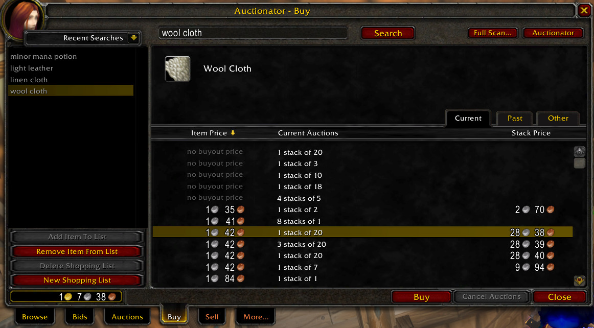
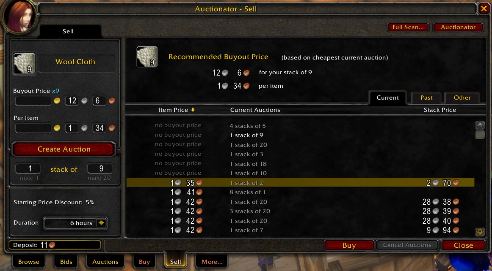

# OctoAuctionator 1.0.0

The classic **Auctionator 2.6.2** auction house (Buy / Sell / More... tabs) ported to **OctoWoW 1.18.1** (1.12.1 client).
A free addon.

**Made by John The Baptist.**

## What it does

- **Buy:** type a name and press Search. Results fill in while the pages are still coming in, so you can already pick
  a row and press Buy (the scan pauses for the purchase and then carries on). Click **Item Price** to flip
  cheapest-first / most-expensive-first. Recent searches and your own shopping lists sit on the left.
- **Sell:** drop an item in the slot and it searches that item, shows the current auctions and recommends a buyout
  just under the cheapest one. Set the stack size and number of stacks, pick 6 / 24 / 72 hours, Create Auction.
- **More...:** your own items: what you have on the AH right now (check for undercuts) and everything you posted before.
- **Full Scan:** optional. Scans the whole auction house and stores the lowest prices for the tooltips.
- **Tooltips:** auction price of an item (and the vendor price if you use SellValue), shown with the game's own coins.

**About speed:** the server sends 50 auctions per page and only while the auction window is open; the 1.12 client has
no "get all". A normal search is a page or a few; a Full Scan of a big auction house takes a while.

## Install

1. Download **OctoAuctionator-1.0.0.zip** from Releases or the forum attachment.
2. Extract it into your WoW `Interface/AddOns` folder.
3. Restart WoW and enable **OctoAuctionator** at character selection.

The folder must contain `Interface/AddOns/OctoAuctionator/OctoAuctionator.toc`.
Turn off other auction house addons (aux, other Auctionator versions) to avoid two UIs fighting over the window.
**SellValue** is optional (vendor prices in tooltips).

## Usage

- Open the auction house: the **Buy**, **Sell** and **More...** tabs are next to Browse / Bids / Auctions.
- The **Auctionator** button (top right) opens the options; **Full Scan...** starts a full scan.
- `/atr clear fullscandb` clears the stored scan prices, `/atr clear posthistory` clears your posting history.

## Screenshots

## Credits

Original addon: **Auctionator 2.6.2 by Zirco** (WoWInterface). This version keeps his interface and code and adapts
them to the 1.12 client and this server.

*It's not much, but it's honest work.*
