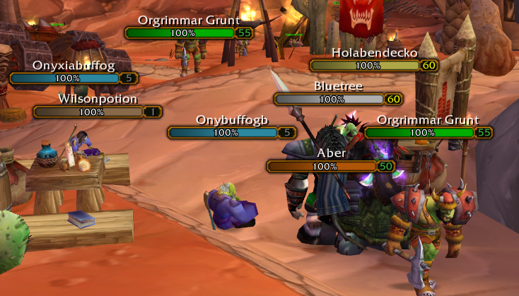
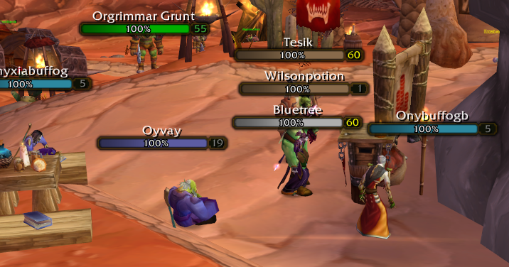
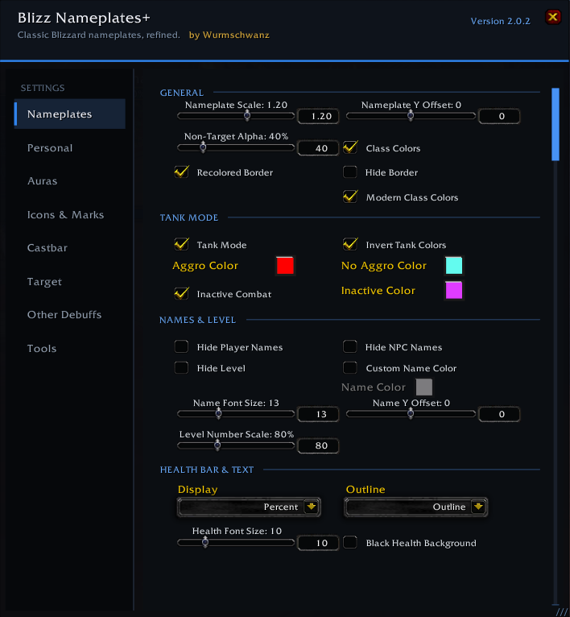

# ⚔️ Blizz Nameplates+

**[Blizz Nameplates+](https://github.com/Wurmschwanz/BlizzNameplatesPlus) Made by Wurmschwanz** enhances the original Blizzard nameplates for **Vanilla WoW / WoW 1.12** while preserving their classic look and feel. All credits to Wurmschwanz, all I've done in this fork is add a couple recoloring and texture options.

It adds reliable multi-target aura tracking, Crowd Control, PvP immunities, castbars, Combo Points, Personal Nameplates, quest indicators, totem icons, Raid Marks and extensive customization — without replacing the original Blizzard nameplate system.

**Required:** `SuperWoW.dll` + `ClassicAPI.dll`

**Current version:** `v2.0.2-oevg.7`

[Changelog](CHANGELOG.md)

## What's different in this fork

This fork adds appearance options to Wurmschwanz's original [Blizz Nameplates+](https://github.com/Wurmschwanz/BlizzNameplatesPlus).

In **Nameplates**, enable **Recolored Border** to follow your ShaguTweaks UI theme.

**Modern Class Colors** independently enables the retail health texture and modern player class palette (off by default).

Keep **Class Colors** enabled for player class tinting. NPCs retain their native red/yellow/green reaction colors. Tank Mode and foreign-tag grey retain priority.

Recolored Border also themes debuff and crowd-control icon rims, preserving the spell artwork and timer text. The level-number background uses a fixed dark olive-black inspired by WoW Forever, independent of health and border colors. Test both normal and bold target borders, changing targets and toggling both new appearance settings in game. Local checks do not validate in-game rendering.

**Names & Level → Level Number Scale:** resize the level number from 50% to 150% (default 100%), independently of the rest of the nameplate. Changes apply immediately.

---

## ✨ Features

### 🎯 Nameplates

- Adjustable **Scale**, **Y Offset** and **Non-Target Alpha**
- Enemy **Class Colors**
- **Tank Mode** with custom Aggro / No Aggro colors
- Optional **Hide Player Names**, **NPC Names**, **Level** and **Border**
- Optional **Recolored Border**: follows ShaguTweaks Darkened UI / Golden UI; dark grey fallback.
- Optional **Modern Class Colors**: retail texture on health bars and castbars, modern player class colors, native NPC reaction colors. Castbars retain their usual cast colors. Toggle independently in BNP Nameplates settings (off by default).
- Adjustable name font size and position
- **Black Health Background**
- Neutral grey healthbar for foreign-tagged mobs
- Improved nameplate detection and recycling

**Golden borders in Orgrimmar**

**Dark borders in Orgrimmar**

**Nameplate settings**

---

### 👤 Personal Nameplate

Customize your own Personal Nameplate independently from enemy nameplates.

- Enable / disable **Personal Nameplate**
- Optional **Combat Only** display
- Optional **Class Color**
- Optional **Hide Level**
- Custom **Health Text**
- Adjustable **Scale**
- Adjustable **Y Offset**
- Optional **Buffs**
- Optional **Debuffs**
- Independent **Buff X / Y Offset**
- Independent **Debuff X / Y Offset**

---

### 🎯 Target

- Customizable **Target Glow**
- Customizable **Target Arrows**
- Shared **Glow / Arrow Color**
- Adjustable Glow scale and opacity
- Multiple Arrow styles and sizes
- Custom **Target Border Color**
- Optional **Bold Target Border**
- Adjustable **Target Scale**
- **Target Plate on Top**

---

### ❤️ Health Text

Display health directly on the nameplate:

**Off • Percent • HP • HP + Percent**

Includes adjustable font size and outline options.

---

### ☠️ Debuffs & DoTs

- GUID-based **multi-target tracking**
- Numeric timers and stack counters
- Optional smooth **Cooldown Spiral**
- Independent Aura font and icon size
- Multiple positioning options
- Independent **X / Y Offset**
- Improved miss, resist and projectile handling
- Reliable cleanup on dispels, deaths and invalid states
- Improved refresh handling for supported abilities and talents

---

### 🌀 Crowd Control

- Dedicated CC tracking
- Optional CCs from other players
- Independent icon size and position
- Adjustable positioning
- Optional separate CC row
- Improved pet-nameplate handling
- Event-driven ClassicAPI tracking
- Improved CC refresh and cleanup behavior

---

### 🛡️ PvP Immunities

Tracks important effects such as:

**Divine Shield, Divine Protection, Blessing of Protection, Ice Block, Berserker Rage, Death Wish, Recklessness, Fear Ward and Will of the Forsaken**

Includes independent size and positioning.

---

### 🗿 Totem Indicators

- Automatic Shaman totem detection
- Ranked totem support
- Displays clean spell icons instead of full nameplates
- Adjustable icon size

---

### 📜 Quest Indicators

**QuestPlatesOcto functionality is integrated directly into BNP.**

- Quest mob and item indicators
- Remaining objective count
- Adjustable **Icon Size**
- Adjustable **X / Y Offset**
- Supports **Questie-Octo** and **pfQuest**

No separate QuestPlatesOcto addon is required.

---

### 🔷 Raid Marks

- Displays Raid Mark icons directly on nameplates
- Multiple positioning options
- Adjustable **X / Y Offset**
- Integrated into the BNP Icons settings

---

### ✨ Combo Points

For **Rogue** and **Druid**:

- Combo Points displayed above the target nameplate
- Adjustable Y Offset
- Optional Dark Combo Point Border
- Previous-target point retention

---

### 🔥 Castbars

- Enemy castbars with spell icons
- Classic / Modern styling
- Adjustable height and spacing
- Adjustable **X / Y Offset**
- Interruptibility support
- ClassicAPI-based enemy cast detection
- Automatic positioning around bottom auras
- Successful-cast completion effect

---

## 🎨 Modern Configuration UI

v2.0.0 introduces a completely redesigned configuration menu.

- Modern dark **Blizzard-inspired design**
- Clean left-side navigation
- Dedicated **Personal** settings page
- Clearly separated option categories
- Improved Aura settings layout
- Consistent dropdown and color-selection styling
- Visible scrollbars for longer pages
- Scrollbars support both mouse wheel and dragging
- Fully **resizable options window**
- Window size stored per character
- Dedicated resize handle
- Layout automatically adapts to different UI scales

The new menu keeps BNP compact while making the growing number of customization options much easier to navigate.

---

## ⚡ Performance & Compatibility

Blizz Nameplates+ is designed to remain lightweight even with many visible nameplates.

- Reliable nameplate-to-unit resolution through **ClassicAPI**
- Event-driven aura updates
- Improved multi-target accuracy
- Efficient cast handling
- Reduced unnecessary scanning
- Improved recycled-nameplate handling
- Mouseover tooltip and macro support
- Improved compatibility with UI addons
- Settings stored **per character**

The goal remains the same:

**Enhance the original Blizzard nameplates without replacing them.**

---

## 🔎 Missing Spell / Aura Recorder

Open:

**BNP Settings → Tools → Missing Spell / Aura**

The recorder can collect:

- Spell IDs
- Aura durations
- Expiration times
- Refresh events
- Target information
- Aura state changes

This makes reporting missing or custom-server effects much easier.

---

## 📦 Requirements

### SuperWoW.dll

Provides GUID, combat, cast and unit information.

[Download SuperWoW](https://github.com/balakethelock/SuperWoW)

### ClassicAPI.dll

Provides reliable nameplate, aura and spell information.

[Download ClassicAPI](https://github.com/brues-code/ClassicAPI)

> **Both DLLs are required and should be kept up to date.**

---

## 📥 Installation

1. Install `SuperWoW.dll` and `ClassicAPI.dll`
2. Delete any older `BlizzNameplatesPlus` folder
3. Extract the addon into:

`Interface\AddOns\`

Final path:

`Interface\AddOns\BlizzNameplatesPlus\BlizzNameplatesPlus.toc`

4. Start the game through your DLL-enabled launcher
5. Enable enemy nameplates

---

## ❤️ Credits

- **Wurmschwanz** created Blizz Nameplates+. [Original project](https://github.com/Wurmschwanz/BlizzNameplatesPlus)
- **Shagu** created the Vanilla addon projects that inspired nameplate discovery and the target glow. **Dusk** maintains ShaguTweaks-ClassicAPI, whose OEVG fork supplies the theme settings, modern class palette, and bundled retail health texture used here. [ShaguTweaks](https://github.com/shagu/ShaguTweaks) · [ShaguTweaks-ClassicAPI](https://github.com/Dusk-92/ShaguTweaks-ClassicAPI)
- **Pap Gergő Rajmund** created QuestPlatesOcto, integrated upstream into BNP. [QuestPlatesOcto](https://github.com/papgergo/QuestPlatesOcto) · [MIT notice](LICENSE-QuestPlatesOcto.txt)
- **Blizzard Entertainment** created the original World of Warcraft interface artwork and retail health-bar artwork. [Artwork and attribution notes](THIRD_PARTY_NOTICES.md)

Thanks to everyone testing **Blizz Nameplates+**, reporting bugs, suggesting features and providing recorder data. ❤️
