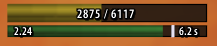
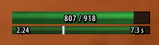
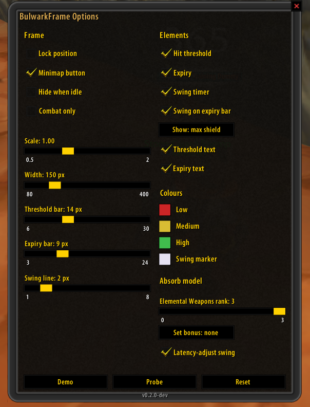

# BulwarkFrame

A compact real-time readout for the shaman **Earthen Bulwark** on **TurtleWoW / WoW 1.12.1
(Vanilla)**.

It answers one question at a glance: *how big would a single incoming hit have to be to use up my
buffer right now?* — alongside how long the buffer still lasts and where the auto-attack swing
stands. Three thin bars, nothing else. No dependencies beyond SuperWoW; adopts the
[pfUI](https://github.com/shagu/pfUI) look automatically when present.



## What's new — v0.3.1 · 2026-08-31

- **Aura-id edit boxes no longer accept 0.** `0` and negative values are now rejected like any
  unparsable entry instead of being written as a spell id.
- **Pool/expiry red and yellow thresholds can no longer cross.** Dragging one past its partner
  now pulls the partner along instead of inverting the colour chain.

**Version history** — details in [CHANGELOG.md](CHANGELOG.md):

- **v0.3.1** (2026-08-31) — aura-id edit boxes reject `0`; pool/expiry threshold sliders can
  no longer cross.
- **v0.3.0** (2026-08-30) — options-panel controls for every setting that had none.
- **v0.2.0** (2026-08-15) — max health stays accurate through stamina buffs and level-ups,
  "Combat only" no longer sticks off after a mid-fight reload, `/bulwark reset` really moves a
  frame stranded off-screen, and the update loop parks itself while idle.

## Screenshots

| The readout | Options panel |
| :---: | :---: |
| <br> |  |

The two readouts show the same buffer answering different questions: **2875 / 6117** is the
largest single hit it would still swallow, **807 / 918** is how much damage it absorbs. On the
lower bar, `2.24` is the current attack speed and the white marker is the swing, riding the expiry
bar the way pfUI's mana tick rides the mana bar.

*(Click any image for full size.)*

## Features

**The readout** — three elements, no portrait, no name, no health or mana, no title:

1. **Hit threshold** — `current / maximum`, e.g. `2875 / 6117`. The bar's fill is the buffer's
   fill. One flat colour by threshold (red / yellow / green), no gradient. Switchable to
   **max shield** (`807 / 918`), which is the same buffer expressed as damage absorbed rather
   than as the hit that would drain it.
2. **Expiry** — remaining seconds as a number *and* as the bar's width, over the buffer's
   8 second lifetime. Re-read five times a second, so it glides rather than steps.
3. **Swing timer** — a marker riding the expiry bar (or its own 1–2 px line, if you prefer),
   with the current attack speed printed on the left. Deliberately subordinate.

**How the buffer works** (from the Elemental Weapons tooltip, verbatim): *"Rockbiter: Physical
damage builds up an earthen bulwark equal to 20% of damage dealt, tripled while wearing a shield.
The bulwark absorbs 15% of incoming damage for 8 sec or until it mitigates enough damage. Its
durability cannot exceed 20% of maximum health."*

Note the asymmetry, because it is easy to get backwards: the pool is built **only** by physical
damage you deal, but it absorbs **incoming damage of any kind** — spell damage included.

**Measured, not guessed.** The numbers the addon computes with were verified in game rather than
taken from a wiki: the fill level is the stack count of aura 58127, a full pool is 20 % of max
health, and the absorb rate at rank 3 is 15 % (median over 477 hits) — matching what the tooltip
claims.

**Honest about what it does not know.** Where a value cannot be established — an unknown talent
rank, a missing aura — the frame shows `--` rather than a number derived from a guess.

**What it deliberately is not:** no statistics, no combat reports, no graphs, no history. It is a
live readout. Recording and analysis belong elsewhere.

## Install

**Option A — download (simplest):**

1. Grab **`BulwarkFrame-vX.Y.Z.zip`** from
   [**Releases**](https://github.com/ShempError/BulwarkFrame/releases).
   *(Use the Release zip, not "Code → Download ZIP" — that names the folder
   `BulwarkFrame-master`, which WoW won't load.)*
2. Extract the **`BulwarkFrame`** folder into `Interface\AddOns\`.
3. Restart the client.

**Option B — git (auto-updatable):**

```
cd Interface/AddOns
git clone https://github.com/ShempError/BulwarkFrame.git BulwarkFrame
```

`master` is the stable channel — git-based managers (GitAddonsManager, OctoWoW) stay current with
a `git pull`.

## Usage

| Command | Does |
|---|---|
| `/bulwark` or `/bulwark options` | opens the options panel (also: left-click the minimap button) |
| `/bulwark demo` | runs the display off a synthetic 12 s cycle — judge colours and sizes without a fight (clears the manual hide, so the frame is actually on screen) |
| `/bulwark probe` | dumps the live aura / weapon / talent data to chat **and**, with SuperWoW, to `imports\bulwark_probe.txt` |
| `/bulwark lock` | locks or unlocks dragging |
| `/bulwark show` | pins the frame visible (clears the manual hide and turns off hide-when-idle and combat-only) |
| `/bulwark reset` | restores every setting to its default |

`/bf` works as a short form of all of them. Right-clicking the minimap button shows or hides the
readout.

## Options

**Frame** — lock, scale, width, per-bar heights, bar spacing, minimap button, hide-when-idle,
combat-only.
**Elements** — each of the three readouts and every text label individually (including the attack
-speed number); swing marker on the expiry bar or on its own line; max hit vs. max shield; expiry
bar opacity.
**Colours** — the three threshold colours, the swing marker, and the background (with its own
opacity slider), via the standard colour picker; the pool and expiry bars' red/yellow/green
threshold sliders.
**Absorb model** — talent rank (5 / 10 / 15 %), the set-bonus reading and its percentage, and
whether the swing marker is latency-adjusted, and by how much.
**Aura IDs** — the pool and time buff spell ids, editable in case TurtleWoW renumbers the custom
spell in a future patch (`/bulwark probe` finds the current one).

Every change applies immediately — an options panel whose effect only shows after `/reload`
teaches you to distrust it.

### A note on units

The threshold is in **post-mitigation** damage — the same numbers your combat log shows. The
buffer sits behind armor, block, resist and Stoneskin, so it never sees a boss's raw swing.
Compare the displayed value against the damage you actually take, not against a tooltip.

### The Tier 2.5 set bonus

The bonus is documented as "+3 % absorption" and it is *not* established whether that means
15 → 18 or 15 × 1.03. Both readings are selectable and neither is assumed; the default is off.

## Requirements

**[SuperWoW](https://github.com/balakethelock/SuperWoW) is required.** The addon stays inactive
without it and says so once on login.

This is not a soft preference. The buffer's fill level is read from a specific aura *by spell id*,
which needs SuperWoW; the fallback would be matching on the icon texture, which several unrelated
auras share. That would produce a number that is confidently wrong rather than absent, and a wrong
number on a defensive readout is worse than no readout.

The swing timer likewise resets on SuperWoW's `UNIT_CASTEVENT`, which is language independent and
fires on misses too — unlike parsing combat-log text.

Nothing else is required. No other addon, no client patch.

## For developers

The calculation core is pure Lua with no WoW API, so it runs offline against a real Lua 5.0.3
interpreter — the same version the 1.12 client uses, which is what catches `#table`, `str:find()`
and `string.match` before they reach the game.

```
lua50 tools/luatests/test_calc.lua
lua50 tools/luatests/test_swing.lua
lua50 tools/luatests/test_env.lua
lua50 tools/luatests/test_config.lua
lua50 tools/luatests/test_slash.lua
lua50 tools/luatests/test_options.lua
```

`test_slash.lua` is the exception to "no WoW API offline": it drives the real slash commands and
the real options panel against a small widget stub. The questions it asks — which of the three
suppressors wins, and whether a command re-syncs an open panel — are pure control flow, and that
is reproducible without a client. Rendering, templates and event ordering are not, and stay
in-game work.

**Looking at the UI without the game:** `node tools/uipreview/render.js` draws the frame as a PNG
across six states (full → empty, including both colour steps) at 3× into `tools/uipreview/out/`.
Same geometry and colour buckets as the addon, so the look can be iterated without a client
restart per change.

**Panel art:** `node tools/gen_panel_textures.js` regenerates the options panel's background and
border textures. Zero dependencies, and it verifies its own TGA headers and tiling seams.

## Licence

MIT.
