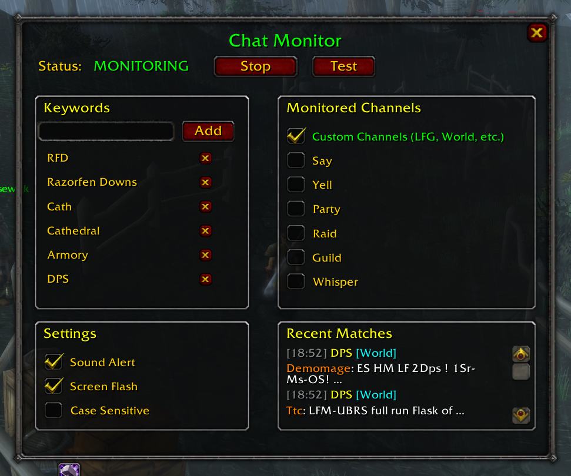

# ChatMonitor
ChatMonitor is an Addon for [Turtle WoW](https://turtlecraft.gg/) that monitors chat channels such as World and LookingForGroup for specific keywords and alerts you when a match has been found.  

  

## How to install:
1. Download and extract [latest version](https://github.com/cryptokn1ght-dev/ChatMonitor/archive/refs/heads/main.zip)
2. Copy the "ChatMonitor-main" folder to <WoW>/Interface/AddOns and rename it to "ChatMonitor"
3. (Re)start WoW

## How to use the addon:
1. Type /cm show (or left click the minimap button) to bring up the GUI
2. Enter in your keywords and press the "Start" button to begin monitoring. You will be alerted when a match is found!
3. You can also start/stop monitoring by right clicking the minimap button.
4. Type /cm help if you'd like to see a full list of chat commands.
5. Enjoy!

## License

This addon is free to use and modify for personal use.

---

*Made with ❤️ for the Turtle WoW community*
