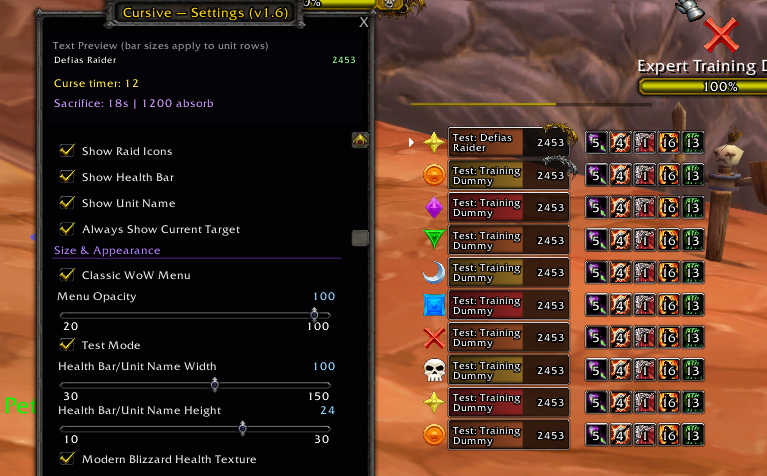

# Cursive — OEVG fork

[](https://github.com/brues-code/nampower)
[](https://github.com/brues-code/ClassicAPI)

Cursive tracks curses, damage-over-time spells and enemies in combat, with commands for choosing and cursing targets. This is OEVG's fork of [Wayoff333/Cursive](https://github.com/Wayoff333/Cursive), building on the work of Pepopo and earlier contributors.

**Version 1.6**, for **OctoWoW / TurtleWoW 1.18.1** (WoW 1.12 API, Interface 11200, Lua 5.0). See the [changelog](CHANGELOG.md) for release details.

## Screenshot



## Requirements

- **Nampower 2.40.0 or newer is required**, as in the upstream addon. It supplies casting events, GUID tracking and improved range checks.
- **ClassicAPI is optional.** Aura features are detected separately and fall back to upstream tracking when unavailable. No separate SuperWoW dependency is introduced by this fork.
- **ShaguTweaks is optional.** OEVG's Darkened UI and Golden UI palettes are used for enabled tooltip borders and Classic menu artwork. Darkened UI takes priority when both modes are enabled.

## What's new in 1.6

- **ClassicAPI aura tracking:** confirm player-owned tracked debuffs from harmful aura slots, correct refresh and expiration times, and remove previously confirmed effects when absent. Target ghost icons and Shadow Vulnerability scans also use ClassicAPI's harmful aura index space.
- **Classic WoW menu:** Blizzard dialog and header artwork, a matching ShaguTweaks tint, and adjustable background opacity. At 100%, the background is opaque; text stays readable when opacity is lowered.
- **Blizzard Modern health texture:** bundled with Cursive; Puppeteer is not required.
- **Independent tooltip borders** for health bars and curse/DoT icons, matching the active ShaguTweaks tooltip palette.
- **Elite dragon:** a trimmed corner decoration above the health/name bar for elites, rare elites and world bosses only. Rare elites use silver artwork; ordinary rares and normal mobs remain unmarked. Aura icons leave room for the decoration.
- **Test Mode:** sample rows, health values, raid markers, curse timers and GCD for adjusting the real layout without a target. Includes elite, rare-elite and normal examples; resets on reload.
- **Quicker appearance updates:** row resizing applies after a short debounce, sliders respect their configured steps, and text previews follow selected font sizes.

ClassicAPI events update tracking as they arrive; rows retain the upstream display refresh cadence. They cannot remove server/network delay or reveal units outside the client's visibility.

## Install and configure

1. Exit WoW completely so it can discover the bundled textures.
2. Back up your existing Cursive folder, then place this repository's addon files in **Interface/AddOns/Cursive**. The manifest must be at **Interface/AddOns/Cursive/Cursive.toc**.
3. Start WoW and open the settings through the minimap icon. Use **Size & Appearance → Test Mode** to adjust the layout, then turn it off for real units.
4. Enable **Classic WoW Menu**, **Modern Blizzard Health Texture**, tooltip borders or **Elite Dragon** as desired. **Menu Opacity** sits directly below Classic WoW Menu.
5. Position the Cursive display using **Show Frame Background**, then turn that off and enable **Allow clickthrough** if desired.

Keep your saved settings when updating. Changing menu opacity affects the settings background, not the unit bars.

ShaguTweaks Debuff Timer, default target aura displays and DoesItDie may display some of the same effects. Choose which displays you want to keep; these addons are not required by Cursive.

## Validation

OEVG tested the appearance changes in game during development. Changed Lua files parse with Lua 5.0, and mocked tests cover aura reconciliation, menu styling/opacity, elite classifications and sample layout isolation.

ClassicAPI tracking still needs broader in-game checks: applications, refreshes, dispels, expiration, other casters, target changes, and operation with ClassicAPI disabled or absent. CPU and memory improvements have not been measured in game.

From the repository root in Linux/WSL, using the workspace Lua 5.0 binary:

    ../tools/lua5.0/lua5.0 tests/classicapi.lua
    ../tools/lua5.0/lua5.0 tests/appearance.lua
    ../tools/lua5.0/lua5.0 tests/testmode.lua

## Credits

- **[Wayoff333](https://github.com/Wayoff333/Cursive)** — the OctoWoW Cursive fork this release builds on, including its settings window and display additions.
- **[Pepopo](https://github.com/pepopo978/Cursive)** and earlier Cursive contributors — upstream curse tracking and targeting functionality.
- **[Shagu / Eric Mauser](https://github.com/shagu)** — ShaguScan foundations, ShaguTweaks artwork, and the copyright attribution retained in the upstream license.
- **[brues-code](https://github.com/brues-code)** — ClassicAPI and Nampower, which supply the client APIs used by this fork.
- **[OldManAlpha/Puppeteer](https://github.com/OldManAlpha/Puppeteer)** and OEVG's Puppeteer fork — the reference for the bundled Blizzard Modern bar texture.
- **OEVG** — this fork's integration, appearance choices and in-game testing.
- **Blizzard Entertainment** — World of Warcraft and the original interface artwork.

## Artwork and license

The bundled Blizzard Modern bar is copied from OEVG's Puppeteer. EliteDragon.tga is an unchanged copy of ShaguTweaks' UI-TargetingFrame-Elite.tga, sourced from the local ShaguTweaks-ClassicAPI fork; the addon uses cropped texture coordinates and desaturation. These are game-derived assets; the repository's code license does not establish separate ownership of Blizzard artwork. See [LICENSE](LICENSE) for the upstream code license.

The command reference below is retained from upstream.

## Commands

`/cursive` for commands, minimap icon to edit options.

### Curse

`/cursive curse <spellName:str>|<guid?:str>|<options?:comma separated str>`: Casts spell if not already on target/guid

EXAMPLE: `/cursive curse Corruption|target` will attempt to cast Corruption on your target if it's not already on them
and they aren't cc'ed.

### Multicurse

`/cursive multicurse <spellName:str>|<priority?:str>|<options?:comma separated str>`: Picks target based on priority and
casts spell if not already on target and they aren't cc'ed.

EXAMPLE: `/cursive multicurse Corruption|HIGHEST_HP` will attempt to cast Corruption picking the target with the highest
HP that doesn't already have it and will warn you if it does nothing.

### Target

`/cursive target <spellName:str>|<priority?:str>|<options?:comma separated str>`: Targets unit based on priority if spell in range and not already on target

EXAMPLE: `/cursive target Icicles|HIGHEST_HP` will target the enemy with the highest HP in range of the spell Icicles.

can also do it only if you don't have a target already:
`/run if not UnitName("target") then SlashCmdList.CURSIVE("target Icicles|HIGHEST_HP") end`

There is also 
`/script targetGuid = Cursive:GetTarget("str", "str", {})`: Returns guid of the unit that would be targeted based on priority and options.

EXAMPLE: `/script targetGuid = Cursive:GetTarget("Corruption", "HIGHEST_HP", {})` will return guid of the enemy with the highest HP in range of the spell Corruption that doesn't already have Corruption.

## Priority Options

- HIGHEST_HP - Target highest HP enemy without a curse first.
- LOWEST_HP - Target lowest HP enemy without a curse first.
- RAID_MARK - Target largest raid mark enemy without a curse first. Priority is as follows:
    - Skull = 8 (1st priority)
    - Cross = 7
    - Square = 6
    - Moon = 5
    - Triangle = 4
    - Diamond = 3
    - Circle = 2
    - Star = 1 (8th priority)
    - No mark = 0
- RAID_MARK_SQUARE - Target largest raid mark but ignore Skull and Cross. Priority is as follows:
    - Square = 6 (1st priority)
    - Moon = 5
    - Triangle = 4
    - Diamond = 3
    - Circle = 2
    - Star = 1
    - No mark = 0
    - Cross = -1
    - Skull = -2 (9th priority)
- INVERSE_RAID_MARK - Target lowest raid mark enemy without a curse first. (reverse of RAID_MARK)

- HIGHEST_HP_RAID_MARK - Target highest HP enemy with a raid (use raid mark priorities for identical hp), then highest
  HP enemy without a mark.
- HIGHEST_HP_RAID_MARK_SQUARE - Same as HIGHEST_HP_RAID_MARK but with RAID_MARK_SQUARE priority for marked enemies.
- HIGHEST_HP_INVERSE_RAID_MARK - Same as HIGHEST_HP_RAID_MARK but with INVERSE_RAID_MARK priority for marked enemies.

## Command Options

All commands can take the following options separated by commas:

- `warnings` : "Display text warnings when a curse fails to cast.",
- `resistsound` : "Play a sound when a curse is resisted.",
- `expiringsound` : "Play a sound when a curse is about to expire.",
- `allowooc` : "Allow out of combat targets to be multicursed. Would only consider using this solo to avoid potentially
  griefing raids/dungeons by pulling unintended mobs.",
- `priotarget` : "Always prioritize current target when choosing target for multicurse. Does not affect 'curse'
  command.",
- `ignoretarget` : "Ignore the current target when choosing target for multicurse. Does not affect 'curse' command.",
- `playeronly` : "Only choose players and ignore npcs when choosing target for multicurse. Does not affect 'curse'
  command.",
- `istapped` : "Only choose mobs tagged by other players when choosing target for multicurse. Does not affect 'curse'
  command.",
- `minhp=<number>` : "Minimum HP for a target to be considered.",
- `refreshtime=<number>` : "Time threshold at which to allow refreshing a curse. Default is 0 seconds.",
- `name=<str>` : "Filter targets by name. Can be a partial match. If no match is found, the command will do nothing.",
- `ignorespellid=<number>` : "Ignore targets with the specified spell id already on them. Useful for ignoring targets
  that already have a shared debuff.",
- `ignorespelltexture=<str>` : "Ignore targets with the specified spell texture already on them. Useful for ignoring
  targets that already have a shared debuff.",
- `malediction=<0|1>` : "For Warlocks with the Malediction talent: when checking if Curse of Recklessness, Curse of
  the Elements, or Curse of Shadow is already on a target, check for Curse of Agony instead. Default is 1 (enabled).
  Set `malediction=0` to disable and check for the original curse.",

EXAMPLE: `/cursive multicurse Corruption|HIGHEST_HP|warnings,resistsound,expiringsound,minhp=10000,refreshtime=2`

EXAMPLE:
`/cursive multicurse Curse of Recklessness|RAID_MARK|name=Touched Warrior,ignorespelltexture=Spell_Shadow_UnholyStrength,resistsound,expiringsound`

## Macro examples

You can just put multiple commands in a macro like this
```
/cursive curse Curse of Recklessness|target|refreshtime=1
/cursive curse Corruption|target|refreshtime=3
/cursive curse Siphon Life|target|refreshtime=1
```
but the game won't always execute them in the order you want

if you want more control of the order you can do something like
```
/script if not Cursive:Curse("Curse of Recklessness", "target", {refreshtime=1}) then if not Cursive:Curse("Corruption", "target", {refreshtime=3}) then Cursive:Curse("Siphon Life", "target", {refreshtime=1}) end end
```
This also works for Multicurse:
```
/script if not Cursive:Multicurse("Curse of Recklessness", "HIGHEST_HP", {refreshtime=1}) then if not Cursive:Multicurse("Corruption", "HIGHEST_HP", {refreshtime=3}) then Cursive:Multicurse("Siphon Life", "HIGHEST_HP", {refreshtime=1}) end end
```

Example with more options
`/script Cursive:Multicurse("Curse of Recklessness", "HIGHEST_HP", {warnings=1,resistsound=1,expiringsound=1,refreshtime=2})`

All cursive commands will return true only if it attempted to cast or it found a target.

## Shared Debuffs

Shared debuffs applied by other players will appear greyed out on targets.

Currently only Faerie Fire is supported as I felt it warranted special handling.  It works by looking for other players casting faerie fire and then checking if the mob has the debuff, so if someone refreshes faerie fire and gets resisted it will incorrectly restart the timer.  However, it should still correctly remove faerie fire if it falls off that target.  I didn't want to impact performance to handle this edge case.

## Accessing curse data in other addons

Cursive data can be accessed in other addons 

You can check if curse is active with
`Cursive.curses:HasCurse(lowercaseSpellNameNoRank, targetGuid, minRemaining, malediction)`

For example `Cursive.curses:HasCurse("corruption", GetUnitGUID("target"), 3, false)` or `Cursive.curses:HasCurse(Cursive.utils.GetLowercaseSpellNameNoRank("Corruption (Rank 2)"), GetUnitGUID("target"), 3, false)` will check if Corruption is on the current target with at least 3 seconds remaining.  It won't specifically check for rank 2 just wanted to show that HasCurse only works with the lowercase spell name without rank.

You can get raw curse data using 
`Cursive.curses:GetCurseData(spellName, guid)`

GetCurseData does not require the spellName to already be lowercase / no rank.

Curse data is a table with the following structure:
```
{
		rank = int,
		duration = float,
		start = float,
		spellID = int,
		targetGuid = string,
		currentPlayer = bool,
}
```

Here's an example that gets the time left on Corruption on the current target:
```
/run _, guid = UnitExists("target"); local data = Cursive.curses:GetCurseData("Corruption", guid); print(Cursive.curses:TimeRemaining(data))
```

## Important info

If you have my latest nampower, it will use the SpellInRange function from that to provide improved range checking.

Otherwise, all commands will prioritize targets within 28 yards of you first to have a better chance of being in range.

All commands will ignore targets with the following CCs on them:

- Sleep
- Entangling Roots
- Shackle Undead
- Polymorph
- Turn Undead
- Blind
- Sap
- Gouge
- Freezing Trap
- Banish

All commands will also ignore spell-immune mobs the same way they ignore crowd controlled mobs. Currently this is only used for `Blackwing Spellbinder` in BWL.

Multicurse will only ever target enemies that are already in combat (except if you target a mob directly first) to
prevent pulling things you didn't intend like marked patrols.

For Warlocks with the Malediction talent, when checking if Curse of Recklessness, Curse of the Elements, or Curse of Shadow is already on a target, the addon will instead check for Curse of Agony to allow you to refresh agony using them. This is enabled by default and can be disabled per-command with `malediction=0`. Don't use the `refreshtime` option with this as the server won't refresh Curse of Agony if it is still on the mob.

Special spells such as `Rake` that deal direct damage but also apply a bleed DoT are handled differently from normal debuffs. When one lands, Cursive starts a 1 second timer then checks that the bleed aura actually appeared on the target. If it did not, Cursive removes the curse.

If that verification failure happened while the target was not at the client buff/debuff cap, the addon assumes that mob name is bleed-immune and caches it in memory. Future casts against mobs with that same name will skip bleed tracking so you do not keep getting `Rake` timers for 1 second on bleed-immune targets.

Mobs with raid marks will be displayed first.

Mobs will the top 3 max hps will always display next. I may make this configurable in the future.

There is an option "always show current target" that will display your current target in the last slot if they aren't already being displayed.

You can ignore mobs based on their unit name using the ignored mob list filter.  It is comma separated and you need to press enter to get it to save.  For example can do:
`whelp,scarab` to ignore all mobs with those strings in their name.
