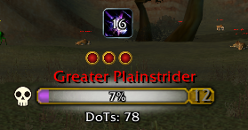
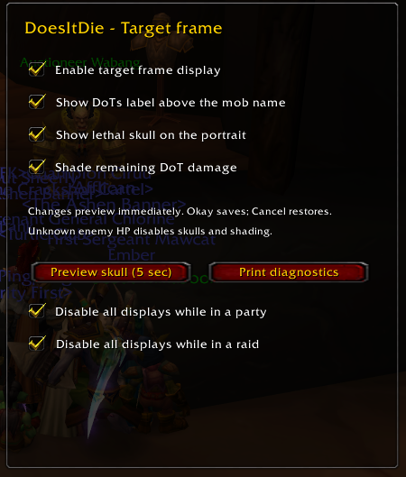
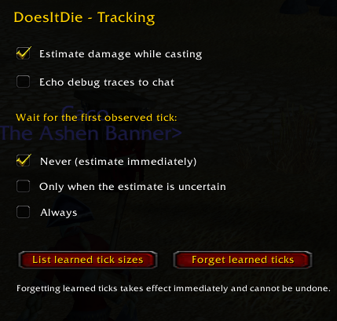
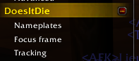

# DoesItDie — 1.12 / 1.18.1

[](https://github.com/brues-code/ClassicAPI)
[](https://github.com/brues-code/nampower)

DoesItDie estimates the damage your active damage-over-time spells have left to deal, shades that damage on enemy health bars, and shows a skull when your DoTs are estimated to finish the enemy.

Made for **1.12 / 1.18.1 clients** with ClassicAPI. **Tested only on 1.18.1** (build 7272). Current release: **v0.2.6-alpha**.

## Screenshots




| Options: target frame | Options: tracking | Options categories |
| :---: | :---: | :---: |
|  |  |  |

## Features

- Target-frame and nameplate damage shading and remaining-damage labels.
- A lethal skull over the target portrait and beside nameplates.
- Target labels above the mob name; nameplate labels below the health bar.
- Learned tick damage, combo-point handling, and Curse of Agony's increasing ticks.
- Siphon Life health-transfer descriptions, including decimal durations.
- Independent display, label, skull, and shading controls for target, nameplates, and focus. Focus requires a focus health bar provided by your UI.
- ClassicAPI options pages with immediate preview, Okay, Cancel, and Defaults.
- Settings and learned ticks saved between sessions.

## Requirements

- **[ClassicAPI](https://github.com/brues-code/ClassicAPI)** is required. The tested version is **1.17.6**. The port uses its Lua compatibility, spell descriptions, cast events, combat log, GUID nameplate APIs, and addon options window.
- **[Nampower](https://github.com/brues-code/nampower)** is recommended for actual enemy health through `GetUnitField` or `GetUnitData`. Without actual HP, enabled labels show `HP unknown`; skulls and shading stay hidden.

ClassicAPI must load with modern script arguments enabled. Earlier API versions and the 1.12 client have not yet been tested with this port. SuperWoW and UnitXP SP3 are not direct requirements. Third-party DLLs are not bundled.

## Installation

1. Extract the release ZIP into `Interface/AddOns`.
2. Confirm the path is `Interface/AddOns/DoesItDie/DoesItDie.toc`.
3. Enable DoesItDie in the addon list; enable “Load out of date AddOns” if needed.
4. Start with ClassicAPI loaded. Target an enemy and run `/did status` to check API and actual-health detection.

For a source checkout, copy only the repository's `DoesItDie` directory into `Interface/AddOns`. The release ZIP contains a single `DoesItDie` folder. Fully restart the client after adding or replacing textures.

## Options

Open **Game Menu > AddOn Options > DoesItDie**, or type `/did`.

- **Target frame:** enable the display, label, portrait skull, and shading.
- **Nameplates:** independently enable the display, label, skull, and shading.
- **Focus frame:** the same controls for a supported focus health bar.
- **Tracking:** cast-time estimates, debug output, and when to wait for the first observed tick: never, only when uncertain, or always.

The target options page also offers separate **Disable in party** and **Disable in raid** switches. These hide all target, focus, and nameplate displays while grouped; tracking continues and displays resume automatically after leaving. Raid membership takes priority over party membership. Both switches default to off.

Changes preview immediately. Okay keeps them; Cancel or Escape restores the page's previous settings. Defaults resets the current page and can be cancelled. Forgetting learned ticks is immediate and cannot be undone.

Settings use `DoesItDieVanillaDB`. Settings persistence has been confirmed in-game on the tested 1.18.1 client.

## Commands

| Command | Action |
| --- | --- |
| `/did` | Open addon options. |
| `/did status` | Print client, API, health, and skull diagnostics. |
| `/did line` | Toggle target damage shading. |
| `/did skull` | Preview the portrait skull for five seconds. |
| `/did ticks` | List learned tick damage. |
| `/did reset` | Forget learned tick damage. |
| `/did debug` | Toggle debug traces in chat. |
| `/did plates` | Print the visible nameplate count. |
| `/did siphon` | Print Siphon Life descriptions and parser results. |
| `/did bar MyAddon.Target.Health` | Use a custom left-to-right target health bar. |
| `/did bar` | Restore the default target health bar. |
| `/did wait off` | Estimate immediately. Also accepts `unsure` or `always`. |

## Compatibility and limitations

The display has been exercised with Blizzard-style frames, ShaguTweaks, and BlizzNameplatesPlus on 1.18.1. Other layouts may need a custom bar path or further support. Nameplates are associated by GUID rather than enemy name.

### pfUI

Automatically recognizes target/focus bars in [brues-code/pfUI](https://github.com/brues-code/pfUI), including its replacement nameplate health bars. No manual frame path is needed. The skull uses a visible target portrait when available, otherwise it appears beside the health bar. Labels sit above the target bar and below nameplate bars or a visible nameplate cast bar. Vertical bars and inverted unit health bars are supported.

Custom bar paths take priority. Anchors are rechecked after pfUI creates or replaces frames. Hiding a pfUI frame hides its display; the addon does not force hidden Blizzard frames to appear. Regression tests cover the installed pfUI layouts; this new integration still needs in-game confirmation.

Damage is an estimate. Initial descriptions can omit stat scaling. Shields, resists, heals, dispels, gear changes, and modified spells can change the outcome. The “Always” first-tick policy waits for observed damage before showing estimates.

Channels, general area effects, and weapon poisons are excluded by the inherited tracker. Not every stacking effect or duration modifier is modeled. Siphon Life's total-transfer description uses ten ticks, with the interval derived from its duration. This version includes English UI text and English spell-description parsing only.

The original addon's full visual presets, animations, frame picker, and experimental execute probe are not included in this port.

## Reporting issues

Include the addon version, `/did status` output, spell and rank, exact tooltip, and relevant UI addons. For tracking issues, `/did debug` records a bounded trace in `DoesItDieVanillaDB.log`, saved in the addon's SavedVariables file after logout or reload. Share relevant lines only, not account folders or client files.

## Development

Run from the repository root:

```sh
python -m pip install -r requirements-dev.txt
python tests/test_vanilla.py
python tests/test_tracking.py
python tests/test_parse.py
python tools/build_release.py
```

`test_vanilla.py` loads the shipped TOC under Lua 5.1 with mocked widgets and tests the port's event handlers and options callbacks. `test_tracking.py` runs inherited tracking assertions. `test_parse.py` prints example parser results as a diagnostic; it is not an assertion suite. These checks do not emulate DLLs or game rendering.

The release builder verifies TOC references, the bundled texture, license, and single-folder installation layout. It writes `dist/DoesItDie-v0.2.6-alpha.zip`. Rebuild the skull with `python tests/make_skull.py` if needed.

## Credits and license

- **Joe Greive / [swirllyman](https://github.com/swirllyman)** — the original [DoesItDie addon](https://github.com/swirllyman/DoesItDie), tracking logic, English spell-description parsers and original regression tests.
- **Upstream contributors** — tracking and parser fixes retained in the port.
- **[brues-code](https://github.com/brues-code)** and ClassicAPI/Nampower contributors — API compatibility and health-reading tools used by this port.
- **ShaguTweaks, BlizzNameplatesPlus, and Cursive contributors** — compatibility references; Cursive's spell definitions informed Siphon Life's ten-tick handling.
- **Shagu, brues-code, and pfUI contributors** — the unit-frame and nameplate implementation used as the reference for pfUI support.
- **The port's tester and collaborators** — in-game testing, bug reports, and iterative display improvements for 1.18.1.

Based on upstream commit `8868b3134d67b3700203b10a2ceb50782c9527c0`. The original copyright notice is preserved in the [MIT license](LICENSE). No third-party DLL implementation code is bundled.


