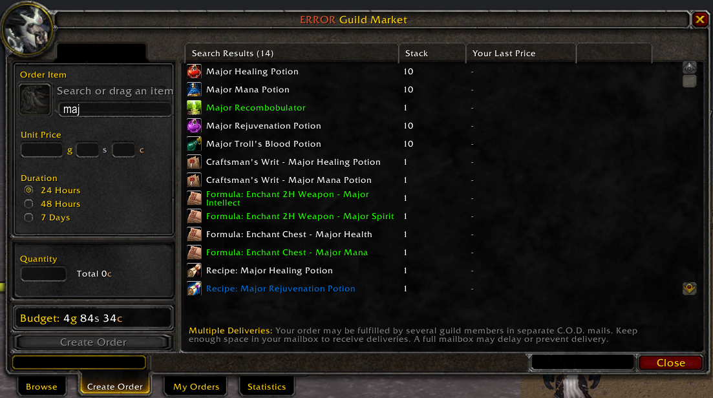
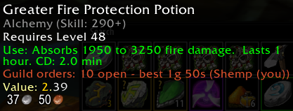
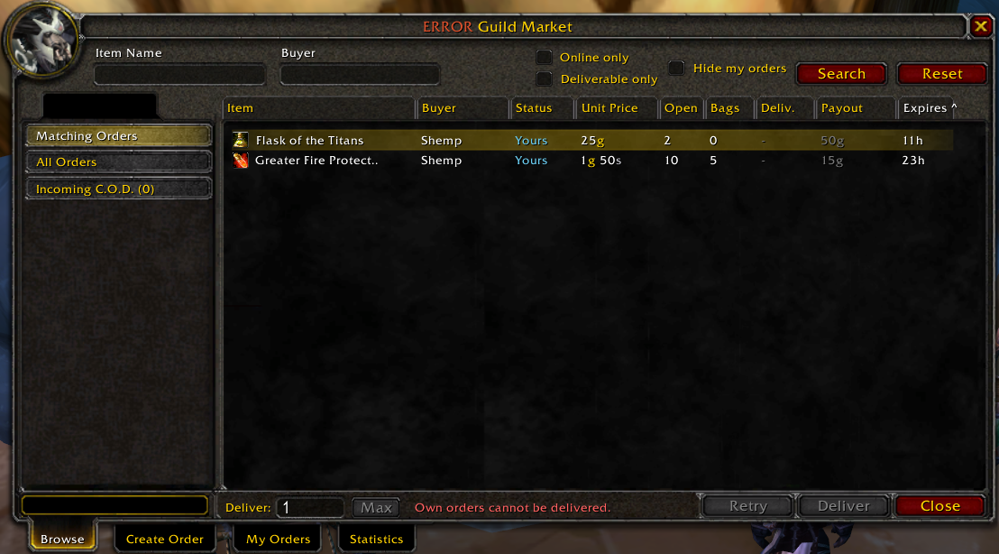
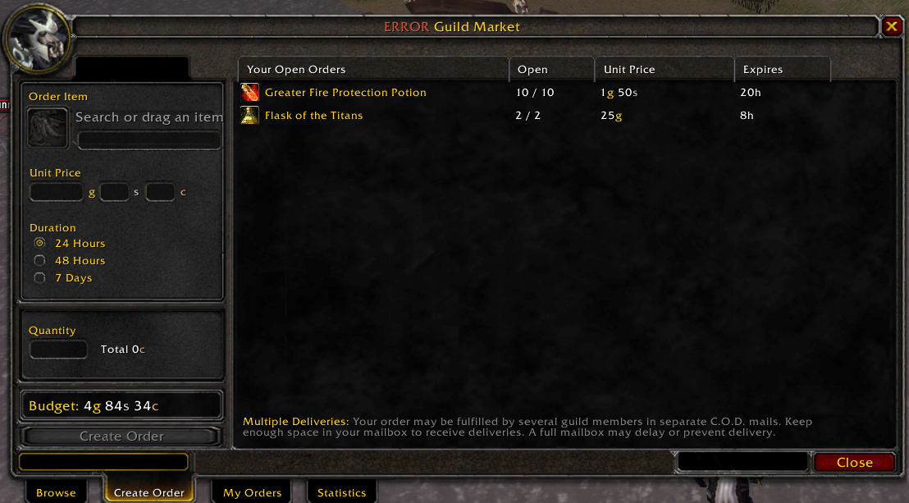
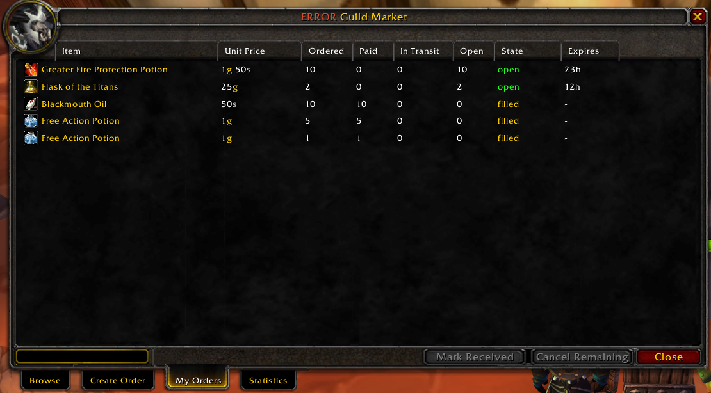
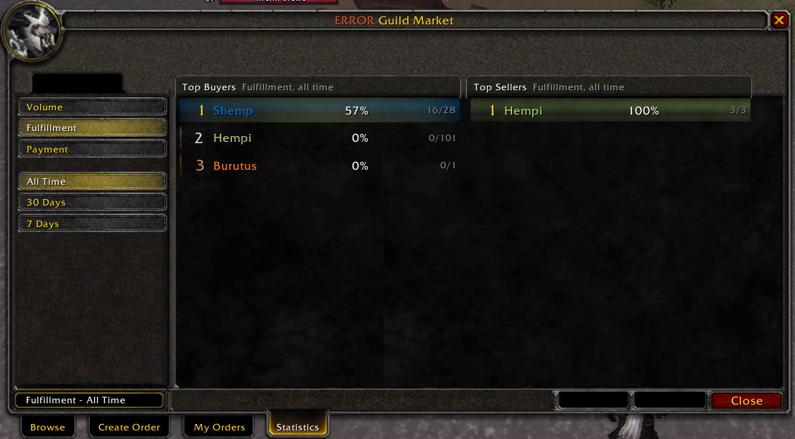
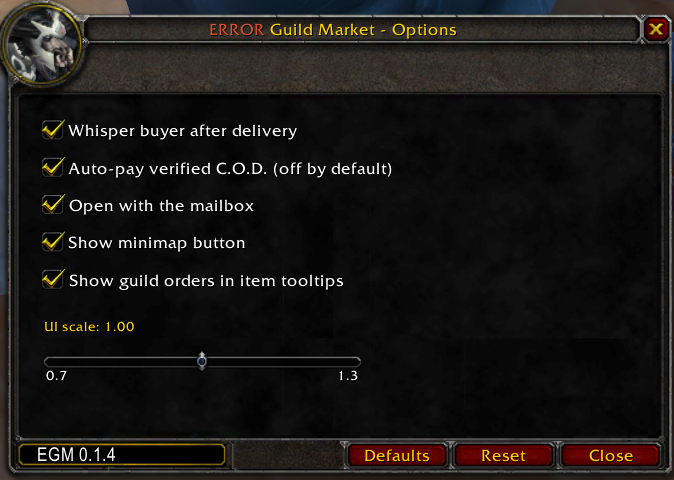

# EGM - ERROR Guild Market

Guild buy orders with C.O.D. delivery for **TurtleWoW / OctoWoW (WoW 1.12.1, Vanilla)**.

A guild member posts what he wants to buy and at which price; other members deliver it by mail as a
C.O.D. and get paid on pickup. EGM keeps the orders in sync between guildmates, sends the mails for
you, and checks every incoming C.O.D. against the order before you pay. Standalone, no dependencies.

> **Early test version.** EGM is new, so use it at your own risk. It only works between members of the same
> guild, and every trade is a normal C.O.D. mail that you can see in your mailbox. If something does not work as
> intended, your guild mates can send the gold or items back - that is what the guild is for. Feedback is welcome.

## What's new - 0.1.5 · 2026-11-06

- **7-day orders.** Create Order offers 24 hours, 48 hours and 7 days; time left of two days and more reads in days.
- **Statistics with a filter list** like Browse: pick Volume, Fulfillment or Payment and All Time, 30 Days or 7 Days on the left.
- **Deliver asks first** and says exactly what is sent and charged; can be switched off in the options.

Earlier in 0.1.4:

- **Guild orders in item tooltips.** Hover any item (bags, bank, vendor, mail, auction, trade, chat links) to see its open guild orders: total open, best price and buyer, the top three orders. Can be switched off in the options.

  

**Version history** - details in [CHANGELOG.md](CHANGELOG.md).

## Screenshots

<table>
  <tr>
    <td align="center" width="50%">
       
      <b>Browse</b> - orders you can deliver from your bags
    </td>
    <td align="center" width="50%">
       
      <b>Create Order</b> - search any item, set price, quantity and duration
    </td>
  </tr>
  <tr>
    <td align="center" width="50%">
       
      <b>My Orders</b> - state, deliveries and payments of your orders
    </td>
    <td align="center" width="50%">
       
      <b>Statistics</b> - who delivers and who pays, by period
    </td>
  </tr>
</table>

## Features

- **Browse** - open guild orders, filtered by item and buyer, with how much of each you can deliver from your bags. Deliver sends the mails as C.O.D. for you, one stack per mail.
- **Create Order** - search every tradeable item by name, set unit price, quantity and 24h/48h duration. A budget line shows what your open orders may still cost.
- **My Orders** - state of your own orders (open, in transit, filled, cancelled, expired), every delivery with its payment status, cancel and "Mark Received".
- **Statistics** - class-colored meters for buyers and sellers: fulfillment, payment, volume, by period.
- **C.O.D. validation** - an incoming C.O.D. is marked *Verified* only if the sender is a guild member, he announced exactly this delivery, the item, quantity and price match the order, and nothing is overdelivered. Everything else shows *Mismatch* or *Unknown*, with the reason. "Pay Verified" pays only verified mails; optional auto-pay is off by default.
- **Penalty rule** - new orders are blocked only while you owe an unpaid C.O.D., or after you actively returned a *verified* delivery. Letting a mail expire or returning a mismatching one never counts against you.
- **Guild-scoped data** - events are stored per realm and guild and synced over the guild addon channel. Only guild members take part; a character without a guild sees "Join a guild to use EGM".
- **Options** - whisper the buyer after a delivery, auto-pay verified C.O.D., open with the mailbox, minimap button, UI scale.

## Options

`/egm options` or the minimap button opens the options: whisper the buyer after a delivery, auto-pay verified C.O.D., open with the mailbox, minimap button and the UI scale slider.

## How it works

**Buyer**
1. Open `/egm`, go to *Create Order*, pick the item, set price per unit and quantity, confirm.
2. The order appears for all guildmates who run EGM.
3. When a C.O.D. mail arrives, EGM shows it under *Incoming C.O.D.* in Browse as Verified, Mismatch or Unknown. Pay it at the mailbox (or with *Pay Verified*).

**Seller**
1. Open the mailbox or `/egm`, *Browse* lists the orders you can fill from your bags.
2. Select an order, choose the amount, press *Deliver*. EGM sends the C.O.D. mails and announces them to the guild.
3. The buyer pays on pickup; the order updates for everyone.

## Slash commands

| Command | Effect |
|---|---|
| `/egm` | Toggle the window |
| `/egm options` | Open the options window |
| `/egm debug` | Toggle debug output and the inbox trace export |

## Install

1. Download the repository and put the folder into `Interface\AddOns\`. The folder must be named **EGM** (so that `EGM\EGM.toc` exists).
2. Restart the client. Every guildmate who should take part needs EGM too.

## Known limits

- Orders are only visible to guildmates who run EGM; history syncs when they are online.
- EGM does not move gold itself: payment is the normal C.O.D. pickup.
- A character in a guild whose name is not yet loaded (right after login) cannot create orders for a few seconds.
- Vanilla 1.12 only (Lua 5.0).

## License

MIT, see [LICENSE](LICENSE).
