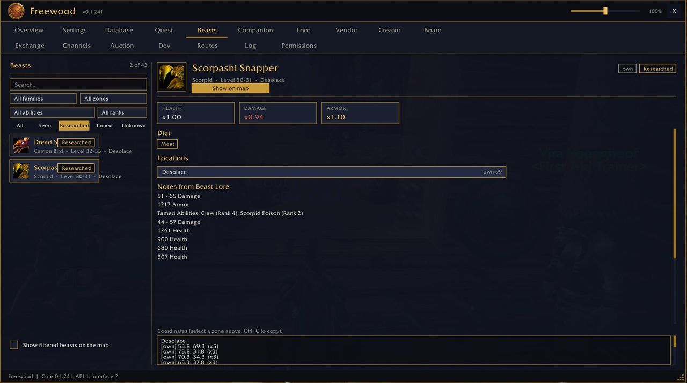

# Freewood-OctoWoW-Beasts

> Tierarchiv · Beast archive

Teil von **Freewood für OctoWoW** (WoW-Client 1.12.1 + ClassicAPI), Version 0.1.241. · Part of **Freewood for OctoWoW** (WoW client 1.12.1 + ClassicAPI), version 0.1.241.

[Deutsch](#deutsch) · [English](#english)

## Screenshots

*Tierarchiv · Beast archive*

## Deutsch

Archiv wilder Tiere, gefüllt durch das, was du siehst, erforschst und zähmst: Lebensraum (Kartenüberlagerung), Nahrung, was Zähmen lehrt. Export/Import und Teilen mit Gruppe/Schlachtzug. Braucht Pet.

### Kurzanleitung

1. Reiter **Beasts**: ein Tier aus der Liste wählen; Fundorte erscheinen auf der Karte.
2. Das Archiv füllt sich beim Spielen (Tiere ansehen, zähmen). Beim Zähmen werden die Fähigkeiten des Begleiters erfasst.
3. Teilen: „Mit meinem Schlachtzug teilen“; Export/Import als Text. Battle.net und globaler Kanal sind auf diesem Client nicht verfügbar.
4. `/fwbeasts mapsize <Pixel>` stellt die kleinste Gebietsgröße auf der Karte ein (Standard 32).

## English

Archive of wild beasts, filled by what you see, explore and tame: habitat (map overlay), diet, what taming teaches. Export/import and sharing with group/raid. Requires Pet.

### Short guide

1. **Beasts** tab: pick a beast from the list; locations show on the map.
2. The archive fills while you play (looking at beasts, taming). Taming records the companion's abilities.
3. Sharing: "share with my raid"; export/import as text. Battle.net and the global channel are not available on this client.
4. `/fwbeasts mapsize <pixels>` sets the smallest area size on the map (default 32).

## Installation · Abhängigkeiten · Dependencies

Ordner `Freewood-OctoWoW-Beasts` nach `Interface\AddOns\` kopieren. · Copy the folder `Freewood-OctoWoW-Beasts` to `Interface\AddOns\`.

- Benötigt · Required: `Freewood-OctoWoW-Core`, `Freewood-OctoWoW-Pet`
- Optional: `Freewood-OctoWoW-BeastsData`, `Freewood-OctoWoW-Codex`

Alle Module und ausführliche Anleitungen: Repo `Freewood-OctoWoW-AI`, `docs/module/`. · All modules and full guides: repo `Freewood-OctoWoW-AI`, `docs/module/`.

Hinweis · Note: Die Anleitungen stammen aus Code und Texten der Module; nicht alles ist im Spiel geprüft. · The guides are derived from the modules' code and texts; not everything is verified in game.

Autor · Author: Lacustat. Lizenz · License: GPL-3.0-or-later (`LICENSE`).
