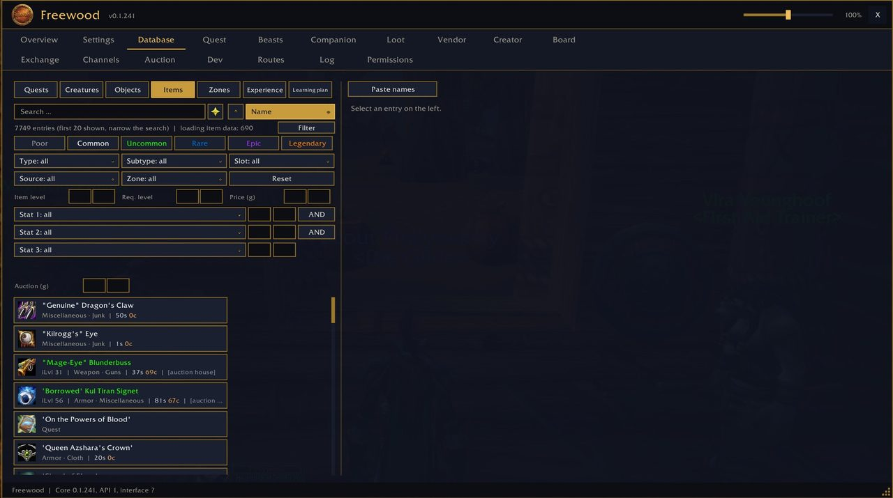
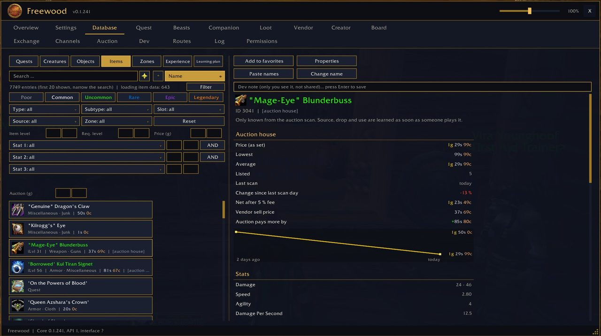

# Freewood-OctoWoW-Codex

> Datenbank · Database

Teil von **Freewood für OctoWoW** (WoW-Client 1.12.1 + ClassicAPI), Version 0.1.241. · Part of **Freewood for OctoWoW** (WoW client 1.12.1 + ClassicAPI), version 0.1.241.

[Deutsch](#deutsch) · [English](#english)

## Screenshots

*Datenbank: Items mit Filtern · Database: items with filters*

*Datenbank: Einzelheiten und Auktionsverlauf · Database: details and auction history*

## Deutsch

Lernt beim Spielen Quests, Kreaturen, Objekte, Items, Zonen und Beute: Geber/Abgabe, Belohnungen, Ziele, Drop-Chancen, Händler, Flugpunkte, Wege. Reiter: Database (Quests, Creatures, Objects, Items, Zones, Experience, Learning plan).

### Kurzanleitung

1. Spiele einfach: Der Codex erfasst automatisch, was du siehst und tust (Quests annehmen/abgeben, Kämpfe, Beute, Händler, Wege).
2. Reiter **Database**: oben Kategorie wählen (Quests, Creatures, …), im Suchfeld tippen, links einen Eintrag wählen, rechts erscheinen die Einzelheiten. Bei Items erscheint „lade Itemdaten“, bis der Server die Namen geliefert hat.
3. **Learning plan**: Quests für deine Stufe; Favoriten und Notizen lassen sich als Text sichern und auf einen anderen Charakter übertragen.
4. `/fwcodex near <haendler|repair|flug|gast|stall|bank|auktion|post|geist>` zeigt den nächsten passenden Ort. `/fwlookup` schlägt etwas nach.
5. `/fwdone` und `/fwblock`: „noch nicht möglich“-Markierungen für Quests ansehen/aufheben (`/fwblock <ID>` oder `/fwblock alle`).
6. `/fwforever an|aus` schaltet die mitgelieferten Startdaten ein/aus.

## English

Learns quests, creatures, objects, items, zones and loot while you play: givers/turn-ins, rewards, objectives, drop chances, vendors, flight points, paths. Tabs: Database (Quests, Creatures, Objects, Items, Zones, Experience, Learning plan).

### Short guide

1. Just play: the Codex records automatically what you see and do (accepting/turning in quests, fights, loot, vendors, paths).
2. **Database** tab: pick a category at the top (Quests, Creatures, …), type in the search box, select an entry on the left, details appear on the right. For items, "loading item data" is shown until the server has delivered the names.
3. **Learning plan**: quests for your level; favourites and notes can be saved as text and moved to another character.
4. `/fwcodex near <haendler|repair|flug|gast|stall|bank|auktion|post|geist>` shows the nearest matching place (vendor, repair, flight, inn, stable, bank, auction, mail, spirit healer). `/fwlookup` looks something up.
5. `/fwdone` and `/fwblock`: view/clear "not yet possible" quest marks (`/fwblock <ID>` or `/fwblock alle` = all).
6. `/fwforever an|aus` (on|off) switches the bundled start data on/off.

## Installation · Abhängigkeiten · Dependencies

Ordner `Freewood-OctoWoW-Codex` nach `Interface\AddOns\` kopieren. · Copy the folder `Freewood-OctoWoW-Codex` to `Interface\AddOns\`.

- Benötigt · Required: `Freewood-OctoWoW-Core`
- Optional: `Freewood-OctoWoW-CodexData`, `Freewood-OctoWoW-ForeverData`

Alle Module und ausführliche Anleitungen: Repo `Freewood-OctoWoW-AI`, `docs/module/`. · All modules and full guides: repo `Freewood-OctoWoW-AI`, `docs/module/`.

Hinweis · Note: Die Anleitungen stammen aus Code und Texten der Module; nicht alles ist im Spiel geprüft. · The guides are derived from the modules' code and texts; not everything is verified in game.

Autor · Author: Lacustat. Lizenz · License: GPL-3.0-or-later (`LICENSE`).
