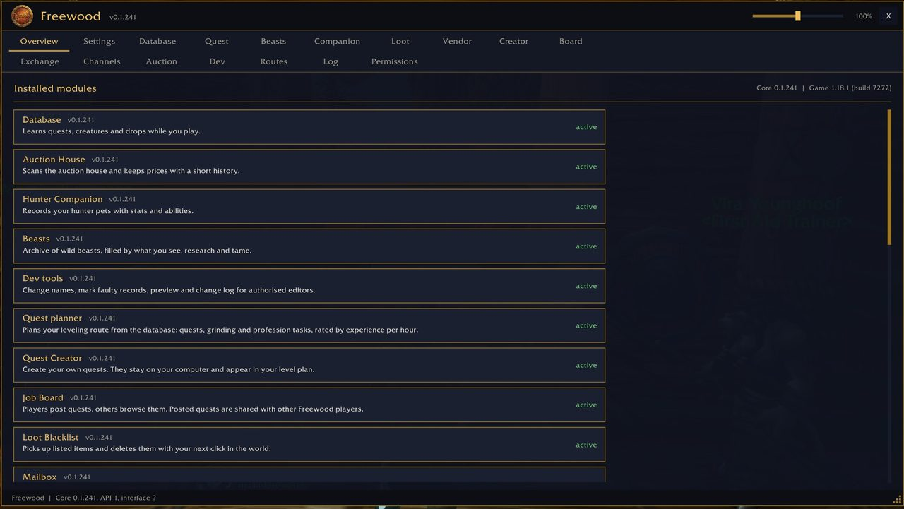
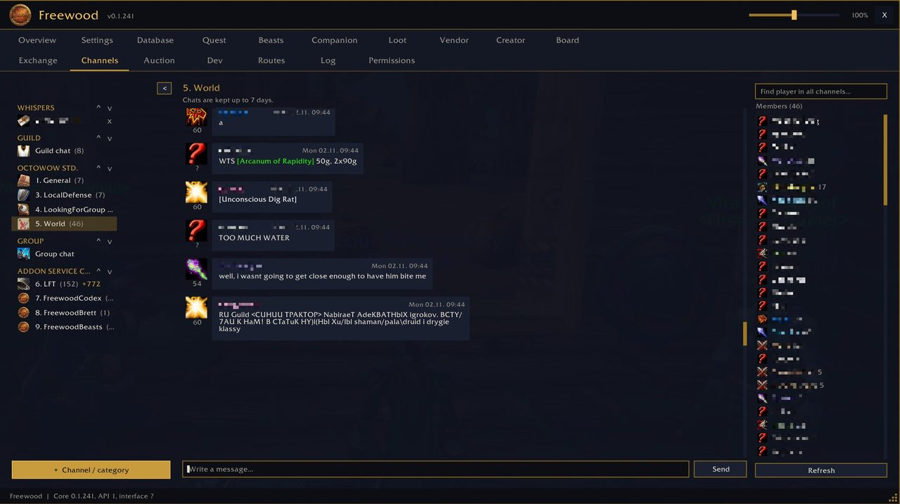
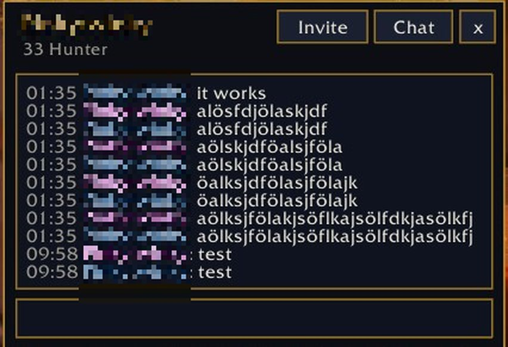
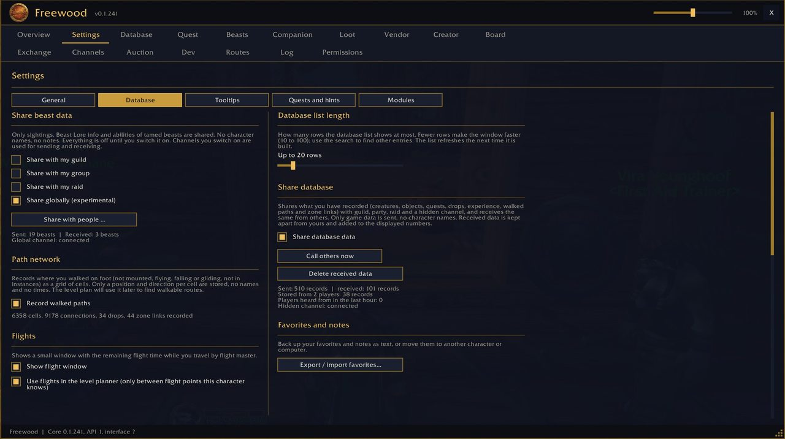
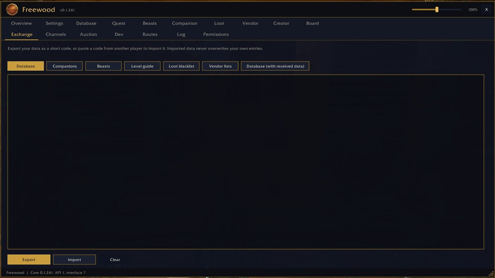

# Freewood-OctoWoW-Core

> Basis · Base

Teil von **Freewood für OctoWoW** (WoW-Client 1.12.1 + ClassicAPI), Version 0.1.241. · Part of **Freewood for OctoWoW** (WoW client 1.12.1 + ClassicAPI), version 0.1.241.

[Deutsch](#deutsch) · [English](#english)

## Screenshots

*Übersicht: installierte Module · Overview: installed modules*

*Kanäle: Chat mit Kanalliste links und Mitgliedern rechts · Channels: chat with channel list on the left and members on the right*

*Flüsterfenster · Whisper window*

*Einstellungen · Settings*

*Austausch: Export und Import · Exchange: export and import*

## Deutsch

Grundlage aller Module: Datenspeicher, UI-Bausteine, Hauptfenster, Export/Import, Kompatibilitätsschicht für 1.12.1 + ClassicAPI. Reiter: Overview, Settings, Exchange und **Channels** (Chatfenster mit Kanälen, Gilde, Gruppe und Flüstern). Dazu verschiebbare Flüsterfenster.

### Kurzanleitung

1. `/fw` öffnet/schließt das Hauptfenster. Jedes installierte Modul hat dort einen Reiter.
2. `/fw settings`: Einstellungen (Sprache, Fenster).
3. `/fw exchange`: Export und Import von Daten als Text (mit Strg+C kopieren, mit Strg+V einfügen).
4. `/fw minimap`: Minimap-Knopf ein-/ausblenden. `/fw reset`: Fensterposition zurücksetzen. `/fw modules`: geladene Module auflisten. `/fw debug`: Debug-Meldungen umschalten.
5. Reiter **Channels** (Kanäle): links alle Kanäle in Kategorien (OctoWoW Std., Gilde, Gruppe, Flüstern, Addon Service Channel; eigene Kategorien mit **+ Kanal / Kategorie**, per `^` `v` verschiebbar, mit `<` / `>` schmal oder breit). In der Mitte der Chat in Sprechblasen mit Klassensymbol, Stufe und Datum, unten das Eingabefeld. Rechts die Mitglieder des Kanals mit Klassensymbol und Stufe, darüber die Suche „Spieler in allen Kanälen“.
6. Klicken: Linksklick auf einen Link öffnet ihn, Rechtsklick auf eine Nachricht kopiert sie. Rechtsklick auf einen Spieler: anflüstern, in die Gruppe einladen, ignorieren. Mit **+ Kanal / Kategorie** trittst du Kanälen bei (`/join` geht auch), mit dem Menü des Kanals verlässt du ihn (höchstens 10 Kanäle).
7. Gespeichert werden bis zu 7 Tage: Gilde, Gruppe und Flüstern vollständig, Kanäle begrenzt. **Service-Kanäle (Freewood…) und LFT werden nie gespeichert**; sie erscheinen als Log ohne Sprechblasen.
8. Klasse und Stufe fragt Freewood nach und nach still per `/who` ab (ein Aufruf alle 6 Sekunden) und merkt sie sich 30 Tage.
9. **Flüsterfenster**: Flüstert dich jemand an (oder du jemanden), öffnet sich ein kleines verschiebbares Fenster mit **Einladen** (Gruppe), **Chat** (springt in den Reiter) und **x**. Es öffnet sich nie im Kampf und schließt sich, wenn der Kampf beginnt. Ein- und ausschalten unter Einstellungen.

## English

Foundation of all modules: data storage, UI kit, main window, export/import, compatibility layer for 1.12.1 + ClassicAPI. Tabs: Overview, Settings, Exchange and **Channels** (chat window with channels, guild, group and whispers). Plus movable whisper windows.

### Short guide

1. `/fw` opens/closes the main window. Every installed module has a tab there.
2. `/fw settings`: settings (language, window).
3. `/fw exchange`: export and import data as text (copy with Ctrl+C, paste with Ctrl+V).
4. `/fw minimap`: show/hide the minimap button. `/fw reset`: reset window position. `/fw modules`: list loaded modules. `/fw debug`: toggle debug messages.
5. **Channels** tab: all channels on the left in categories (OctoWoW Std., Guild, Group, Whispers, Addon Service Channel; own categories via **+ Channel / category**, movable with `^` `v`, narrow or wide with `<` / `>`). In the middle the chat in speech bubbles with class icon, level and date, the input box below. On the right the channel's members with class icon and level, above them the search "Find player in all channels".
6. Clicking: left-click on a link opens it, right-click on a message copies it. Right-click on a player: whisper, invite to group, ignore. Use **+ Channel / category** to join channels (`/join` works too), the channel's menu to leave one (at most 10 channels).
7. Kept for up to 7 days: guild, group and whispers completely, channels limited. **Service channels (Freewood…) and LFT are never saved**; they appear as a log without bubbles.
8. Freewood asks for class and level silently, one `/who` every 6 seconds, and remembers them for 30 days.
9. **Whisper windows**: when someone whispers you (or you whisper someone), a small movable window opens with **Invite** (group), **Chat** (jumps to the tab) and **x**. It never opens in combat and closes when combat starts. Switch on/off in Settings.

## Installation · Abhängigkeiten · Dependencies

Ordner `Freewood-OctoWoW-Core` nach `Interface\AddOns\` kopieren. · Copy the folder `Freewood-OctoWoW-Core` to `Interface\AddOns\`.

- Benötigt · Required: –
- Optional: –

Alle Module und ausführliche Anleitungen: Repo `Freewood-OctoWoW-AI`, `docs/module/`. · All modules and full guides: repo `Freewood-OctoWoW-AI`, `docs/module/`.

Hinweis · Note: Die Anleitungen stammen aus Code und Texten der Module; nicht alles ist im Spiel geprüft. · The guides are derived from the modules' code and texts; not everything is verified in game.

Autor · Author: Lacustat. Lizenz · License: GPL-3.0-or-later (`LICENSE`).
