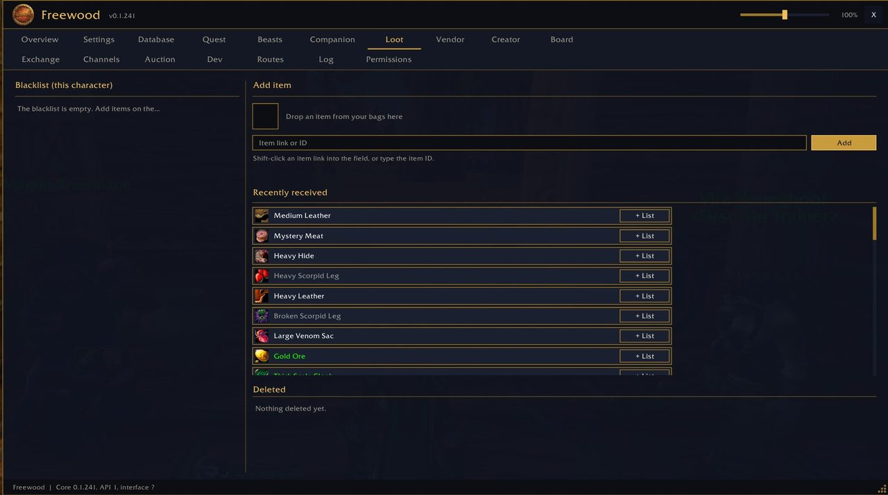

# Freewood-OctoWoW-Loot

> Beute-Blacklist · Loot blacklist

Teil von **Freewood für OctoWoW** (WoW-Client 1.12.1 + ClassicAPI), Version 0.1.241. · Part of **Freewood for OctoWoW** (WoW client 1.12.1 + ClassicAPI), version 0.1.241.

[Deutsch](#deutsch) · [English](#english)

## Screenshots

*Beute-Blacklist · Loot blacklist*

## Deutsch

Items auf der Liste werden aus Beutefenstern automatisch mitgenommen und mit deinem nächsten Klick in der Spielwelt gelöscht (das Spiel erlaubt Addons nur ein gelöschtes Item pro Mausklick).

### Kurzanleitung

1. Reiter **Loot**: Item mit Shift-Klick ins Feld setzen, per Item-ID eintippen oder aus der Tasche auf den Slot ziehen, dann **Hinzufügen**.
2. Die Liste gilt pro Charakter. Entfernen über „Von der Blacklist entfernen“. „Zuletzt erhalten“ zeigt Beute, „+ Listen“ setzt sie direkt auf die Liste.
3. Einstellungen: automatisch aus Beutefenstern mitnehmen; gelistete Items mit dem nächsten Klick löschen; Meldung im Chat.
4. Meldung „Wartende Items“: einmal in die Spielwelt klicken, dann wird eines gelöscht. Blockiert das Spiel das Löschen: `/fwloot test`.

## English

Items on the list are picked up automatically from loot windows and deleted with your next click in the game world (the game allows addons only one deleted item per mouse click).

### Short guide

1. **Loot** tab: shift-click an item into the field, type its item ID, or drag it from a bag onto the slot, then **Hinzufügen** (add).
2. The list is per character. Remove via "remove from blacklist". "Recently received" shows loot, "+ lists" puts it straight on the list.
3. Settings: auto-pick-up from loot windows; delete listed items with the next click; chat message.
4. Message "waiting items": click once into the game world and one gets deleted. If the game blocks deleting: `/fwloot test`.

## Installation · Abhängigkeiten · Dependencies

Ordner `Freewood-OctoWoW-Loot` nach `Interface\AddOns\` kopieren. · Copy the folder `Freewood-OctoWoW-Loot` to `Interface\AddOns\`.

- Benötigt · Required: `Freewood-OctoWoW-Core`
- Optional: –

Alle Module und ausführliche Anleitungen: Repo `Freewood-OctoWoW-AI`, `docs/module/`. · All modules and full guides: repo `Freewood-OctoWoW-AI`, `docs/module/`.

Hinweis · Note: Die Anleitungen stammen aus Code und Texten der Module; nicht alles ist im Spiel geprüft. · The guides are derived from the modules' code and texts; not everything is verified in game.

Autor · Author: Lacustat. Lizenz · License: GPL-3.0-or-later (`LICENSE`).
