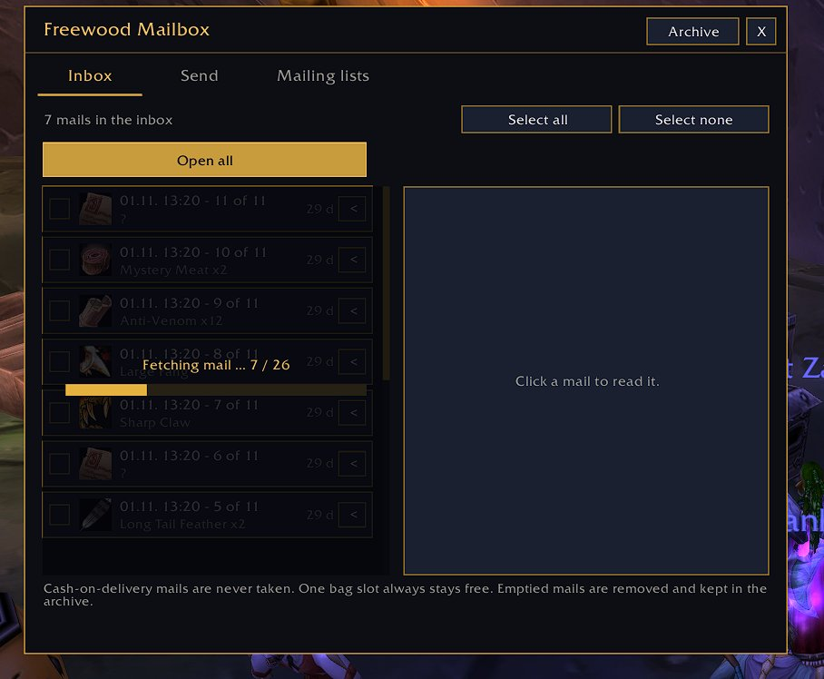

# Freewood-OctoWoW-Mail

> Briefkasten · Mailbox

Teil von **Freewood für OctoWoW** (WoW-Client 1.12.1 + ClassicAPI), Version 0.1.241. · Part of **Freewood for OctoWoW** (WoW client 1.12.1 + ClassicAPI), version 0.1.241.

[Deutsch](#deutsch) · [English](#english)

## Screenshots

*Briefkasten beim Abholen · Mailbox while fetching*

## Deutsch

Eigenes Briefkasten-Fenster (optional, standardmäßig aus): alles oder Ausgewähltes sicher öffnen, letzte Empfänger, Mailinglisten mit Automatik, mehrere Items pro Versand, Gold-Überschuss, Nachnahme, Archiv und Rückversand. Braucht Core; mit Creator und Brett kommen die Brett-Briefe dazu (optional).

### Kurzanleitung

1. Einschalten: Einstellungen > Briefkasten > „Normalen Briefkasten ersetzen“ oder `/fwmail on` (`/fwmail off` schaltet zurück). Das normale Fenster bleibt dabei unsichtbar geöffnet, damit Brett-Aufträge weiter funktionieren.
2. Reiter **Posteingang**: Briefe wählen und lesen, **Alles öffnen** oder **Nur Ausgewählte** nehmen. Ein Platz in den Taschen bleibt immer frei. Geleerte Briefe werden entfernt und vorher im **Archiv** gesichert (suchbar, Aufbewahrungsdauer einstellbar).
3. Nachnahme-Briefe werden nie automatisch genommen: **Zahlen und nehmen** mit zweitem Klick zur Bestätigung. **Löschen** löscht Nachnahme-Briefe nie, sondern schickt sie sofort an den Absender zurück (auch im normalen Fenster). Mit **Zurück an Absender** (zweimal klicken, auch als „<“ in der Liste) schickst du jeden Brief mit Anhang zurück.
4. Reiter **Senden**: Empfänger (mit Liste der letzten), Betreff, Text, Items, Gold, Nachnahme. Auch reine Textbriefe ohne Anhang sind möglich. Mehrere Items werden als mehrere Briefe nacheinander gesendet, so schnell der Server es zulässt (das Tempo passt sich selbst an).
5. Reiter **Mailinglisten**: pro Charakter Name und Items festlegen, „automatisch beim Öffnen senden“ und „Gold über … senden“ (Überschuss). **Alle Listen jetzt senden**. Für Brett-Aufträge reservierte Items werden dabei nicht verschickt.
6. Brett-Briefe: Wird ein Brett-Auftrag per Brief abgegeben, bereitet das Brett den Brief im Freewood-Briefkasten vor (Hinweis „Brett-Auftrag“) und sendet ihn automatisch, sobald alles stimmt (abschaltbar). Betreff `[Brett] Auftragsname`, grün hervorgehoben; Text mit Kurzinfo. Beim Auftraggeber werden solche Briefe gegen den eigenen Auftrag geprüft; Fehler sind getrennt benannt (kein passender Auftrag, schon vergeben, Nachnahme zu hoch).

## English

Own mailbox window (optional, off by default): open all or selected mails safely, recent recipients, mailing lists with automation, several items per send, gold surplus, cash on delivery, archive and return to sender. Requires Core; with Creator and Brett the board letters are added (optional).

### Short guide

1. Switch on: Settings > Mailbox > "Replace the normal mailbox window" or `/fwmail on` (`/fwmail off` switches back). The normal window stays open but invisible so board quests keep working.
2. **Inbox** tab: select and read mails, **Open all** or **Open selected only**. One bag slot always stays free. Emptied mails are removed and saved in the **archive** first (searchable, retention adjustable).
3. Cash-on-delivery mails are never taken automatically: **Pay and take** needs a second click. **Delete** never deletes cash-on-delivery mails but returns them to the sender at once (also in the normal window). **Return to sender** (click twice, also as "<" in the list) sends back any mail with attachments.
4. **Send** tab: recipient (with list of recent ones), subject, text, items, gold, cash on delivery. Plain text mails without attachments are possible. Several items are sent as several mails one after another, as fast as the server allows (the speed adapts itself).
5. **Mailing lists** tab: per character set name and items, "send automatically when the mailbox opens" and "send gold above ..." (surplus). **Send all lists now**. Items reserved for board quests are not sent.
6. Board letters: when a board quest is handed in by letter, the board prepares the letter in the Freewood mailbox (note "Board mission") and sends it automatically once everything is correct (can be switched off). Subject `[Brett] quest name`, shown in green; text with short info. On the giver's side such letters are checked against their own quest; errors are named separately (no matching quest, already taken, cash on delivery too high).

## Installation · Abhängigkeiten · Dependencies

Ordner `Freewood-OctoWoW-Mail` nach `Interface\AddOns\` kopieren. · Copy the folder `Freewood-OctoWoW-Mail` to `Interface\AddOns\`.

- Benötigt · Required: `Freewood-OctoWoW-Core`
- Optional: `Freewood-OctoWoW-Creator`, `Freewood-OctoWoW-Brett`

Alle Module und ausführliche Anleitungen: Repo `Freewood-OctoWoW-AI`, `docs/module/`. · All modules and full guides: repo `Freewood-OctoWoW-AI`, `docs/module/`.

Hinweis · Note: Die Anleitungen stammen aus Code und Texten der Module; nicht alles ist im Spiel geprüft. · The guides are derived from the modules' code and texts; not everything is verified in game.

Autor · Author: Lacustat. Lizenz · License: GPL-3.0-or-later (`LICENSE`).
