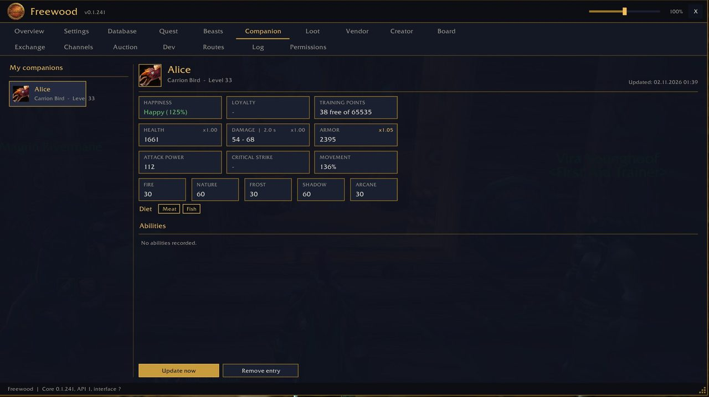

# Freewood-OctoWoW-Pet

> Begleiter · Companions

Teil von **Freewood für OctoWoW** (WoW-Client 1.12.1 + ClassicAPI), Version 0.1.241. · Part of **Freewood for OctoWoW** (WoW client 1.12.1 + ClassicAPI), version 0.1.241.

[Deutsch](#deutsch) · [English](#english)

## Screenshots

*Begleiter · Companions*

## Deutsch

Erfasst deine Jäger-Begleiter mit Werten (Zufriedenheit, Treue, Trainingspunkte, Schaden, Rüstung, Resistenzen) und Fähigkeiten. Export/Import.

### Kurzanleitung

1. Reiter **Companion**: Begleiter rufen, dann erscheint er in „Meine Begleiter“.
2. Links einen Begleiter wählen, rechts Werte, Nahrung und Fähigkeiten ansehen. **Jetzt aktualisieren** liest neu (nicht im Kampf möglich, danach automatisch).
3. Mit Import/Export Begleiter auf einen anderen Charakter oder Rechner übertragen. Befehl: `/fwpet`.

## English

Records your hunter companions with stats (happiness, loyalty, training points, damage, armour, resistances) and abilities. Export/import.

### Short guide

1. **Companion** tab: summon your pet, then it appears under "My companions".
2. Select a companion on the left; see stats, food and abilities on the right. **Jetzt aktualisieren** (update now) rereads (not possible in combat, automatic afterwards).
3. Use import/export to move companions to another character or computer. Command: `/fwpet`.

## Installation · Abhängigkeiten · Dependencies

Ordner `Freewood-OctoWoW-Pet` nach `Interface\AddOns\` kopieren. · Copy the folder `Freewood-OctoWoW-Pet` to `Interface\AddOns\`.

- Benötigt · Required: `Freewood-OctoWoW-Core`
- Optional: –

Alle Module und ausführliche Anleitungen: Repo `Freewood-OctoWoW-AI`, `docs/module/`. · All modules and full guides: repo `Freewood-OctoWoW-AI`, `docs/module/`.

Hinweis · Note: Die Anleitungen stammen aus Code und Texten der Module; nicht alles ist im Spiel geprüft. · The guides are derived from the modules' code and texts; not everything is verified in game.

Autor · Author: Lacustat. Lizenz · License: GPL-3.0-or-later (`LICENSE`).
