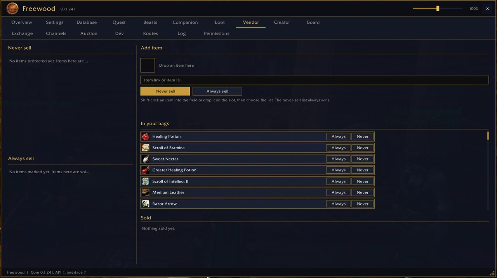

# Freewood-OctoWoW-Vendor

> Händler · Vendors

Teil von **Freewood für OctoWoW** (WoW-Client 1.12.1 + ClassicAPI), Version 0.1.241. · Part of **Freewood for OctoWoW** (WoW client 1.12.1 + ClassicAPI), version 0.1.241.

[Deutsch](#deutsch) · [English](#english)

## Screenshots

*Händler-Listen · Vendor lists*

## Deutsch

Listen „Nie verkaufen“ und „Immer verkaufen“, ein Knopf verkauft alles Markierte plus alle grauen Items. Die Nie-Liste gewinnt immer; Questitems werden nie verkauft.

### Kurzanleitung

1. Reiter **Vendor**: Item per Shift-Klick ins Feld setzen, per Item-ID eintippen oder auf den Slot ziehen, dann die Liste wählen (**Nie verkaufen** oder **Immer verkaufen**).
2. Beim Händler: **Markierte Items verkaufen** verkauft graue Items plus deine Immer-Liste. Nie-Items und Questitems bleiben.
3. Einstellungen: graue Items mit verkaufen; automatisch verkaufen, wenn ein Händler geöffnet wird; Zusammenfassung im Chat. Befehl: `/fwsell`.

## English

"Never sell" and "Always sell" lists; one button sells everything marked plus all gray items. The never-list always wins; quest items are never sold.

### Short guide

1. **Vendor** tab: shift-click an item into the field, type its item ID or drag it onto the slot, then choose the list (**Never sell** / **Always sell**).
2. At a vendor: **Sell marked items** sells gray items plus your always-list. Never-items and quest items stay.
3. Settings: also sell gray items; auto-sell when a vendor opens; summary in chat. Command: `/fwsell`.

## Installation · Abhängigkeiten · Dependencies

Ordner `Freewood-OctoWoW-Vendor` nach `Interface\AddOns\` kopieren. · Copy the folder `Freewood-OctoWoW-Vendor` to `Interface\AddOns\`.

- Benötigt · Required: `Freewood-OctoWoW-Core`
- Optional: –

Alle Module und ausführliche Anleitungen: Repo `Freewood-OctoWoW-AI`, `docs/module/`. · All modules and full guides: repo `Freewood-OctoWoW-AI`, `docs/module/`.

Hinweis · Note: Die Anleitungen stammen aus Code und Texten der Module; nicht alles ist im Spiel geprüft. · The guides are derived from the modules' code and texts; not everything is verified in game.

Autor · Author: Lacustat. Lizenz · License: GPL-3.0-or-later (`LICENSE`).
