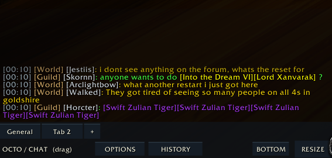
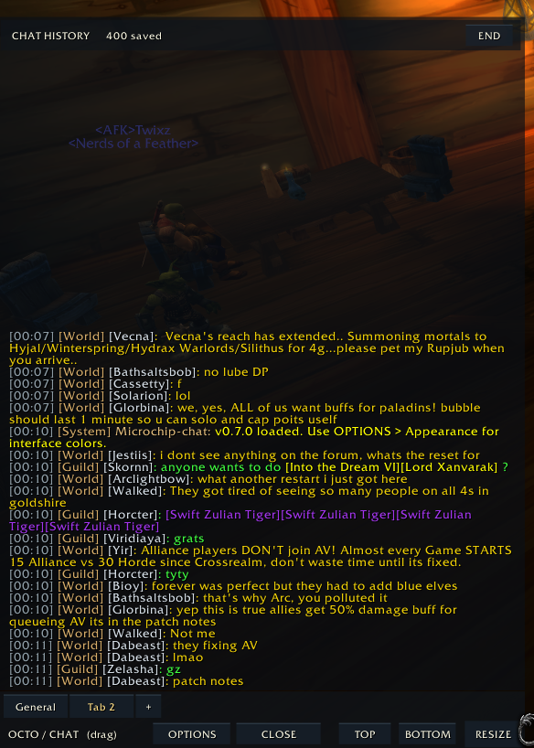

# Microchip-chat

**Microchip-chat** is a customizable, New World-inspired chat replacement for **OctoWoW's modified World of Warcraft 1.12 client**. It keeps live chat compact while making older messages easy to find, without the default WoW chat window taking up screen space.

## Screenshots

**Live chat** — a compact chat feed with tabs and auto-hiding controls.

**Chat history** — the same window expands upward to browse earlier messages.

*Screenshots show an earlier version of the toolbar branding.*

## Features

- **Minimal live chat:** Messages scroll upward, include timestamps, and can fade after a configurable number of seconds. Message fading can also be disabled.
- **Expandable history:** Scroll through previous messages in the same window, jump to the oldest or newest messages, and configure retention separately for each channel. Older messages are loaded on demand for smoother browsing.
- **Custom chat tabs:** Create tabs with their own channel selections, message colors, font sizes, and filters. The default chat tab enables supported channels except LFT.
- **Combat Log:** A separate combat tab with **All Events** and **What Happened to Me** views.
- **Built-in filtering:** Block words or phrases and filter World chat advertisements independently for each tab. No separate WorldChatFilter installation is needed.
- **Class-colored names:** Player names use class colors when the client can identify their class. Names remain clickable for whispers and other player interactions.
- **Clickable links:** Supports WoW item links and web addresses. Clicking a web address opens a text field so you can copy it with **Ctrl+C**.
- **Customizable appearance:** Adjust window, button, and interface-text colors; move, resize, or lock the chat window; and configure the auto-hiding toolbar.

## Installation

1. Extract the `Microchip-chat` folder into `World of Warcraft/Interface/AddOns/`.
2. Check that `Microchip-chat.toc` is directly inside the addon folder.
3. Start the game and enter `/mchat options` to customize the interface.

Use `/mchat history` to toggle expanded history. The older `/osc` command is also supported.

## Credits

Includes a built-in World chat filtering implementation adapted from [WorldChatFilter](https://github.com/papafru/WorldChatFilter). See `WORLDFILTER_LICENSE.txt` in the addon for attribution and license details.
