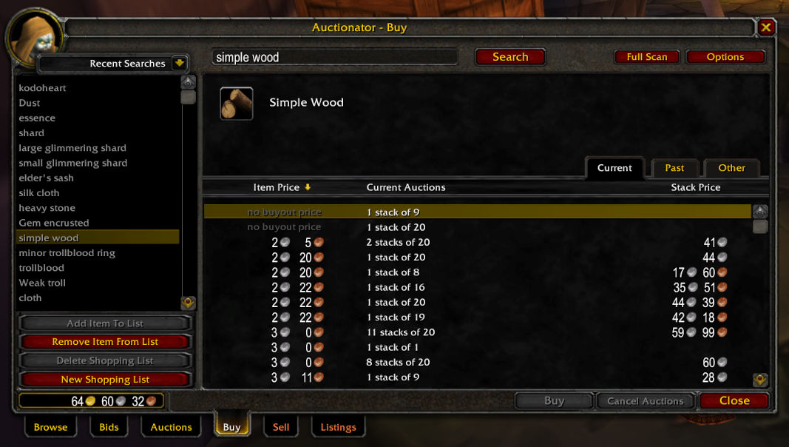
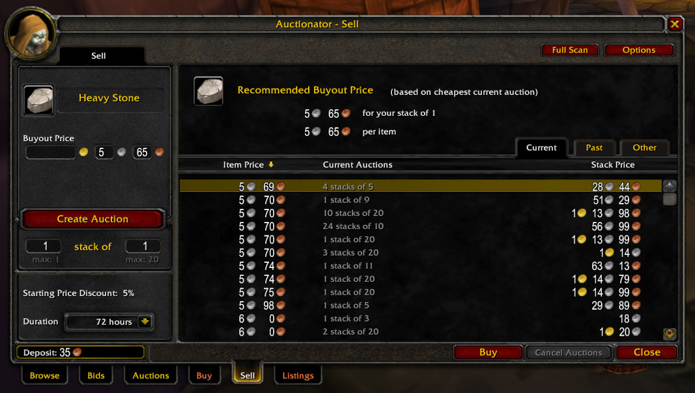
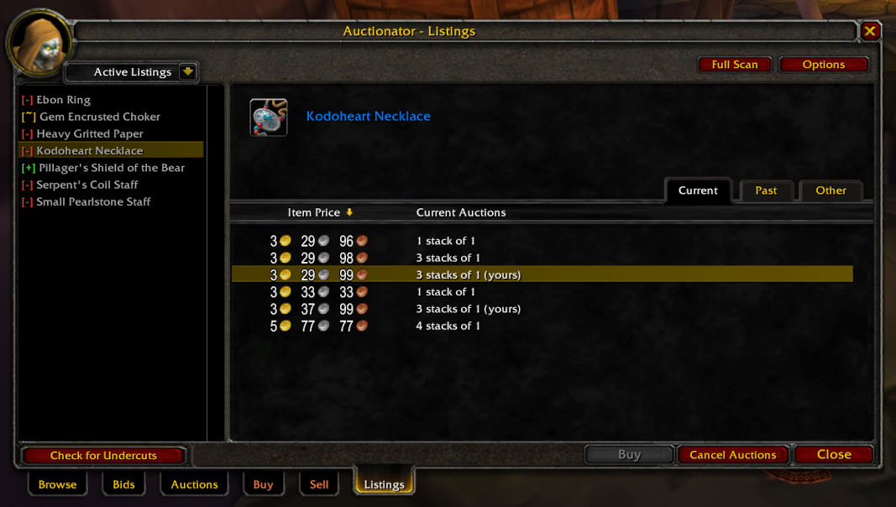
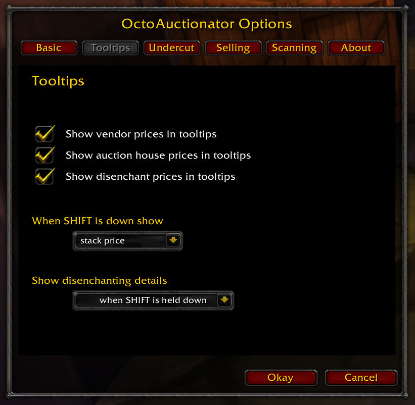
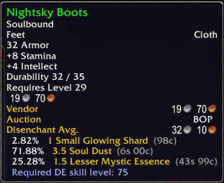
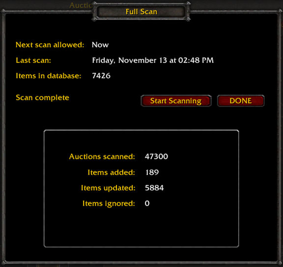

# OctoAuctionator Plus - Fixed and improved

The classic **Auctionator 2.6.2** auction house addon (Buy / Sell / Listings tabs) ported to **OctoWoW 1.18.1** (1.12.1 client).

Fixed and improved. With a Plus so you just know it must be good. Free and open-source.

## What it does

- **Buy:** type a name and press Search. Results fill in while the pages are still coming in, so you can already pick
  a row and press Buy (the scan pauses for the purchase and then carries on). Click **Item Price** to flip
  cheapest-first / most-expensive-first. Recent searches and your own shopping lists sit on the left.
- **Sell:** drop an item in the slot and it searches that item, shows the current auctions and recommends a buyout
  just under the cheapest one. Set the stack size and number of stacks, pick 6 / 24 / 72 hours, Create Auction.
- **Listings:** your listed items: what you have on the AH right now (check for undercuts) and everything you posted before.
- **Full Scan:** optional. Scans the whole auction house and stores the lowest prices for the tooltips.
- **Tooltips:** auction price of an item (and the vendor price if you use SellValue), plus the expected value when you disenchant the item

**About speed:** 1.12.1 auction house browsing is quite slow, since the client has a 5 second delay requests, so I'd recommend using AuctionQueryThrottle.dll. More info and download here . It is loaded via VanillaFixes by adding it to your dlls.txt.

## Install

* Recommended:
    - Open your OctoWoW Launcher and open the "Addons" tab.
    - Click "+ Add custom git addon" and paste this repository's URL into the input field: https://github.com/PastaStomp/OctoAuctionatorPlus
    - Click "Install".
    - Your addon has now been installed and will receive update notifications in the OctoWoW Launcher.
* Manual installation (no automatic updates):
    - Download this repository by cloning it or downloading the zip (green '< > Code'-button top right, then 'Download ZIP').
    - Unpack it. Copy the contents to your WoW installation folder under ./Interface/AddOns/OctoAuctionatorPlus (Addon folder name has to be exact)
    - This, for example, is where OctoAuctionatorPlus.toc should be now: <WoW-Install-Folder>/Interface/AddOns/OctoAuctionatorPlus/OctoAuctionatorPlus.toc
    - That's it. However, you'll need to update the addon manually, so don't forget to check back once in a while.

## Usage

- Open the auction house: the **Buy**, **Sell** and **Listings** tabs are next to Browse / Bids / Auctions.
- The **Options** button (top right) opens the options; **Full Scan** starts a full scan.
- `/atr clear fullscandb` clears the stored scan prices, `/atr clear posthistory` clears your posting history.

## Credits

**Made by John The Baptist.**

Original addon: **Auctionator 2.6.2 by Zirco** (WoWInterface). This version keeps his interface and code and adapts
them to the 1.12 client and this server.

*It's not much, but it's honest work.*
