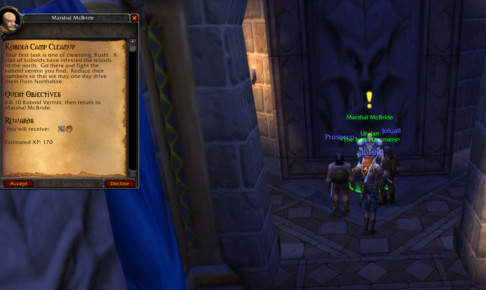
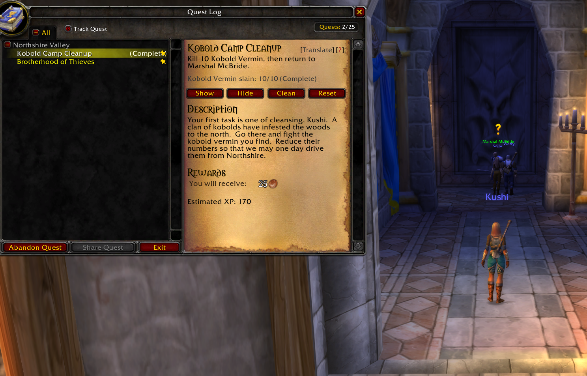
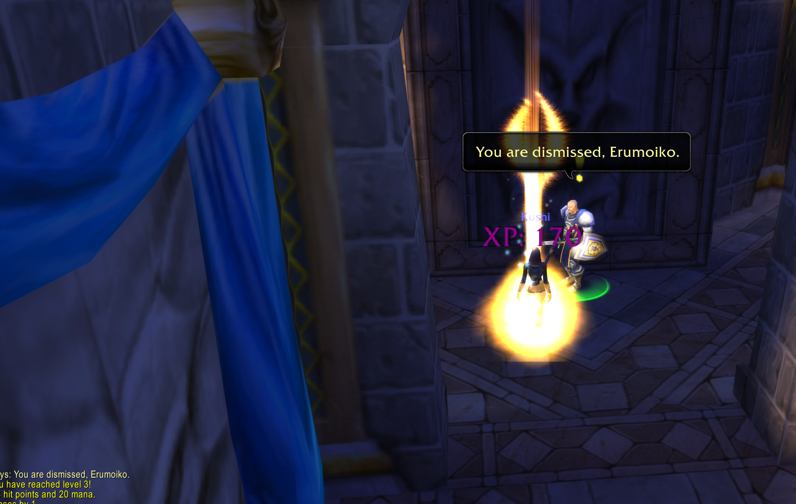

# OctoQuestRewards 1.0.0

See a quest's **estimated XP reward** without leaving the original quest window.
A small, free addon for **OctoWoW 1.18.1**.

**Made by John The Baptist.**

## What it does

- Shows XP before accepting a quest, in the Quest Log, and when turning it in.
- Uses the same font as the quest text.
- Leaves the game's money and item rewards alone.
- No extra window, libraries or setup menu.

**XP is an estimate.** Custom quests, XP bonuses and server changes can differ.
If the addon cannot identify a reward safely, it hides the XP line.

## Install

1. Download **OctoQuestRewards-1.0.0.zip** from the forum attachment or repository Releases.
2. Extract it into your WoW `Interface/AddOns` folder.
3. Restart WoW and enable **OctoQuestRewards** at character selection.

The folder must contain `Interface/AddOns/OctoQuestRewards/OctoQuestRewards.toc`.
Use it with **pfQuest + pfQuest-turtle**. **pfExtend** and **ClassicAPI** are optional.

## Commands

- `/oqr` — help.
- `/oqr status` — version and reward sources.
- `/oqr debug` — toggle reward comparisons in your own chat window.

## Screenshots

Before accepting:

In the Quest Log:

Turn-in: this test quest estimated **170 XP** and awarded **170 XP**.

## Credits

Vanilla XP data: [MrFox / LibQuestXP](https://github.com/Questie/Questie/blob/v6.8.0/LibsOnlyClassic/LibQuestXP/LibQuestXPDB.lua).
Quest matching and optional custom data come from your installed pfQuest, pfQuest-turtle and pfExtend.
Independent addon; no changes to those addons are required.

*It's not much, but it's honest work.*
