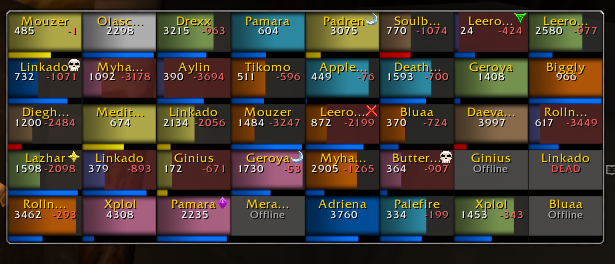
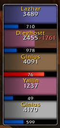

# Puppeteer

Puppeteer, formerly HealersMate, is a unit frames addon for World of Warcraft Vanilla 1.12 that strives to be an alternative to modern WoW's VuhDo, Cell, or Healbot. Its features are tailored for healers, but it works as a unit frames addon for any class and spec.

**This is OEVG's fork of [OldManAlpha/Puppeteer](https://github.com/OldManAlpha/Puppeteer), version 1.2.** It produces much less garbage in combat, supports ClassicAPI, and adds Blizzard Modern bar textures and a few options. See [What's new in this fork](#whats-new-in-this-fork).

### Features
- See health, power, marks, incoming healing, mob aggro, PvP status, and relevant buffs & debuffs of your party, raid, pets, and targets
- Bind mouse clicks, the mouse wheel, and keys to spells
- See your bound spells, their cost, and available mana while hovering over frames
- Assign roles to players
- Choose from a variety of preset frame styles, with some customization
- See the distance between you and other players (**[UnitXP SP3, SuperWoW or ClassicAPI](#client-mods-that-enhance-puppeteer)**, otherwise only 28 yds can be checked)
- See when players/enemies are out of your line-of-sight (**[UnitXP SP3 or ClassicAPI](#client-mods-that-enhance-puppeteer)**)
- See the remaining duration of buffs and HoTs on other players (**[SuperWoW or ClassicAPI](#client-mods-that-enhance-puppeteer)**)
- Add players/enemies to a separate Focus group, even if they're not in your party or raid (**[SuperWoW Required](#client-mods-that-enhance-puppeteer)**)

  
  

 

### Simple, Yet Advanced Bindings

Puppeteer can bind mouse clicks, the mouse wheel, and keys with any combination of Shift/Ctrl/Alt modifiers. You can bind spells, macros, items, custom Lua scripts, and menus which contain multiple bindings. **Use the `/pt` command to open the configuration menu.**

  
  

  

  
  

 

### View Spells at a Glance

When hovering over a player, a tooltip shows your current power, the spells you have bound, and their power cost.

  

### Installation

1. Download the repository as a ZIP and extract it.
2. Rename the extracted folder to **Puppeteer** if it has another name.
3. Place it in `World of Warcraft/Interface/AddOns/`, so that the file is at `Interface/AddOns/Puppeteer/Puppeteer.toc` with no extra nested folder.
4. Restart WoW completely (new textures are not picked up by a reload), then enable Puppeteer at character selection.

When updating, back up your existing addon folder. Your settings are kept in the `WTF` folder.

### Commands

| Command | Action |
| - | - |
| `/pt` | Open the configuration menu |
| `/pt help` | Show available commands |
| `/pt testui [count]` | Show fake players for layout testing (count 1–40). Raid frames show even when you're not in a raid |
| `/pt reset` | Reset frame positions |
| `/pt toggle` | Toggle frame visibility |

## What's New in This Fork

Full details, including measurements and implementation notes, are in [CHANGELOG.md](CHANGELOG.md).

### 1.2

- **Optional ClassicAPI support.** Turn it off with **Use ClassicAPI** in `/pt` → Options → Mods (needs a reload). See [ClassicAPI](#classicapi).
- **Less work for hidden frames.** Frames you can't see, such as the party frames while you're in a raid, skip event updates and catch up when they're shown.
- **Idle heal prediction.** Heal prediction's cleanup check stops when there is nothing left to expire.
- **Tooltip Behavior option** (Options → Other):
  - **Default** keeps the game's tooltip.
  - **Always** shows the unit tooltip even for far away members.
  - **Never** hides the tooltip while you hover frames, so it doesn't cover other frames.
- **Test UI** (`/pt testui`) shows raid frames while you're solo or in a party ([fey](https://github.com/fey/Puppeteer)).
- **Fix:** when one resurrection on a target timed out, every resurrection on that target was dropped.
- **Fix:** labels in the Other and About settings tabs no longer run outside the window.

### Earlier changes in this fork

- **Low garbage.** Much fewer temporary allocations in combat, group updates, target changes, healing and aura handling. A simulated Naxxramas-style fight went from 21.1 KB/s to 8.6 KB/s of garbage. See [CHANGELOG.md](CHANGELOG.md).
- **Blizzard Modern bars** and white health/power numbers. See [Blizzard Modern appearance](#blizzard-modern-appearance).
- **Puppeteer Flat** and **Puppeteer Flat Borderless** bar textures.
- **Pets Use Owner's Class Color** option.
- **Vanilla Shaman Color** option for the original pink shaman color.
- **Move frames with hidden titles** by holding **Shift+Ctrl+Alt** and left-dragging a unit frame, unless frames are locked.
- **Shorter Party/Raid title bars.**
- **Raid and healer mana in the Raid header**, with reporting for raid leaders and officers ([skrymsli](https://github.com/skrymsli/Puppeteer)).
- **Variable test UI size** with `/pt testui [count]` ([skrymsli](https://github.com/skrymsli/Puppeteer)).

### Blizzard Modern Appearance

  
  

Open **`/pt` → Customize**, then choose the style under **Edit Style**.

| Setting | Selection | Effect |
| - | - | - |
| Health Bar Texture | Blizzard Modern | Uses the supplied Blizzard Retail Bar texture |
| Health Bar Color | Class | Uses the matching nine-class palette when Blizzard Modern is selected |
| Power Bar Texture | Blizzard Modern | Uses colored mana, rage, focus and energy artwork with an opaque black backing |
| Health Numbers Color | White | Makes normal health values and percentages white |
| Power Numbers Color | White | Makes power values and percentages white |

Click **Reload UI** after changing style settings.

**Settings are separate for each style.** Configuring Default does not configure Small, Very Small, Long, or the other styles, so select each style you use and apply the options there.

- **Use Style Default** for either numbers setting restores the normal gold color. White numbers work with any bar texture.
- Power artwork follows the unit's current resource, including shapeshifts. Mana uses the ManaClass texture for every class, and rogue and druid energy use EnergyClass.
- Enemy bars keep their separate health color setting.
- Saved selections named **Modern Blizzard** migrate to **Blizzard Modern** automatically.
- These textures and settings don't need ShaguTweaks or BetterBlizzFrames.

## Client Mods That Enhance Puppeteer

None of these mods are required, but they greatly improve Puppeteer, and likely the game in general. Some vanilla servers may not allow them, so check with your server first. **`/pt` → Options → Mods** shows which mods were detected.

| Mod | Enhancement |
| - | - |
| SuperWoW ([GitHub](https://github.com/balakethelock/SuperWoW)) | - Shows more accurate incoming healing, including from players that do not have HealComm - Tracks the remaining duration of many buffs and HoTs on other players - Casts on players without split-second target switching - Shows accurate distance to friendly players/NPCs - Sets the unit you're hovering over as your mouseover target - Focus and Enemy frames |
| UnitXP SP3 ([GitHub](https://github.com/brues-code/UnitXP_SP3)) | Very accurate distance to both friendly players and enemies, and shows when they're out of line-of-sight |
| Nampower ([GitHub](https://github.com/brues-code/nampower)) | Drastically decreases the time between casting consecutive spells, and tracks more buff/debuff timers |
| ClassicAPI ([GitHub](https://github.com/brues-code/ClassicAPI)) | Faster aura handling, aura timers without SuperWoW, event-driven range/online/resurrection updates. See below |

### ClassicAPI

With [ClassicAPI](https://github.com/brues-code/ClassicAPI) 1.18.10 or newer, Puppeteer:

- **Reads auras in one pass.** All buffs and debuffs come in one pass with their spell IDs, dispel types, timers and casters. There's no tooltip scanning, and debuffs the server moved into buff slots show as debuffs.
- **Updates refreshed auras in place.** When an aura is only refreshed, its timer and stack count update without rebuilding the aura icons and health bar.
- **Shows aura timers without SuperWoW.** Your own auras are exact. Other casters' auras have timers when ClassicAPI saw the cast.
- **Lets the game draw timer sweeps.** Native Cooldown frames draw the sweep, and one shared updater handles all countdown text.
- **Updates state as it changes.** Range, online status, visibility and incoming resurrections update right away. Resurrections are seen from any nearby caster, including players without HealComm.
- **Learns heals in any language** (with SuperWoW). Heal amounts come from the combat log event, not combat log chat text.
- **Fills in distance and line-of-sight.** It provides line-of-sight and distance when UnitXP SP3 is missing, and distance only when SuperWoW is missing too. UnitXP SP3 and SuperWoW are still preferred.

Each feature is detected separately, so an older ClassicAPI only loses the parts it lacks.

## FAQ & Known Issues

  
Click To View

| Question/Issue | Answer |
| - | - |
| **Addon does not load** | Check that the folder is named `Puppeteer` and that `Puppeteer.toc` is directly inside it. |
| **New textures do not appear** | Exit WoW completely and restart; reloading alone does not find newly installed files. |
| **A style still has the old mana color** | Select that exact style under Customize, set Power Bar Texture to Blizzard Modern, and reload. |
| **Power numbers are missing** | Some styles hide them by default. Change Power Display for that style. |
| **Focus/Enemy frames don't work** | If you are using the PerfBoost mod, you must turn off the `Filter GUID Events` setting. |
| **Casting on other players doesn't work** | Another addon is likely interfering with Puppeteer's ability to cast directly. Try disabling other addons until you find the culprit. CallOfElements is known to cause this issue. To fix it, use [this version of CallOfElements](https://github.com/MarcelineVQ/CallOfElements). |
| **Something behaves differently with ClassicAPI** | Untick **Use ClassicAPI** in `/pt` → Options → Mods and reload to compare. |

## Credits

- [OldManAlpha](https://github.com/OldManAlpha) - Puppeteer Author
- [i2ichardt](https://github.com/i2ichardt) - Original HealersMate Author
- [skrymsli](https://github.com/skrymsli/Puppeteer) and [fey](https://github.com/fey/Puppeteer) - Contributions included in this fork
- [brues-code](https://github.com/brues-code) - ClassicAPI, and the pfUI unit frame patterns this fork follows
- WoW 1.18.1 Clients Community - Answers to addon development questions
- [Shagu](https://github.com/shagu) - Utility functions, providing a wealth of research material, and general inspiration
- @blondieart (Discord) - Created the art at the top of this page
- OEVG - This fork

### Artwork

- Blizzard Entertainment - Resource artwork
- Bodify / BetterBlizzFrames - Source of the Blizzard Retail Bar health texture

The health texture and power artwork retain their original rights and attribution; inclusion does not grant new artwork rights. See [MODERN-BLIZZARD.txt](MODERN-BLIZZARD.txt) and [MODERN-POWER-NOTICES.md](assets/textures/bars/MODERN-POWER-NOTICES.md) for details.
