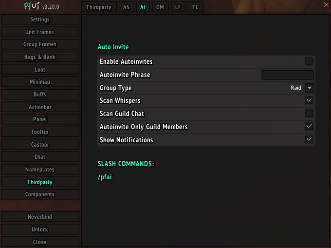

This addon is an external module for [pfUI](https://gitlab.com/shagu/pfUI) addon.

## Screenshots


## Description
Addon allows you to autoinvite people that whispers specified keyword. Additionaly it can scan guild chat for a keyword, invite only guild members and convert your group into a raid if "Group Type" option is set to "Raid"

## Installation
**This addon will not function without [pfUI](https://gitlab.com/shagu/pfUI) installed**
1. Download **[Latest Version](https://gitlab.com/dein0s_wow_vanilla/pfUI-autoinvite/-/archive/master/pfUI-master.zip)**
2. Unpack the Zip file
3. Rename the folder to "pfUI-autoinvite"
4. Copy "pfUI-managems" into Wow-Directory\Interface\AddOns
5. Restart WoW

## Panel entry
Pick **Auto Invite** in pfUI Config > Panel for any panel slot (left/right bars or the minimap bar). It shows whether autoinvites are on.
- Left click: enable/disable autoinvites (same as `/pfai`)
- Right click: open the Auto Invite settings page
- Hover: phrase, group type, scanned chats, guild-only

## Session behaviour
With "Turn Off On Login (Kept On Reload)" enabled (default), autoinvites stay on through `/reload` but are switched off after a logout, disconnect or client restart.

## Commands
```
/pfai                                  - Enable/Disable autoinvites
```

## Source
This copy lives at https://octowow.st/git/Hapto/pfUI-autoinvite (based on BahamutxD/pfUI-autoinvite, originally by dein0s), with the panel entry added.
