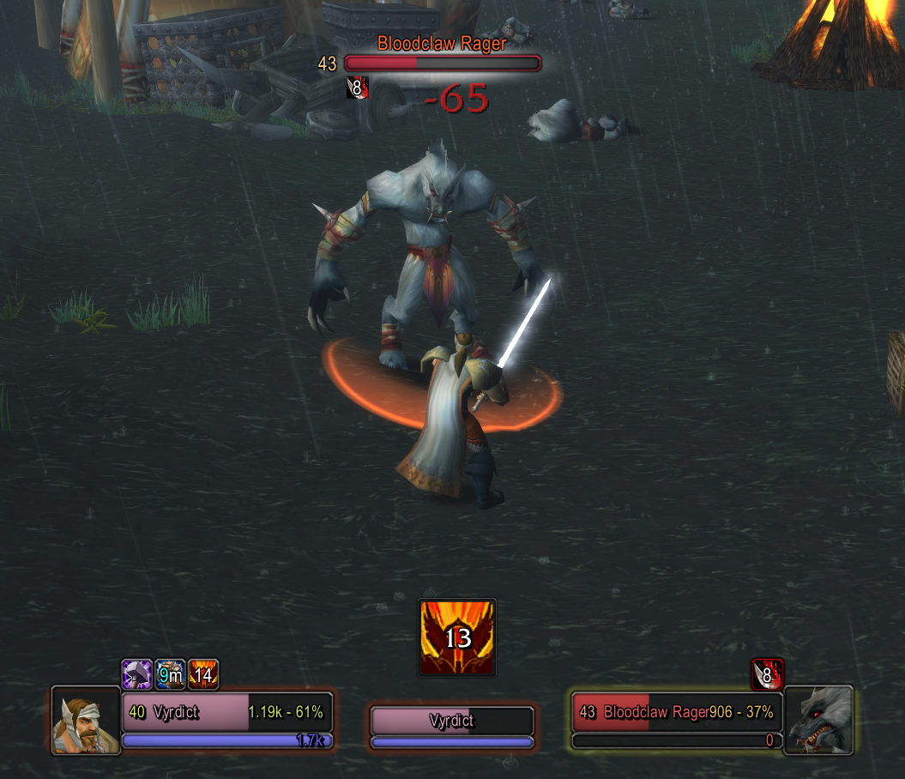

# SealTracker
SealTracker is a lightweight addon for [Turtle WoW](https://turtle-wow.org/) that displays your current Paladin seal with a countdown timer in a customizable frame.<br><br>

<p align="center">
  
</p>

## How to install:

1. Download and extract [latest version](https://github.com/cryptokn1ght-dev/SealTracker/archive/refs/heads/main.zip)
2. Copy the "SealTracker-main" folder to /Interface/AddOns and rename it to "SealTracker"
3. (Re)start WoW

## How to use:

1. Drag the frame wherever you like and resize it by dragging from the bottom-right corner. 
2. Right-click the frame to access the options menu and lock the frame.
3. Type /st (or /sealtracker) to see all commands.
4. Enjoy!

## Supported Seals

### Standard Vanilla Seals
- Seal of Righteousness
- Seal of the Crusader
- Seal of Command
- Seal of Justice
- Seal of Light
- Seal of Wisdom

*Note: If Turtle WoW adds additional custom seals, they'll still be detected and shown with a generic icon. You can add them to the SEALS table in SealTracker.lua for proper icons.*

## Customization

### Adding Custom Seals

If Turtle WoW adds new seals, you can add them to the `SEALS` table in `SealTracker.lua`:

```lua
local SEALS = {
    -- Add your custom seal here:
    ["Seal of YourNewSeal"] = { 
        duration = 30,  -- Duration in seconds
        texture = "Interface\\Icons\\Your_Icon_Path" 
    },
    -- ... existing seals ...
}
```

### Changing Fonts/Colors

The addon uses standard WoW fonts. You can modify these in the `CreateMainFrame()` function:

```lua
-- Timer font (change size, style)
f.timer:SetFont("Fonts\\FRIZQT__.TTF", 18, "OUTLINE")

-- Name font
f.name:SetFont("Fonts\\FRIZQT__.TTF", 10, "OUTLINE")
```

## Troubleshooting

**Addon doesn't show up:**
- Make sure you're playing a Paladin
- Check that the folder structure is correct
- Try `/reload` to reload the UI

**Seal not detected:**
- The addon scans player buffs - make sure the seal buff is actually active
- If it's a custom Turtle WoW seal, it may need to be added to the SEALS table

**Frame is stuck/can't move:**
- Type `/st lock` to unlock the frame
- Or right-click and select "Unlock Frame"

## Version History

### v1.0.0
- Initial release
- Full seal tracking with countdown timer
- Draggable, resizable, lockable frame
- Right-click options menu
- Support for vanilla and future Turtle WoW seals

## License

This addon is free to use and modify for personal use.

---

*Made with ❤️ for the Turtle WoW community*
