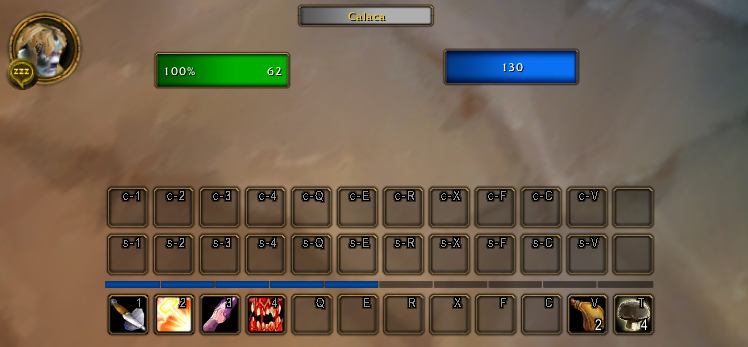
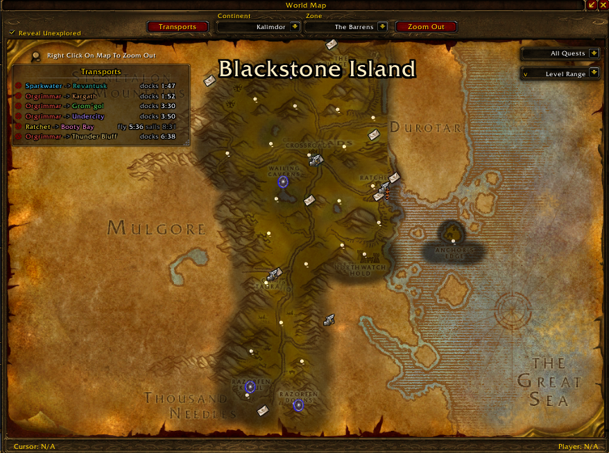
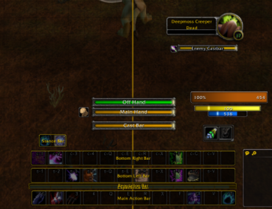
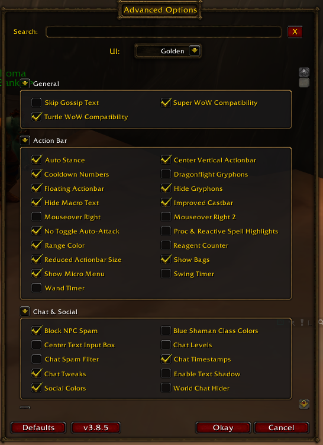

# 🧩 ShaguTweaks — ClassicAPI

English-only fork of [Dusk/ShaguTweaks-ClassicAPI](https://octowow.st/git/Dusk/ShaguTweaks-ClassicAPI), based on [ShaguTweaks](https://github.com/shagu/ShaguTweaks), for the **Turtle WoW-like servers**. 

Focused on **stability, compatibility, customization, and performance** while keeping the original ShaguTweaks experience.

**Version 3.8.8.** What changed in each update: see the [changelog](CHANGELOG.md).

> **Upgrading to 3.7:** the modules of the separate *ShaguTweaks Extras ClassicAPI* addon are now built into ShaguTweaks. **Disable or delete `ShaguTweaks-extras`** after updating, otherwise its older copies replace the built-in ones. Your on/off settings carry over. Raid Frames, Bag Item Click, Bag Search Bar and Auction Alt-Buy were not merged. See [Docs/EXTRAS_MERGE.md](Docs/EXTRAS_MERGE.md) for where each module went and why some were left out. See the [migration guide](Docs/EXTRAS_MERGE.md#removed-later) for removed modules.

## 🔌 Requirements

- **[ClassicAPI](https://github.com/brues-code/ClassicAPI) — required.** Install both the DLL and its bundled `!!!ClassicAPI` addon, and restart the client after a DLL update. v1.18.10 or newer is required (it includes a crash fix for addons that restyle nameplates). The addon checks the loaded DLL version and core APIs before enabling tweaks, and feature-detects newer range and duration-timer APIs. See [current integration notes and the historical review](Docs/CLASSICAPI_UPDATES.md). ClassicAPI is the main API layer. 
- **[SuperWoW](https://github.com/balakethelock/SuperWoW) — optional and recommended.** Supplements missing enemy cast timing when Enemy Castbars and Super WoW Compatibility are enabled. Complete ClassicAPI records are used directly without a second cache. See the [cast tracking review](Docs/CAST_TRACKING_REVIEW.md).
- **[ShaguTweaks Extras ClassicAPI](https://octowow.st/git/Dusk/ShaguTweaks-Extras-ClassicAPI) — no longer used.** Its modules are built in since 3.7 (see [Docs/EXTRAS_MERGE.md](Docs/EXTRAS_MERGE.md)). Disable or remove it; while it is enabled, its copies replace the built-in ones.

## 📦 Installation

1. Install **ClassicAPI**.
2. Optionally install **SuperWoW**.
3. Rename the addon folder to `ShaguTweaks`.
4. Copy it to `World of Warcraft\Interface\AddOns\ShaguTweaks`.
5. Restart the game.

Settings: **Esc → Advanced Options**.

## 📷 Screenshots

Personal Resource Display, independently positioned player name and movable action bars with Golden UI.

Golden UI world map with the OctoBus Transports panel.

Modifier-key previews for movable action bars, cast bars and personal resources.

Advanced Options with search and grouped settings.

## ✨ What's different in this fork

**Proc & Reactive Spell Highlights** (Action Bar, off): pale light-blue action-button glows for supported procs and reactive spells, including macros. Uses ClassicAPI glow events and native animation where available, with a static fallback. Central artwork is left to Proc Doc or other alert addons. Requires ClassicAPI spell-overlay support; older supported DLLs leave this feature inactive.

**Action Bar 6 and Action Bar 7** (Action Bar, both off) add a horizontal and a vertical bar with 12 independent slots each. Drop spells, items or saved macros onto them. Empty slots follow the game's **Always Show ActionBars** setting and appear temporarily when placing an action. Drag between the extra bars to rearrange buttons or drop an action onto a native bar to move it there. Shift+right-click clears an extra slot. Bind buttons under **Action Bar 6** or **Action Bar 7** in the game's Key Bindings menu. With Reduced Actionbar Size enabled, use Ctrl+Shift+Alt to reposition either bar and snap it to a native row or column. These options require ClassicAPI's cursor, spell and item APIs.

**Unit frames**

- **Hide Player Name** (off): hides the name and raid group number while **Hide Player Frame Resources** is enabled. Its checkbox is unavailable without that prerequisite.
- **Unit Frame Energy & Mana Tick** (off): uses native spark movement when available, retains the five-second mana sweep for mana-costing spells, and observes the two-second regen phase separately. Form changes reset power samples; drains and mid-period gains do not falsely start/reset the cast-cost display. The spark also appears on the Personal Resource Display power bar, sharing timing and resizing with either bar.
- **Healing Predictions** (off): a green segment shows incoming direct heals plus one upcoming tick per active HoT, capped at maximum health. Reuses compatible Puppeteer prediction data when available, including its HoTs, without starting a second estimator. Otherwise ClassicAPI supplies cast/aura/combat events: own direct heals need an observed non-critical heal per spell rank each session, and HoTs such as Rejuvenation/Regrowth need an observed tick amount and identified live aura. Form changes preserve estimates; actual gear, talent or level changes invalidate own standalone samples. Other direct heals can arrive through explicit-duration vanilla HealComm messages. Unknown amounts/timing and percentage-only target health are not projected. Supports Big Health and Personal Resource Display. See the [estimator review](Docs/HEALING_PREDICTION_REVIEW.md).
- **Personal Resource Display** (off): independent copies of your health and power bars, leaving the original player frame intact. Hold **Ctrl+Shift+Alt** to drag either bar or resize it with its bottom-right grip; right-click with those keys held to reset that bar. Positions and sizes are saved per character. Big Health for Player gives both bars the enlarged height. Copied bars share native values, textures and colors, plus Healing Predictions when enabled. Replaces Standalone Player Frame and migrates its health/power positions.

- **Hide Player Frame Resources** (off): hides the original health and power bars, leaving a clean rounded portrait and a class-colored name. Independent of Personal Resource Display; use either or both. Ctrl+Shift+Alt-drag moves the name independently; right-click with those keys held resets it beside the portrait. Its position is saved per character. **Movable Unit Frames** moves the portrait; an undetached name follows it. The portrait keeps its native left level badge and resting/combat icons.
- **Modern Class Colors:** optional palette for all nine Vanilla classes, including blue shamans. Listed directly below **Unit Frame Class Colors**.
- **Modern textures:** class-tinted health artwork and precolored rage, energy and focus artwork. Mana uses the light-blue rectangular retail fill on every supported frame, including the druid's separate mana bar in bear/cat forms.
- **Real Health Numbers:** an independent module. Percentage on the left and current health on the right, inset 4 pixels; power numbers remain centered. It uses direct values when available and a lazy Vanilla health estimator for percentage-only targets, so unknown absolute target health stays percentage-only.
- **Number styling:** health, percentage and power numbers copy the corresponding character name's font, size and shadow. Gold is the default; **White Unit Frame Numbers** under Unit Frames switches the numbers to white independently of Modern Class Colors.
- **Unit Frame Big Health for Player** and **Unit Frame Big Health for Target** independently enlarge their respective health bars. The player option also class-colors the player health bar and the Personal Resource Display health bar when enabled. Both are presentation-only and do not force numeric health/power text. The resting pulse is limited to the portrait, and the full status artwork is restored outside resting or in combat.
- **Movable Unit Frames:** Player, Target, Party, Minimap, Buffs, Debuffs and Weapon Buffs share one mover and alignment grid. Hold **Ctrl+Shift+Alt** to drag; right-click while unlocked to reset.
- **Hide Pet Unit Frame:** hides the pet frame below the player frame for pet classes. The stock pet code keeps running, so nothing breaks when the pet is summoned, dismissed or dies.

**Loss of Control Alert and Totem Timers** (both off by default)

- **Loss of Control Alert** (Interface): a large icon, the name of the effect and a countdown above the middle of the screen when you are stunned, feared, confused, charmed, silenced, pacified, disarmed, rooted or locked out of a spell school after an interrupt. If several apply, the most disabling one is shown. Hold Ctrl+Shift+Alt to show a preview and drag it, right-click to reset (like the Swing Timer). Uses ClassicAPI's `C_LossOfControl`. A classic tooltip panel and icon rim follow the default, Darkened or Golden UI palette; the timer fill retains its effect-type color.
- **Totem Timers** (Interface, Shaman only): one icon per totem you have out (Fire, Earth, Water, Air) with the time left, turning yellow at 10 seconds and red at 5. Left-click an icon to target the totem; hover for its tooltip. Hold Ctrl+Shift+Alt to show four preview icons and drag them, right-click to reset. Uses ClassicAPI's `GetTotemInfo` and `PLAYER_TOTEM_UPDATE`.

**Cast-bar movement is always available** (no checkbox): hold Ctrl+Shift+Alt, drag the marker that appears over the cast bar, right-click to reset. When you drag it, the swing bars stay where they are. The position is saved per character and survives other addons re-anchoring the bar; the Swing Timer, Wand Timer and Improved Castbar icon follow it. **Enemy Castbars** (the target's cast bar) works the same way: its marker appears even without a target, and the saved spot is an offset from the target frame, so the bar follows the frame.

**Swing Timer and Wand Timer**

Current ClassicAPI animates the fill and countdown through native duration objects, following pfUI's approach, without a Lua per-frame driver. Older supported APIs keep a throttled fallback. Styling, movement, range/queued-attack colors and Hunter warning timing remain ShaguTweaks' own.

- **Swing Timer:** main-hand and off-hand swing timers styled like the classic cast bar, with the weapon's icon on the left. They sit just above the cast bar until you move them; hold **Ctrl+Shift+Alt** to drag each bar (main hand, off hand and the ranged/wand bar) on its own, and right-click a bar to put just that one back.
- **Wand Timer:** the time until your next wand shot in the same style. It also times Auto Shot for bows, guns and crossbows, turning red during the last half second, when moving would cancel the shot.
- The timers follow the server's real attack timers through ClassicAPI's `PLAYER_SWING` event, including parry haste and on-next-swing abilities. A bar turns gray while the target is out of reach.
- The main-hand bar shows a queued **Heroic Strike** in light blue and **Cleave** in green (warriors), and **Maul** in orange (druids).
- Ported from [brues-code/pfUI](https://github.com/brues-code/pfUI)'s swing timer. Requires ClassicAPI v1.15.10 or newer.

**Tooltips, items and action bars**

- **Equip Compare:** Shift shows native equipped-item comparisons from full item links, including paired slots and stat differences, while retaining our placement. Older APIs keep the previous comparison path.
- **Macro Icons:** current ClassicAPI handles ordinary directives, conditions and chosen icons. This option adds compatibility for legacy `--showtooltip` and `/pfcast` display hints; only conditional custom hints need periodic re-evaluation. **Macro Tweaks** supplies missing interactive command aliases through the native parser and preserves command-history filtering. Other macro parsers/registered aliases keep ownership.
- **Tooltip Details:** restored guild ranks and leader marker; optional modern class colors and health texture. NPC interaction and tooltip-clear handling prevent cached colors leaking between tooltips.
- **Item Rarity Borders** cover merchant, quest, mail (including every TurtleMail attachment), both sides of trade, crafting and loot frames in every UI mode. **Item Rarity Glows** add an independent glow using the same shared rarity engine. **Loot Quality** colors the loot window itself and does not enable mail or trade borders.
- **Range Color:** self/rangeless spells no longer use a misleading legacy fallback; invalid friendly/hostile target checks and stale red/no-mana tint are handled. No additional AoE-specific exceptions have been added. The range check runs five times a second instead of every frame.
- **XP Bar Text:** hovering the experience bar shows current and needed XP like the reputation bar (`1555/3000`), then the percentage and the rested bonus.
- **WorldMap Class Colors:** raid members on the world map and battlefield minimap show their own class color.
- **WorldMap Window:** the map keeps the size you pick with Ctrl+Mousewheel (saved per character), and the title bar drags the window as well. With [OctoBus](https://github.com/Phridgey/OctoBus) installed, a **Transports** button left of the Continent dropdown shows or hides its transport timers.
- **Loot History:** `/loothistory` lists recent group-loot rolls with the winner of each item; click an item for everyone's need, greed or pass and their rolls. Ported from [brues-code/pfUI](https://github.com/brues-code/pfUI). Requires ClassicAPI.

**Built-in Extras modules** — full list of where each one went and what was left out: [Docs/EXTRAS_MERGE.md](Docs/EXTRAS_MERGE.md)

- The modules of Dusk's [ShaguTweaks Extras ClassicAPI](https://octowow.st/git/Dusk/ShaguTweaks-Extras-ClassicAPI) are part of this addon, each under the matching category: Action Bar, Chat & Social, Loot, Minimap & World Map, Tooltip & Items and Unit Frames, plus two new categories, **Macro** and **Merchant**.
- They keep their names, so your saved on/off choices carry over.
- Left out: **Raid Frames**; **Bag Item Click** and **Bag Search Bar**, which [Bagshui](https://octowow.st/git/OEVG/Bagshui) already covers; and **Auction Alt-Buy**, which [aux](https://octowow.st/git/Dusk/aux-addon-ClassicAPI) already does (Alt+click a row to buy out or cancel).

**Performance and stability**

- Reduced per-frame work, tooltip scans and repeated UI updates.
- **Bounded player cache:** the shared player cache expires old entries and holds at most 10,000 players, so the saved variables file no longer grows without limit. See [Docs/PERFORMANCE.md](Docs/PERFORMANCE.md).
- Event-driven target castbars where possible.
- Safer GUID-based handling for same-name enemies.
- Safer hooks and fewer destructive global overrides.
- **English-only loading:** only English data and translations are included, avoiding unused locale allocations.
- Better Turtle WoW-like server compatibility for custom items, spells and UI changes, plus various stability fixes across legacy ShaguTweaks modules.

## 🔷 ClassicAPI integration

ClassicAPI backs casts, auras, items and unit data: native cooldown support, filtered unit events, corrected chat identity/payload handling, and reduced duplicate player-cache records when native persistence is already enabled. Older fallbacks are retained for clients without the newer features.

Modules that use ClassicAPI directly:

- Range Color
- Chat Tweaks
- Equip Compare
- Free Slot Count
- Improved Castbar
- Item Rarity Borders
- Item Rarity Glows
- Loot History
- Movable Unit Frames
- Real Health Numbers
- No Toggle Auto-Attack
- Sell Junk
- Skip Gossip Text
- Swing Timer
- Wand Timer
- Loss of Control Alert
- Totem Timers
- Enemy Castbars
- Tooltip Details
- WorldMap Window
- Buy Em All
- Macro Icons and Macro Tweaks
- MiniMap Framerate & Latency
- Reagent Counter
- Reveal World Map
- Show Bags and Show Micro Menu

Other modules can also benefit indirectly from ClassicAPI through shared ShaguTweaks libraries and caches. Per-version notes are in [Docs/CLASSICAPI_UPDATES.md](Docs/CLASSICAPI_UPDATES.md).

## ⚙️ Modules

Names match the in-game options list. Modules marked *(off)* are disabled until you enable them.

### Action Bar

- Auto Stance (enters a required stance/form; to cast Moonfire from Cat Form, enable ClassicAPI Auto Cancel Form instead)
- Range Color *(off)*
- Cooldown Numbers
- Hide Gryphons *(off)*
- Improved Castbar *(off)*
- Cast-bar movement is built in: hold Ctrl+Shift+Alt to drag it, right-click to reset (no checkbox)
- Swing Timer *(off)*
- Wand Timer *(off)*
- No Toggle Auto-Attack
- Reduced Actionbar Size *(off)*
- Show Bags *(off)*
- Show Micro Menu *(off)*
- Reagent Counter *(off)*
- Hide Macro Text *(off)*
- Mouseover Right *(off)*
- Mouseover Right 2 *(off)*
- Center Vertical Actionbar *(off)*
- Floating Actionbar *(off)*
- Dragonflight Gryphons *(off)*

### Unit Frames

- Unit Frame Big Health for Player *(off)*
- Unit Frame Big Health for Target *(off)*
- Unit Frame Class Colors *(off)*
- Modern Class Colors *(off)*
- Unit Frame Class Portraits *(off)*
- Unit Frame Energy & Mana Tick *(off)*
- Hide Pet Unit Frame *(off)*
- Unit Frame Abbreviated Names *(off)*
- Movable Unit Frames
- Real Health Numbers *(off)*
- White Unit Frame Numbers *(off)*
- Enemy Castbars

### Nameplate addons

Nameplate Scale, Class Colors and Castbar were removed in 3.8 because enabling them alongside another nameplate addon can cause conflicts. See [the migration guide](Docs/EXTRAS_MERGE.md#nameplate-alternatives) for BlizzNameplatesPlus, UnitPlates and ShaguPlates alternatives.

### Tooltip & Items

- Equip Compare
- Free Slot Count
- Item Rarity Borders
- Item Rarity Glows *(off)*
- Sell Junk
- Tooltip Details
- Vendor Values
- Metric Range
- Cursor Tooltip *(off)*
- Hide Combat Tooltip *(off)*

### Chat & Social

- Blue Shaman Class Colors *(off)*
- Chat Tweaks
- Chat Levels *(off)*
- Chat Spam Filter *(off)*
- Social Colors
- Chat Timestamps *(off)*
- Enable Text Shadow *(off)*
- Center Text Input Box *(off)*
- Block NPC Spam *(off)*
- World Chat Hider *(off)*

### Minimap & World Map

- Minimap Clean *(off)*
- MiniMap Clock
- MiniMap Square *(off)*
- MiniMap Tweaks
- Enlarged Minimap *(off)*
- Hide Tracking Icon
- WorldMap Class Colors
- WorldMap Coordinates
- WorldMap Window
- Reveal World Map
- MiniMap Framerate & Latency *(off)*

### Loot

- Improved Roll Frames *(off)*
- Loot Cursor
- Loot History (`/loothistory`)
- Loot Quality *(off)*

### Macro

- Macro Icons
- Macro Tweaks

### Merchant

- Buy Em All

### Interface

- **UI:** dropdown below the Advanced Options search bar, with **Default**, **Darkened** and **Golden** (Default initially). Select one mode and press Okay to apply/reload. Existing theme selections carry over; old saves with both enabled retain Darkened priority. Both themed modes recolor supported addon borders and minimap buttons. Golden uses gold borders, tooltips and dialogs like WoW Forever while retaining default text colors. TrinketMenu keeps its own styling.

Golden and Darkened UI keep the original NPC quest/gossip parchment, including its torn edges, while styling the outer frame. No stationery overlay is used on those panels.

When **Unit Frame Big Health for Target** is disabled, Golden UI's NPC target name header uses an opaque native window-title texture matching the map/quest titles. Player targets and your own player frame retain their native/class-colored backgrounds. The header updates when switching targets.
- Hide Errors *(off)*
- Smaller Error Frame *(off)*
- Loss of Control Alert *(off)*
- Totem Timers *(off, Shaman)*
- XP Bar Text (current/needed XP, percentage and rested bonus on hover)

### General

- Super WoW Compatibility
- Turtle WoW Compatibility
- Skip Gossip Text *(off)*

## 🧹 Removed / integrated modules

The following original ShaguTweaks modules are not included as standalone modules because their functionality is either integrated elsewhere or no longer required:

- **Chat Links** → integrated into **Chat Tweaks**
- **Movable Unit Frames Extended** → integrated into **Movable Unit Frames**
- **ShaguTweaks Extras ClassicAPI** → its modules are built in, except Raid Frames, Bag Item Click, Bag Search Bar and Auction Alt-Buy

## 📜 Project identity & licensing

This is an independent community project. Compatibility with **World of Warcraft**, **Turtle WoW-like environments**, **ClassicAPI**, **SuperWoW**, or other referenced projects does not imply affiliation, endorsement, sponsorship, or ownership by their respective rights holders or maintainers.

**World of Warcraft** and **Blizzard Entertainment** names, marks, and game assets remain the property of their respective rights holders.

For detailed provenance and licensing information, see:

- [CHANGELOG.md](CHANGELOG.md)
- [THIRD_PARTY_NOTICES.md](THIRD_PARTY_NOTICES.md)
- [PROJECT_IDENTITY.md](PROJECT_IDENTITY.md)
- [Docs/ASSET_PROVENANCE.md](Docs/ASSET_PROVENANCE.md)
- [Docs/MODERN_MANA.md](Docs/MODERN_MANA.md)
- [Docs/PERFORMANCE.md](Docs/PERFORMANCE.md) — player cache limits and other performance notes
- [Docs/UPSTREAM_README.md](Docs/UPSTREAM_README.md) — the Dusk fork's README, kept for reference
- [LICENSES/](LICENSES)

## 🙏 Credits

Original addon and modules by **Shagu**.

Additional maintenance and Turtle WoW work by **paokkerkir**.

ClassicAPI compatibility fork maintained by **Dusk-92**.

The former **AoE Loot** module was removed in 3.8.6. See the [migration guide](Docs/EXTRAS_MERGE.md#removed-later) for the recommended replacement.

Special thanks to **Jesper_92** for reporting issues that helped improve the addon.

Additional code and ideas from **pfUI** and **zUI**.

Extras modules from **Dusk-92**'s ShaguTweaks-Extras-ClassicAPI, a fork of **paokkerkir**'s ShaguTweaks-extras (MIT, Shagu).

Swing Timer, Wand Timer and Loot History ported from **brues-code/pfUI** (MIT, Shagu and contributors).

Extended Movable Unit Frames support and several of the Extras modules adapted from **TokensWorth/ShaguTweaks-mods**, originally released under MIT by **GryllsAddons**. See `THIRD_PARTY_NOTICES.md`.

Released under the original **MIT License**.
