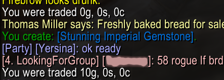

# TradeChat logs when you've been given money to your chat window.

When you enchant or jewelcraft things for other players, they give you their
materials, then they open trade again to apply the enchant or the gem, and
normally give you some tip.

Some players will, however, give you the tip right when they hand you the
materials; others will not give you a tip at all and say "hey, I gave you gold
with the mats, don't expect another tip from me".

This addon will log any money you receive to your chat, so you can check if
and how much you got later. In the screenshot example, the player gave me
mats and no gold first, I created a gem, then got 10 gold when applying the stone.

