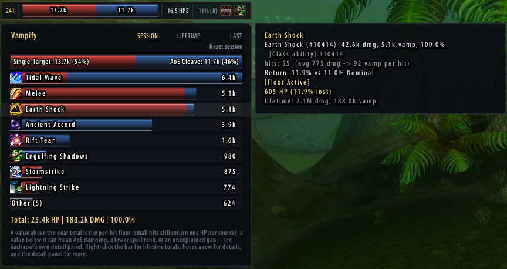
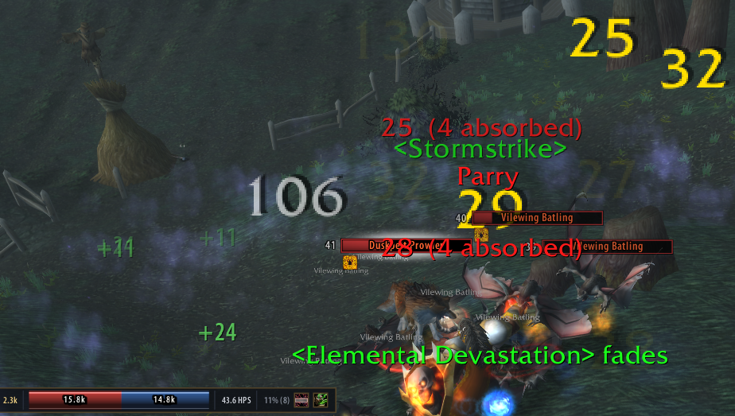
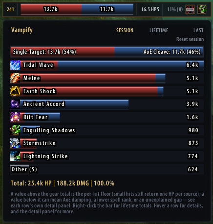
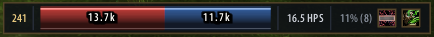
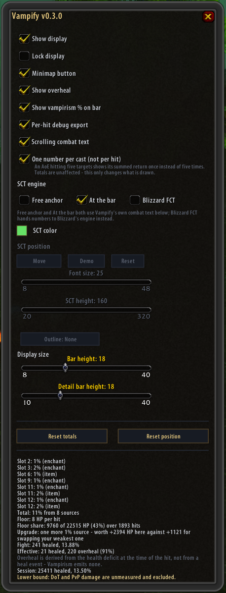

# Vampify

A TurtleWoW 1.12.1 addon that shows the healing you get back from the **Vampirism** item stat.

The game emits no event for that healing — it happens silently, folded into your health bar. Vampify
computes it from your own outgoing damage using a formula measured in-game, and shows it live on a
small movable bar, optionally as scrolling combat text.



*Hover the bar for the per-ability breakdown; hover a row for that ability's own detail — hit count,
average damage per hit, the return rate it actually achieved against the rate your gear promises,
and whether the per-hit floor is what is carrying it.*

## What's new — 0.4.0 · 2026-08-30

- **Fade duration and text shadow** for the scrolling combat text are in the options window
  (and as `/vf sct duration <seconds>`, `/vf sct shadow on|off`).
- **The glass-bar textures are in the package.** The 0.3.0 upload had left them out, so the
  bars drew without fill, shading and gloss.
- The per-hit export carries each source's own percentage, the zone, and whether the hit
  followed a cast — for the offline analysis of the healing formula.

**Version history** — details in [CHANGELOG.md](CHANGELOG.md):

- **0.4.0** (2026-08-30) — options controls, the missing textures, three export fields.
- **0.3.0** (2026-08-22) — the healing model matches the server (each source truncated on its
  own), a hit of 1 or less returns nothing, DoT healing measured rather than estimated, AoE
  damping only where two targets are proven; per-hit export and spell exclusions; the bar
  breakdown panel, target/rest split and the LAST scope.
- **0.2.0** (2026-08-10) — AoE casts shown as one number, backdrop on the display, damage
  shields excluded; Lua 5.0 `table.setn` fix in the options window.
- **0.1.0** (2026-08-10) — first working version: detects equipped Vampirism sources and shows a
  running total of the healing computed from your outgoing damage.

## Screenshots

<table>
  <tr>
    <td align="center" width="50%">
      <a href="screenshots/sct.png"></a><br>
      <sub><b>In a fight</b> — each return scrolls past as it lands, with the bar keeping the running totals</sub>
    </td>
    <td align="center" width="50%">
      <a href="screenshots/breakdown.png"></a><br>
      <sub><b>Breakdown</b> — every ability that returned health, for the session, the character's lifetime or the last fight</sub>
    </td>
  </tr>
  <tr>
    <td align="center" width="50%">
      <a href="screenshots/bar.png"></a><br>
      <sub><b>The bar</b> — this fight's returned health, the single-target/AoE split, HPS, gear total</sub>
    </td>
    <td align="center" width="50%">
      <a href="screenshots/options.png"></a><br>
      <sub><b>Options</b> — every setting, plus a panel stating what the addon can and cannot see</sub>
    </td>
  </tr>
</table>

## What it does

- **Live total** of Vampirism healing for the current session and for the character's lifetime.
- **Per-ability breakdown** on mouseover: which spells and attacks actually returned health.
- **Overheal split** — how much of the returned healing was wasted at full health.
- **Automatic source detection**: reads your equipped items and enchants and sums their Vampirism
  percentages. Sources it cannot read from a tooltip can be added by hand.
- **AoE handling**: a multi-target hit returns less per point of damage, and Vampify accounts for it
  rather than reporting a confident wrong number.
- **Scrolling combat text**, either through Blizzard's own engine or Vampify's, with its own colour,
  font size and anchor.
- **It tells you when it cannot see** — if no damage events arrive while you are visibly fighting,
  it says so instead of displaying a reassuring zero.

## The formula

```
heal(D) = 0                        if D <= 1
        = max(nSources, D * P * a) otherwise
```

`P` is the summed percentage of your equipped Vampirism sources, `a` is `0.7` on AoE hits, and the
per-hit floor equals the number of equipped sources. Healing accumulates as a float; every integer
you see is a crossing of that accumulator rather than a per-hit rounding. That is what reproduces
the measured behaviour where two identical 251-damage hits healed 18 and then 17.

The constants are pinned in `core/const.lua`, each with the observation it came from.

## Install

1. Close the game.
2. Copy the `Vampify` folder into `<WoW>\Interface\AddOns\` so that `Vampify.toc` sits at
   `<WoW>\Interface\AddOns\Vampify\Vampify.toc`.
3. Start the game and enable **Vampify** in the character-select AddOns list.

## Requirements

- **WoW 1.12.1 client (TurtleWoW).**
- **nampower — required.** Vampify reads your outgoing damage from the packet-derived events
  nampower provides (`SPELL_DAMAGE_EVENT_SELF`, `AUTO_ATTACK_SELF`, `SPELL_GO_SELF`). Without it
  the addon has no damage to work from and will say so rather than show zeros. Developed against
  nampower v4.6.2.
- **SuperWoW — optional.** Used to resolve spell names for the breakdown and to write the debug
  export. Everything else works without it.

## Usage

`/vampify` or `/vf`:

| Command | What it does |
|---|---|
| `/vf status` | equipped sources and current totals |
| `/vf options` | open the options window |
| `/vf reset [session\|lifetime\|both]` | reset totals (default: session) |
| `/vf pos` | move the display back to its default position |
| `/vf lock` | toggle dragging of the display |
| `/vf fct` / `/vf sct` | toggle scrolling combat text (either engine) |
| `/vf sctmove` | reposition Vampify's own SCT anchor |
| `/vf source add <pct>` | add a source by hand, if tooltip detection missed it |
| `/vf source clear` | drop all manually added sources |
| `/vf exclude add <spellId>` | stop a spell from counting as a Vampirism trigger |
| `/vf exclude remove <spellId>` | undo a runtime exclusion |
| `/vf exclude list` | show excluded spells |
| `/vf perhit on\|off\|status` | per-hit debug export |

There is also a **minimap button**: left-click toggles the display, right-click opens the options.

## Options

The options window (`/vf options`, the minimap button's right-click, or the button on the bar)
covers every setting: show and lock the display, minimap button, overheal reporting, the gear
percentage on the bar, scrolling combat text and which of the three engines draws it, one number
per cast instead of per hit, SCT colour, anchor, font size, rise height and outline, the heights of
the bar and of the breakdown panel's rows, the per-hit debug export, and buttons to reset the
totals or bring the bar home.

Below the controls sits a panel that states what the addon currently sees: every Vampirism source
it read off your gear and enchants, the summed total, the per-hit floor, how much of your healing
came from that floor rather than from the percentage, what one more percent would be worth on your
present numbers — and, in plain words, the two things it cannot measure.

## For developers

Everything under `core/` is pure Lua with no WoW API calls, and every WoW-facing file keeps its
wiring behind a single `if CreateFrame then` guard. That split exists so the logic can be run and
tested outside the game, against a real Lua 5.0.3 interpreter — the same language version the 1.12
client runs, which catches the classic traps (`#table`, string-method call syntax, `string.match`)
that a newer interpreter would silently accept and the client would then throw on.

The test suite itself is developed alongside the addon but is not part of this distribution.

## License

MIT — see [LICENSE](LICENSE).
