# VimFinder

Search your spells, tracking, profession recipes, bag items and game
windows by name, and use them from the keyboard. Press **Alt+Space**, type a
few letters, press **Enter**.

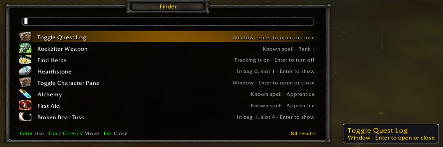

## Requirements

- A World of Warcraft 1.12.1 (build 5875) client (`## Interface: 11200`).
- **VimWowSettings**, the options window VimFinder keeps its key in.
  Install it beside VimFinder (below).
- **No DLL.** VimFinder needs neither `ClassicAPI.dll` nor
  `VimWowNative.dll`. It was tested on a 1.12.1 client both with and
  without `ClassicAPI.dll` in `dlls.txt`. With ClassicAPI it finds more
  (see [With ClassicAPI](#with-classicapi)).

## Install

With Git, from your game folder:

```
cd Interface/AddOns
git clone https://octowow.st/git/Lupo/VimFinder.git
git clone https://octowow.st/git/Lupo/VimWowSettings.git
```

To update later, run `git pull` in each of the two folders.

Without Git, download the ZIP of
[VimFinder](https://octowow.st/git/Lupo/VimFinder) and of
[VimWowSettings](https://octowow.st/git/Lupo/VimWowSettings), unzip both
into `Interface/AddOns/`, and rename the folders to exactly `VimFinder`
and `VimWowSettings`.

At character select, under AddOns, make sure both are ticked.

Use counts are saved per account in `VimFinderDB`.

## Use

| Key | Does |
|---|---|
| **Alt+Space** | Opens the finder (change it in the options, below) |
| Type | Narrows the list. Letters match in order, so `ql` finds Toggle Quest Log; letters found together rank first |
| **Tab** / **Shift+Tab** | Next / previous result |
| **Ctrl+J** / **Ctrl+K** | Next / previous result (hold Ctrl, then press J or K) |
| **Enter** | Uses the chosen result |
| **Esc** | Closes the finder |

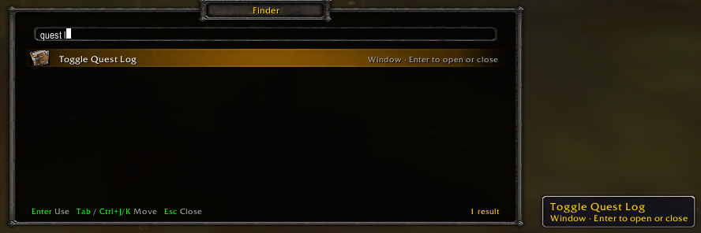

With nothing typed, the results you use most come first; while you type,
they win ties. Each result shows its icon, its name and what Enter does.
A result in white can be used; one in grey is only shown, with its tooltip
beside the finder.

In combat the finder turns partly see-through; it still opens windows and
casts spells, but leaves bag items, trade skills and crafts until the fight
is over.

## What it finds

### Windows

Every window the game's key bindings open (quest log, spellbook, talents,
character, reputation, skills, social, world map and the rest), by the
game's own names. Enter opens it, or closes it when it is open, and closes
the finder.

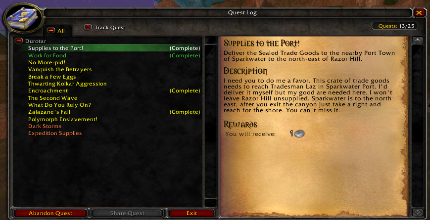

### Spells

Your spells and your pet's. Enter casts a spell that needs no target:
professions (Cooking, First Aid, Fishing and so on), Disenchant (then click
the item), summons and Basic Campfire; with ClassicAPI, helpful spells on
yourself too. Other spells are shown in grey with their rank. A search
finds everything that matches, here a bag item, three spells and a window:

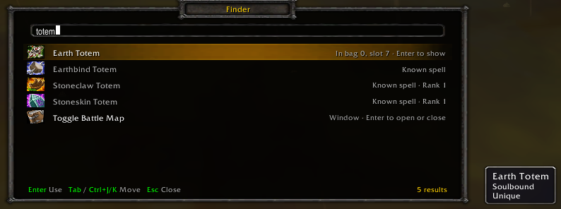

### Bag items

Everything in your bags, with the bag and slot it is in. Enter opens your
bags so you can find the item.

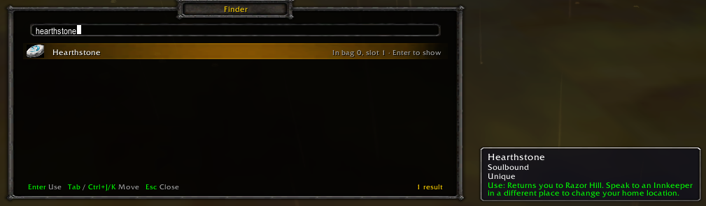

### Recipes

Every recipe your professions know, with the icon of the item it makes.
Enter opens the profession's window and selects the recipe there; it never
crafts. Without ClassicAPI the finder lists the recipes of the profession
window that is open.

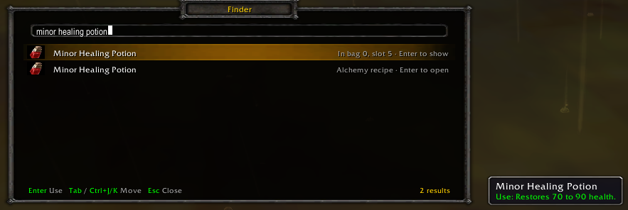

### Tracking

With ClassicAPI, your tracking spells (Find Herbs, Find Minerals...), and
whether each one is on. Enter turns it on or off.

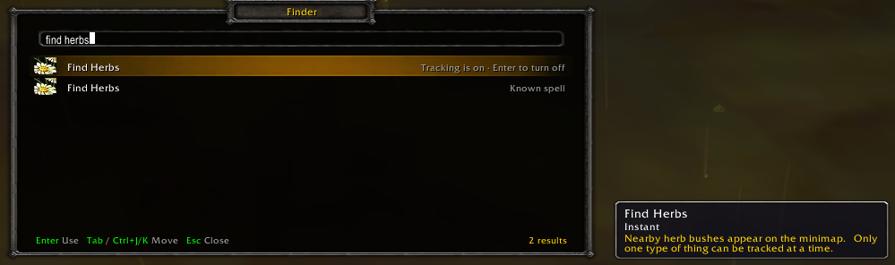

## Change the key

Press **Esc**, click **VimWow Options** (the options window VimFinder
shares with the other Vim mods), and open the **Finder** tab at the bottom.
Its Bindings page has **Open the finder**:

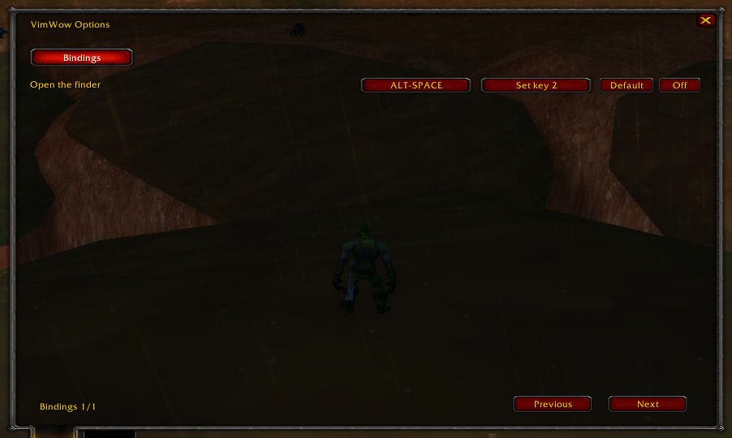

- Click the key to set a new one, or **Set key 2** for a second key.
- **Default** goes back to Alt+Space. **Off** binds no key.

**Esc > Key Bindings** lists Open the finder under VimFinder too. Without
ClassicAPI the key you set on the Finder tab is saved there: VimFinder only
takes a key nothing else is bound to, and gives a key back when you change
it on the Finder tab. With ClassicAPI the key stays out of your game key
bindings, and a key saved there by a start without ClassicAPI is given
back.

## With ClassicAPI

`ClassicAPI.dll` is optional. With it the finder:

- lists the recipes of every profession, their windows closed;
- lists your tracking spells and turns them on or off;
- casts helpful spells on yourself;
- keeps its key apart from your game key bindings.

## Even better with VimBag and VimWow

VimFinder works alone. Two other mods of the same family take it further;
each is optional and installs the same way.

**VimBag**, one bag for all your bags, run from the keyboard: Enter on a
bag item opens VimBag with that item selected, and VimBag's search matches
the way the finder does.

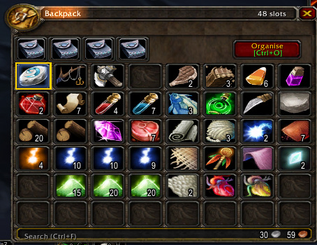

**VimWow**, keyboard control of the game's windows: a window the finder
opens gets VimWow's keyboard focus, so you go on in it by keyboard. Enter
on a recipe of the open profession window selects it there, and VimWow
puts a key beside every row.

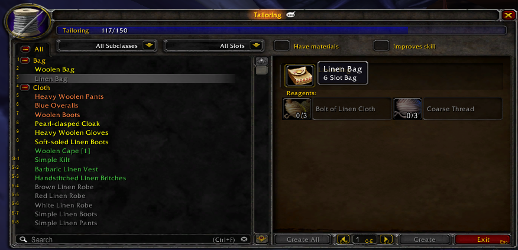

> **Warning: VimWow is far more than a boost for the finder.** It moves
> the whole game to the keyboard. It takes over many of your keys,
> movement, targeting and interaction among them, and changes how you use
> every window. It also needs `ClassicAPI.dll`. Install it only if you want
> that overhaul; VimFinder and VimBag do not need it.

All three together: a profession window, VimBag and the finder, which finds
the recipes and the bag items in one search, with VimWow's key list at the
top right.

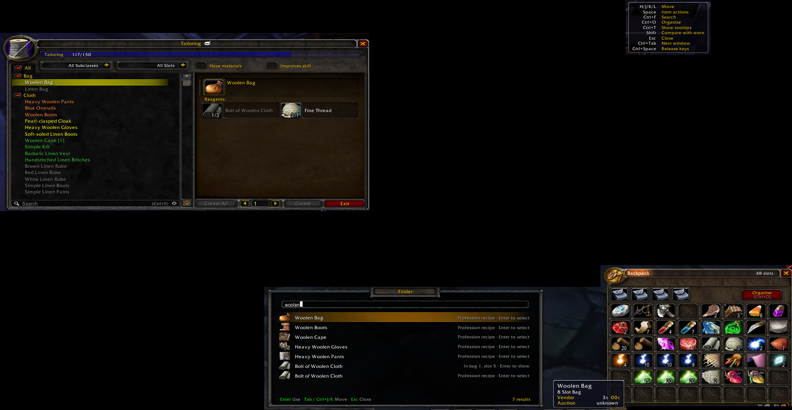
