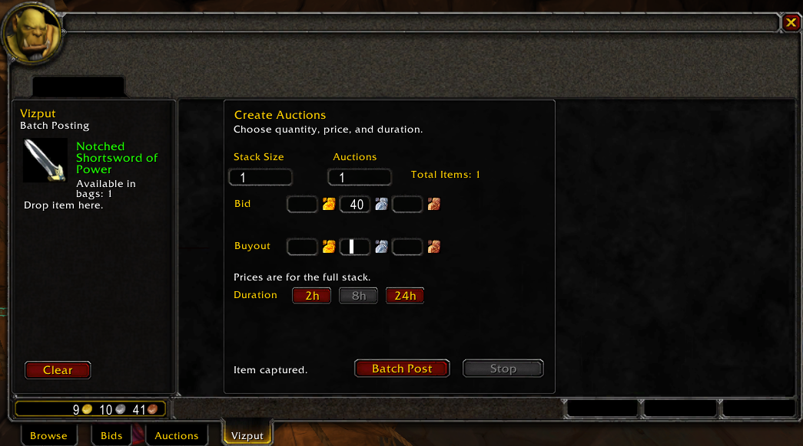
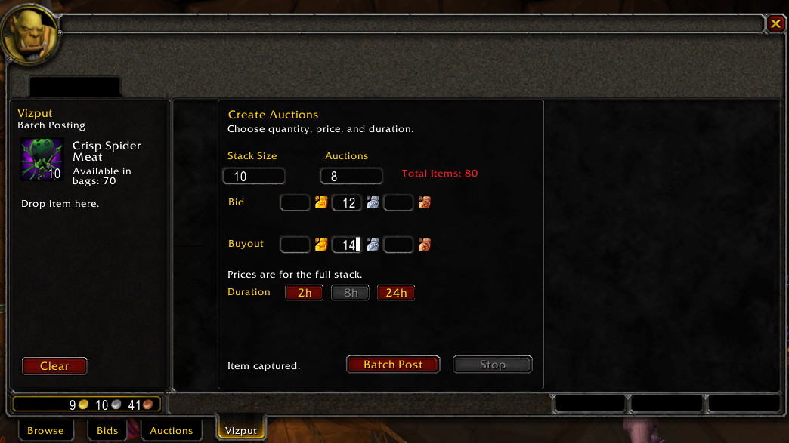

# Vizput

Bulk auction posting, goblin style.

`Vizput` is a Turtle WoW auction house addon built for one job: posting batches of auctions quickly without dragging the same item over and over.

It adds a dedicated `Vizput` tab to the auction house and keeps the workflow focused on bulk posting stacks or singles with as little friction as possible.

The addon is named after Vizput, one of the Horde auctioneers.

## Why Vizput? 🐢

`Vizput` exists for the one part of auction posting that gets repetitive fast: listing the same item over and over in clean, controlled batches. Instead of leaning on a giant auction suite, it stays focused on quick stack posting with a simple Turtle-native workflow.

## Features ✨

- Dedicated auction house tab
- Drag-and-drop item capture
- Batch posting for multiple stacks or single-item auctions
- Gold, silver, and copper pricing inputs for bid and buyout
- Live total item count
- Item well name coloring based on the real item link color
- Red warning when the requested total exceeds the amount in your bags
- Keyboard tab navigation through the quantity and price fields

## In Action 📸

### Quality-Colored Item Capture 🟢

The item well picks up the actual item icon and uses the item's link color for the item name, so uncommon items show in green instead of a generic auction-house color.



### Overstock Warning 🚨

If the batch total is higher than the amount you actually have in your bags, `Total Items` turns red immediately so you can catch the mistake before posting.



## How It Works ⚙️

1. Open the auction house and switch to the `Vizput` tab.
2. Drag an item from your bags into the item well.
3. Enter your stack size and number of auctions.
4. Set total-stack bid and buyout prices.
5. Choose the posting duration.
6. Click `Batch Post`.

## Install 📦

Place the `Vizput` folder inside:

```text
Interface\AddOns\
```

Your final layout should look like this:

```text
Interface\AddOns\Vizput\Vizput.lua
Interface\AddOns\Vizput\Vizput.toc
```

## Commands ⌨️

- `/vizput`
- `/vz`
- `/vizput stop`

## Turtle WoW 🌿

`Vizput` is built for the Turtle WoW client and its auction house UI.

## Version 🛠️

Current release: `1.0.0`
