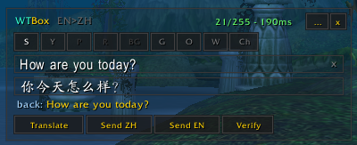
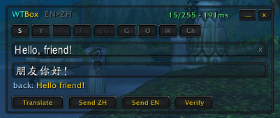
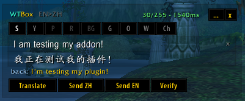

**English** | [简体中文](README.zh-CN.md)

# WTBox

**Chat with Chinese players without the language barrier** (or with English players, if you're Chinese — 支持中文界面).

WTBox lets you translate individual messages and post them into the channel of your liking. You can also verify a translation by translating it back, so you can better assess what you're actually about to say. Your normal chat stays completely untouched: the addon only translates when you ask it to.

You get a small chatbox-like window you can **move, pin and hide**. Show it with **`/wtb`**.

Three looks — pick yours in the settings:

### Modern (default)

### Classic

### pfUI-matched (when you run pfUI)

## How it works

1. Type your message and press **Enter** — it translates and posts in one go (made for quick callouts like "inc lumber mill").
2. Want to check first? Click **Translate** instead, review or edit the result — **Verify** shows it translated back.
3. Then click **Send**.

Pick the channel with the buttons on top (S = say, P = party, BG = battleground, …). The **Ch** button lists your joined channels like World, and **W** remembers the last people you whispered.

## Requirements

You need **[WoWTranslate](https://github.com/paokkerkir/wow-translate)** — it does the actual translating (free, no API key needed). Install it first and make sure `/wt` works in-game. Without it, WTBox shows as *"Dependency missing"* in your addon list.

WTBox is built for **Capycraft**, but any vanilla 1.12 server works.

## Installation

1. Install [WoWTranslate](https://github.com/paokkerkir/wow-translate) first (see above).
2. Download the ZIP from the [latest release](../../releases/latest) and unpack it.
3. Put the `WTBox` folder into `<your WoW folder>\Interface\AddOns\`
   (so that `Interface\AddOns\WTBox\WTBox.toc` exists).
4. Restart the game. You'll see `WTBox loaded.` in chat — type `/wtb`.

If you downloaded via the green **Code → Download ZIP** button instead, rename the unpacked folder from `WTBox-master` to `WTBox`, or the game won't load it.

## Commands

| Command | What it does |
|---|---|
| `/wtb` | Show/hide the box |
| `/wtb <text>` | Open and translate `<text>` right away |
| `/wtb pin` | Keep the box always open |
| `/wtb alpha <0-100>` | Background transparency |
| `/wtb lang en\|zh\|auto` | UI language |
| `/wtb style modern\|classic\|pfui` | Look of the box (pfui only with pfUI installed; applies after reload) |
| `/wtb reset` | Reset the window position |
| `/wtb help` | List commands |

There's also a keybind (Key Bindings → WTBox) that opens the box ready to type, and a `...` button on the box for settings.

## Good to know

- WoW terms like dungeon names and battleground callouts are translated from a built-in dictionary, so "inc lumber mill" comes out right. You can add your own terms in `WTBox_Glossary.lua` — good ones are welcome as [issues](../../issues), they'll be added for everyone.
- Chat messages have a length limit; the box shows you the size and warns before anything gets cut off.
- **Immersive fade** (settings): the box gently fades out when idle and snaps back when you hover it or press your keybind.
- **Three looks** (settings): Modern (flat), Classic (Blizzard-style), and pfUI-matched when you run pfUI. Pick one and hit Apply.

## Credits

Built on [WoWTranslate](https://github.com/paokkerkir/wow-translate) by belthazor. If you use [pfUI](https://github.com/shagu/pfUI), WTBox automatically matches its look — pfUI is not required. MIT licensed.
