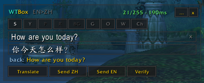
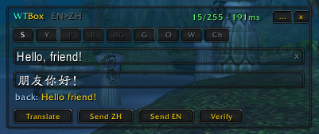
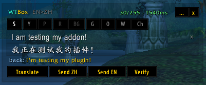

[English](README.md) | **简体中文**

# WTBox

**魔兽世界 1.12 中英聊天翻译插件 —— 和外国玩家交流不再有语言障碍。为 Capycraft 服务器打造，所有 1.12 服务器均可使用。**

WTBox 让你逐条翻译消息，并发送到你想要的频道。发送前还可以「回译」——把译文翻回来核对一遍，确保意思没跑偏。你的正常聊天完全不受影响：只有你主动使用时才会翻译。

插件是一个小巧的聊天框式窗口，可以**移动、常驻、隐藏**。输入 **`/wtb`** 打开。

三种界面风格，可在设置中切换：

### 现代（默认）

### 经典

### pfUI 匹配（已加载 pfUI 时）

界面支持中文，翻译方向跟随你的 WoWTranslate 设置（中文玩家设置 zh→en 即可获得中译英输入框）。

## 使用方法

1. 输入内容，按**回车** —— 立即翻译并发送（为战斗中快速报点设计）。
2. 想先确认？点击**翻译**，检查或编辑译文，**回译**可将译文翻回核对。
3. 再点击**发送**。

顶部按钮选择频道（说/队/团/战/会/密/频等）。**频**按钮列出你加入的编号频道（如世界频道），**密**按钮记住你最近密语过的玩家。

## 前置需求

必须先安装 **[WoWTranslate](https://github.com/paokkerkir/wow-translate)**（免费，无需 API 密钥），它负责实际的翻译。装好后在游戏里输入 `/wt` 确认它正常工作。没有它，WTBox 会在插件列表中显示"缺少依赖"。

## 安装

1. 先安装 [WoWTranslate](https://github.com/paokkerkir/wow-translate)。
2. 从[最新发布页](../../releases/latest)下载压缩包并解压。
3. 把 `WTBox` 文件夹放进 `游戏目录\Interface\AddOns\`。
4. 重启游戏，输入 `/wtb`。

## 命令

| 命令 | 作用 |
|---|---|
| `/wtb` | 打开/关闭翻译框 |
| `/wtb <文本>` | 打开并立即翻译 |
| `/wtb pin` | 常驻显示 |
| `/wtb alpha <0-100>` | 背景透明度 |
| `/wtb lang en\|zh\|auto` | 界面语言 |
| `/wtb style modern\|classic\|pfui` | 界面风格（pfui 需已安装 pfUI；重载后生效） |
| `/wtb reset` | 重置窗口位置 |
| `/wtb help` | 查看命令 |

也可以在「按键绑定 → WTBox」设置快捷键，一键打开并直接输入。窗口上的 `...` 按钮打开设置。

## 小提示

- 副本名、战场报点等魔兽术语走内置词典，翻译更准确。可以在 `WTBox_Glossary.lua` 中添加自己的词条，也欢迎[提交](../../issues)好词条，会合并给所有人使用。
- 聊天消息有长度上限，超长时插件会提前警告。
- 设置中可开启**沉浸淡出**：闲置时翻译框自动淡出，悬停或按快捷键立即恢复。
- 设置中可切换**三种界面风格**：现代（扁平）、经典（暴雪样式）、pfUI 匹配（需已加载 pfUI）。选好后点击应用。

## 鸣谢

基于 belthazor 的 [WoWTranslate](https://github.com/paokkerkir/wow-translate) 开发。如果你使用 [pfUI](https://github.com/shagu/pfUI)，WTBox 会自动匹配其外观（非必需）。MIT 许可。
